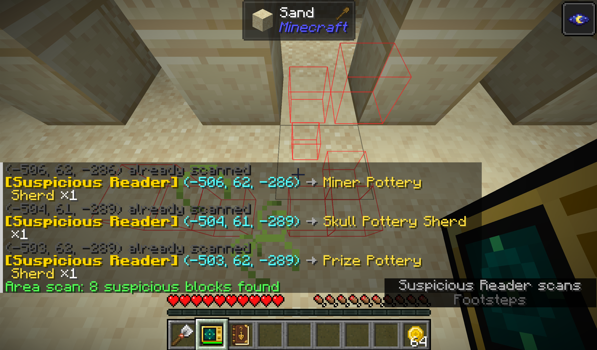

# Unsuspicious Block

**Unsuspicious Block** 是一个面向 Minecraft `1.21.1` 的考古探索与发现记录模组。它为可疑方块提供扫描与快速发掘工具，并通过一本随探索不断完善的考古笔记，帮助你整理战利品来源、获取条件、估算概率与发掘坐标，同时拓展了淘洗、制陶、远古植物与遗迹重生成等玩法。

> English: [README_EN](README_EN.md)

## 运行环境与依赖

| 项目 | 说明 |
|---|---|
| Minecraft | 1.21.1 |
| 当前基准版本 | 1.6.0 |
| 加载器 | Fabric 0.17.0+ / NeoForge 21.1.221+ |
| Java | 21 |
| 多人游戏 | 客户端与服务端均需安装 |

- **Fabric**：需要额外安装 [Fabric API](https://modrinth.com/mod/fabric-api)。
- **NeoForge**：无额外必需依赖。
- **界面依赖库**：模组使用 [Meteo's UI Kit](https://github.com/meteoritel/meteo-s-ui-kit)（`0.1.0-rc1`），发行版 JAR 已内嵌该库，玩家无需单独下载安装；源码构建与界面开发说明请见该仓库。

## 内容概览

- **探索与记录**：[考古笔记](https://github.com/meteoritel/unsuspicious-block/wiki/zh-Archaeology-Journal)、[可疑解析仪与考古铲](https://github.com/meteoritel/unsuspicious-block/wiki/zh-Reader-and-Shovel)、[猫之瞳](https://github.com/meteoritel/unsuspicious-block/wiki/zh-Eye-of-Cat)、[标本箱](https://github.com/meteoritel/unsuspicious-block/wiki/zh-Specimen-Box)
- **收集、制作与世界玩法**：[失落书页与附魔](https://github.com/meteoritel/unsuspicious-block/wiki/zh-Lost-Pages-and-Enchantments)、[钓鱼打捞与淘盘淘洗](https://github.com/meteoritel/unsuspicious-block/wiki/zh-Fishing-and-Panning)、[纹饰陶轮台](https://github.com/meteoritel/unsuspicious-block/wiki/zh-Pottery-Wheel)、[不可疑方块](https://github.com/meteoritel/unsuspicious-block/wiki/zh-Unsuspicious-Blocks)、[咕噜荆芥](https://github.com/meteoritel/unsuspicious-block/wiki/zh-Purrmint)、[花火粉与回溯粉](https://github.com/meteoritel/unsuspicious-block/wiki/zh-Spark-and-Rewind-Dust)

## 导航与文档

- **[玩家 Wiki](https://github.com/meteoritel/unsuspicious-block/wiki/zh-Home)**：安装说明、快速上手、各系统玩法详解、联动与常见问题（仓库内源文件见 [docs/wiki/zh-Home.md](docs/wiki/zh-Home.md)）。
- **[开发者文档](docs/dev/README.md)**：多平台架构、子系统设计、开发与构建流程，面向二次开发与代码贡献者。
- **[更新日志](CHANGELOG.md)**：各版本新增特性、调整与修复记录。

## 许可协议

- **源代码**采用 MIT 许可。[许可全文](LICENSE.txt)
- **原创纹理**及 `texture_files/` 中的原创纹理源稿采用 CC BY 4.0 许可。[适用范围与许可全文](common/src/main/resources/assets/unsuspiciousblock/textures/LICENSE-CC-BY-4.0.txt)

你可以分享、改编这些纹理，也可以用于商业用途。分发时请保留原版权和许可声明，附上来源与许可链接，并标明改动。[纹理来源](https://github.com/meteoritel/unsuspicious-block) · [CC BY 4.0](https://creativecommons.org/licenses/by/4.0/)

## 相关链接

- [CurseForge](https://www.curseforge.com/minecraft/mc-mods/unsuspicious-block)
- [Modrinth](https://modrinth.com/mod/unsuspicious-block)
- [源代码](https://github.com/meteoritel/unsuspicious-block)
- [问题反馈](https://github.com/meteoritel/unsuspicious-block/issues)
