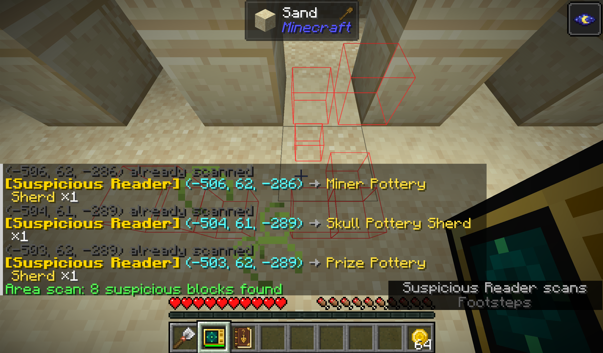

# Unsuspicious Block

**Unsuspicious Block** is an archaeology exploration and discovery mod for Minecraft `1.21.1`. It adds tools for scanning and quickly excavating suspicious blocks, an Archaeology Journal for tracking loot sources, conditions, drop odds, and coordinates, plus river and Nether panning, pottery duplication, ancient plants, and structure rewinding.

> 中文版: [README](README.md)

## Requirements & Dependencies

| Item | Support |
|---|---|
| Minecraft | 1.21.1 |
| Current Baseline | 1.6.0 |
| Loader | Fabric 0.17.0+ / NeoForge 21.1.221+ |
| Java | 21 |
| Multiplayer | Required on both client and server |
| License | [MIT](LICENSE.txt) |

- **Fabric**: Requires [Fabric API](https://modrinth.com/mod/fabric-api).
- **NeoForge**: No additional required mods.
- **UI Library Dependency**: Built with [Meteo's UI Kit](https://github.com/meteoritel/meteo-s-ui-kit) (`0.1.0-rc1`). Release JARs bundle the library automatically, so players do not need a separate download; see its repository for source builds and UI library details.

## Content Overview

- **Exploration & Tracking**: [Archaeology Journal](https://github.com/meteoritel/unsuspicious-block/wiki/en-Archaeology-Journal), [Suspicious Reader & Archaeological Shovel](https://github.com/meteoritel/unsuspicious-block/wiki/en-Reader-and-Shovel), [Eye of Cat](https://github.com/meteoritel/unsuspicious-block/wiki/en-Eye-of-Cat), [Specimen Box](https://github.com/meteoritel/unsuspicious-block/wiki/en-Specimen-Box)
- **Gathering, Crafting & World Features**: [Lost Pages & Enchantments](https://github.com/meteoritel/unsuspicious-block/wiki/en-Lost-Pages-and-Enchantments), [Fishing & Panning](https://github.com/meteoritel/unsuspicious-block/wiki/en-Fishing-and-Panning), [Decorated Pottery Wheel](https://github.com/meteoritel/unsuspicious-block/wiki/en-Pottery-Wheel), [Unsuspicious Blocks](https://github.com/meteoritel/unsuspicious-block/wiki/en-Unsuspicious-Blocks), [Purrmint](https://github.com/meteoritel/unsuspicious-block/wiki/en-Purrmint), [Spark Dust & Rewind Dust](https://github.com/meteoritel/unsuspicious-block/wiki/en-Spark-and-Rewind-Dust)

## Documentation

- **[Player Wiki](https://github.com/meteoritel/unsuspicious-block/wiki/en-Home)**: Installation, getting started, detailed feature guides, compatibility, and FAQ (source files in [docs/wiki/en-Home.md](docs/wiki/en-Home.md)).
- **[Developer Docs](docs/dev/README.md)**: Multi-loader architecture, subsystem docs, and build workflows for contributors and modders.
- **[Changelog](CHANGELOG.md)**: Release notes and version history.

## Links

- [CurseForge](https://www.curseforge.com/minecraft/mc-mods/unsuspicious-block)
- [Source Code](https://github.com/meteoritel/unsuspicious-block)
- [Meteo's UI Kit](https://github.com/meteoritel/meteo-s-ui-kit)
- [Issue Tracker](https://github.com/meteoritel/unsuspicious-block/issues)
