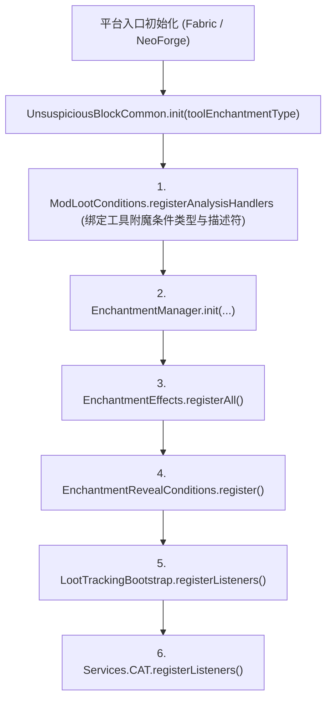

# 架构总览

> 三模块划分、初始化流程、构建系统与横切设计原则。
> **新加入的开发者读完本文后，再阅读[平台抽象](platform-spi.md)与[注册架构](registration.md)，即可开始修改代码。**
> 各子系统的包级分布与修改落点见[开发者文档索引](../README.md)的「子系统地图」。

## 1. 项目定位与技术栈

| 项目 | 说明 |
|---|---|
| Minecraft | 1.21.1 |
| Loader | Fabric 0.17.0+ / NeoForge 21.1.195+（双平台同源） |
| Java | 21 |
| 映射 | Mojang 官方映射 + Parchment（版本见 `gradle.properties`） |
| 构建系统 | Gradle（`multiloader` 自定义插件）+ Wrapper 版本见 `gradle/wrapper/` |
| 当前版本 | 见 `gradle.properties` 的 `version` |

模组围绕**考古探索 / 战利品发现记录 / 猫族关系**三条玩法主线展开，采用 Architectury 风格同源多模块结构：绝大多数业务与客户端 UI 代码写在 `common`，`fabric` 与 `neoforge` 仅承担各自平台接入。

## 2. 三模块划分

```text
unsuspiciousBlock-1.21.1-multi/
├── common/      跨平台核心：玩法逻辑、注册清单、数据资源、Mixin、客户端 UI
├── fabric/      Fabric 接入：入口、注册实现、平台 SPI 实现、Fabric 专用 Mixin
└── neoforge/    NeoForge 接入：入口、注册实现、平台 SPI 实现、GLM 与事件
```

### Java 分包职责

| 包 | 职责 | 依赖方向 |
|---|---|---|
| `core` | 玩法逻辑、共享模型、注册清单、网络协议、持久化与公共 Mixin | 经 `platform.services` 调用平台能力 |
| `client` | 客户端状态、网络接收绑定、UI、渲染、按键与客户端 Mixin/联动 | 消费 `core` 与公共平台契约 |
| `platform` | SPI 接口、服务装配与第三方联动桥；Loader 源集中的原生适配器 | 把平台事件与能力转接到公共逻辑 |

`core` 同时承载服务端逻辑以及客户端需要共用的共享类型（如物品、实体、菜单与 Payload）；客户端专属实现统一留在 `client` 包。端边界由初始化接线与[仓库工具](../../../tools/README.md)共同约束。

根包仅保留 `Constants` 与 Loader 公共入口；`common` 的引导类 [`UnsuspiciousBlockCommon`](../../../common/src/main/java/com/meteorite/unsuspiciousblock/core/bootstrap/UnsuspiciousBlockCommon.java) 位于 `core.bootstrap`，两端客户端入口位于各自的 `client` 包。

### 2.1 common 模块

- 承载跨平台玩法、注册清单、数据资源（`assets/`、`data/`）、公共 Mixin 与客户端 GUI。
- **零平台依赖**：严禁在 `common` 中导入任何 `net.fabricmc.*` 或 `net.neoforged.*` 包，平台能力一律经 [`platform/services/`](../../../common/src/main/java/com/meteorite/unsuspiciousblock/platform/services) SPI 接口访问（见[平台抽象](platform-spi.md)）。
- 公共执行路径仅使用共享契约；客户端实现由两端的客户端入口负责装配。

### 2.2 fabric 模块

- 入口：[`UnsuspiciousBlockFabric`](../../../fabric/src/main/java/com/meteorite/unsuspiciousblock/UnsuspiciousBlockFabric.java)（`ModInitializer`）与 [`UnsuspiciousBlockFabricClient`](../../../fabric/src/main/java/com/meteorite/unsuspiciousblock/client/UnsuspiciousBlockFabricClient.java)（`ClientModInitializer`）。
- 通过 `Registry.register` 与 Fabric API 事件完成注册与回调接入，注册结果**即时回写**（见[注册架构](registration.md)）。
- 通过 Fabric 专用 Mixin 补齐原生事件缺失的能力（铁砧、刷拭、剪羊毛、骨块扫描等），见[Mixin 边界与接线](mixin.md)。
- 通过 `META-INF/services/` 声明平台 SPI 实现。

### 2.3 neoforge 模块

- 入口：[`UnsuspiciousBlockNeoForge`](../../../neoforge/src/main/java/com/meteorite/unsuspiciousblock/UnsuspiciousBlockNeoForge.java)（`@Mod`）与 [`UnsuspiciousBlockNeoForgeClient`](../../../neoforge/src/main/java/com/meteorite/unsuspiciousblock/client/UnsuspiciousBlockNeoForgeClient.java)（`@EventBusSubscriber(Dist.CLIENT)`）。
- 通过 `DeferredRegister` 与 `@SubscribeEvent` 完成注册与事件接入，注册结果**延迟回写**。
- 战利品注入采用 NeoForge `IGlobalLootModifier`（GLM），铁砧修复使用 `AnvilUpdateEvent`。
- 通过 `META-INF/services/` 声明平台 SPI 实现。

> **关键原则**：允许两个平台采用不同的底层机制（如 GLM vs 事件/注入器、事件 vs 平台 Mixin）实现相同玩法，只要玩家可见语义一致，不强求实现代码同构。

## 3. 初始化流程

### 3.1 服务端与公共初始化

双端平台入口均调用 [`UnsuspiciousBlockCommon.init(toolEnchantmentType)`](../../../common/src/main/java/com/meteorite/unsuspiciousblock/core/bootstrap/UnsuspiciousBlockCommon.java)，按固定顺序完成核心子系统的静态装配：



平台向 `init` 传入工具附魔条件类型的 `Supplier`（Fabric 预先即时注册，NeoForge 传入 `DeferredHolder`）。初始化阶段仅保存引用，实际条件求值发生在注册表就绪之后（见[注册架构](registration.md)）。

除调用 `init()` 外，平台入口还需完成以下接线工作：

- **内容注册**：调用 `ModContent.register(Registrars)`，按依赖顺序遍历各 `ModXxx` 清单完成注册（见[注册架构](registration.md)）。
- **服务端生命周期**：两端将服务器 `started` / `tick` / `stopped` 事件统一转交 `core/bootstrap/ModServerLifecycle`：
  - 启动时按显式顺序协调配置加载、玩家数据准备、模拟工作器与目录构建；
  - 停止时按逆序先保存玩家数据，再停止工作器、失效目录、卸载配置并清理世界状态。若某个清理条目抛出常规异常，仍会继续释放其余引用并最终上报原始异常；
  - 区块加载与玩家事件由各平台原生入口接入。
- **淘洗生成服务**：服务器 `tick` 与 `stopped` 事件转交 `ShimmerSpawnService` 驱动自然生成（仅投放水域变体）；世界生成通过统一的 `ShimmerFeature` 与两端群系修改接入原版地物阶段（见[淘洗系统](../subsystems/panning.md)）。
- **笔记玩家数据**：`ModServerLifecycle` 调度 `JournalPlayerDataService` 的服务器阶段事件，两端登录与退出回调转交于此；`PlayerDataLifecycle` 在统一的玩家 Mixin 中协调笔记与猫族状态的存取及重生复制（见[考古笔记系统](../subsystems/journal.md)）。
- **战利品注入**：Fabric 注册各 `LootInjection`，NeoForge 注册 GLM 序列化器与数据定义（见[战利品表系统](../subsystems/loottable.md)）。
- **可选联动**：通过 `OptionalModIntegration.instantiate()` 惰性加载 Trinkets / Curios；Jade 分别发现并装配 `common` 中的 `JadePlugin` 与 `JadeClientPlugin`。

### 3.2 客户端初始化

双端客户端入口通过 `client/ModClientLifecycle`（`install` / `tick` / `disconnect`）共用安装与断连清理逻辑，公共服务端入口不引用该模块。平台入口分别绑定以下客户端阶段：

1. **按键绑定**：遍历 `ModKeyBindings.MANIFEST`。
2. **渲染器与模型层**：遍历 `ModEntityRenderers`、`ModBlockEntityRenderers` 与 `ModModelLayers`。
3. **菜单界面 (Screen)**：遍历 `ModMenuScreens`（考古笔记、标本箱、陶轮）。
4. **S2C 网络接收器**：遍历 `ClientPayloadBindings`。
5. **Tooltip 组件工厂**：遍历 `ModTooltipComponents`（标本箱内容预览）。
6. **HUD 与世界叠加渲染**：遍历 `ModHudRenderers` 与 `ModWorldRenderers`。
7. **客户端 tick 驱动**：处理笔记快捷键、扫描高亮与客户端状态刷新。
8. **断连重置**：清理当前连接缓存并复位客户端状态。

具体类与明细见[客户端与 GUI](../subsystems/client-ui.md)。

### 3.3 NeoForge 的注册时序陷阱

- **Item 静态字段回写延迟**：`DeferredRegister` 在 `FMLCommonSetupEvent` 阶段才实例化物品，而方块物品构造器可能依赖 `ModBlocks.XXX.get()`。因此 Item 静态字段回写必须延迟到 `syncCommonItemRefs` 的 `enqueueWork` 中；Block、BlockEntity、Effect、Sound 与 Entity 的 `DeferredHolder` 本身即 `Supplier`，可在声明期立即回写引用。
- **MenuType 取值时机**：`RegisterMenuScreensEvent` 可能早于 `enqueueWork` 触发，因此菜单与 Screen 清单通过 `Supplier<MenuType<T>>` 延迟求值，而不读取尚未写入的普通静态字段。

完整机制见[注册架构](registration.md)。

## 4. 构建系统

### 4.1 multiloader 插件

`buildSrc/` 提供两个共享 Gradle 脚本插件：

- `multiloader-common`（[`multiloader-common.gradle`](../../../buildSrc/src/main/groovy/multiloader-common.gradle)）：统一配置 Java 21 工具链、源码/Javadoc JAR、UTF-8 编码、仓库过滤、能力声明与 `processResources` 占位符展开。
- `multiloader-loader`：Fabric 与 NeoForge 子模块的公共配置。

`processResources` 中的 `expandProps` 是**构建元数据占位符的唯一展开入口**：`fabric.mod.json`、`neoforge.mods.toml`、`*.mixins.json`、`pack.mcmeta` 中的 `${...}` 均由它替换。新增变量时必须同步加入 `expandProps`，否则产物中会残留字面量 `${xxx}`。

### 4.2 各平台构建配置

| 维度 | `common` | `fabric` | `neoforge` |
|---|---|---|---|
| Gradle 插件 | `multiloader-common` + `net.neoforged.moddev` | `multiloader-loader` + `fabric-loom` | `multiloader-loader` + `net.neoforged.moddev` |
| 映射 | ModDev 提供 Mojang + Parchment | Loom layered（Mojang + Parchment） | ModDev 提供 Mojang + Parchment |
| 访问扩展 | AccessTransformer（`META-INF/accesstransformer.cfg`） | AccessWidener（`unsuspiciousblock.accesswidener`） | AccessTransformer（复用 `common`） |
| DataGen | — | — | `runData` 任务，输出至 `src/generated/resources` |

> **Gradle 版本约束**：当前 Loom 版本尚未兼容 Gradle 8.14.5，升级至该版本会导致 Fabric `remapJar` 产出空包；调整 Gradle 或 Loom 版本前需先验证 `remapJar` 产物内容。

### 4.3 Lootr 构建时开关

Lootr 兼容通过 `gradle.properties` 中的布尔开关在构建期裁决：

```properties
lootr_compat_fabric=false
lootr_compat_neoforge=true
```

开关为 `false` 时，`common/build.gradle` 会排除 `core/mixin/compat/lootr/`、`core/plugin/lootr/`、`unsuspiciousblock.lootr.mixins.json` 及对应 `META-INF/services` 声明；`multiloader-common.gradle` 也会从 `neoforge.mods.toml` 模板移除 Lootr 依赖与 Mixin 块。

### 4.4 可选联动依赖

Trinkets、Curios、Artifacts、ModMenu、Jade 与 JEI 均采用 `compileOnly`（编译期引用 API）+ `runtimeOnly`（仅开发运行环境加载）声明，发布时不作为强制前置依赖。运行时检测与加载策略见[平台抽象](platform-spi.md)与[配置与第三方联动](config-and-integrations.md)。

### 4.5 Meteo's UI Kit 依赖环境

模组自有 GUI 消费独立库 **Meteo's UI Kit** 的公开 API，版本号在 `gradle.properties` 的 `meteos_ui_kit_version` 固定；本地 Maven 仓库路径由用户级属性 `meteos_ui_kit_maven_dir` 指定，且构建脚本仅对 `com.meteorite.meteosuikit` 分组开放该本地仓库过滤。

| 构建单元 | 依赖声明 | 说明 |
|---|---|---|
| `common` | `compileOnly` `meteos-ui-kit-common-1.21.1:${meteos_ui_kit_version}` | 仅参与编译宿主客户端源码，不引入独立运行时依赖 |
| `fabric` | `modImplementation` + `include` `meteos-ui-kit-fabric-1.21.1:${meteos_ui_kit_version}` | 参与开发运行并内嵌于 Fabric 发布 JAR |
| `neoforge` | `implementation` + `jarJar` `meteos-ui-kit-neoforge-1.21.1:${meteos_ui_kit_version}` | 参与开发运行并通过 Jar-in-Jar 内嵌于 NeoForge 发布 JAR |

当前开发配置保持编译、内嵌与运行依赖精确同版本；接入规范与边界校验规则见 [UI kit 公开 API 与兼容策略](../internals/ui-kit-api.md)。

## 5. 横切设计原则

1. **`common` 零平台依赖**：不导入任何平台专属包，平台能力通过 SPI 接口抽象（见[平台抽象](platform-spi.md)）。
2. **客户端与服务端物理隔离**：服务端执行路径仅使用共享类型；客户端逻辑集中在 `client/` 与平台客户端入口。
3. **清单 + 回调模式**：新增物品、方块、实体、渲染器或按键时只在 `common` 的对应清单登记一行，双端自动遍历执行（见[注册架构](registration.md)）。
4. **Event API 优先于 Mixin**：仅在原生或 Loader 事件无法满足需求时添加 Mixin，且 Mixin 仅作调用入口，不承载业务分支（见[Mixin 边界与接线](mixin.md)）。
5. **数据驱动优先**：可枚举规则（战利品表、配方、商人交易、结构、附魔、目录分类）放入数据包，可调数值放入配置，核心身份与关系不变量由代码守护。
6. **源码风格与本地化**：遵守[代码风格规范](../../guides/style-code.md)与[文本格式规范](text-format.md)，所有 HUD/GUI 文本保持 `en_us.json` 与 `zh_cn.json` 键集合同步。

## 6. 数据资源结构

```text
common/src/main/resources/
├── assets/unsuspiciousblock/      blockstates / models / textures / lang / sounds
└── data/unsuspiciousblock/
    ├── advancement/               进度（adventure / challenges / recipes）
    ├── enchantment/               数据驱动附魔定义
    ├── journal_categories/        考古笔记目录分类规则
    ├── loot_table/                战利品表（blocks / chests / gameplay / usb）
    ├── merchant_cat_trades/       猫猫商人交易定义
    ├── recipe/                    配方
    ├── structure/ 与 worldgen/    结构模板与世界生成定义
    └── tags/                      物品与世界生成标签
```

> 源码包级拓扑与各子系统具体类落点由[开发者文档索引](../README.md)和各子系统篇的「代码地图」维护，不在本文重复罗列。

## 7. 相关文档

- [代码风格规范](../../guides/style-code.md)
- [开发者文档索引](../README.md)
- [平台抽象](platform-spi.md)
- [注册架构](registration.md)
- [Mixin 边界与接线](mixin.md)
- [网络与同步](network.md)
- [配置与第三方联动](config-and-integrations.md)
- [文本格式规范](text-format.md)
