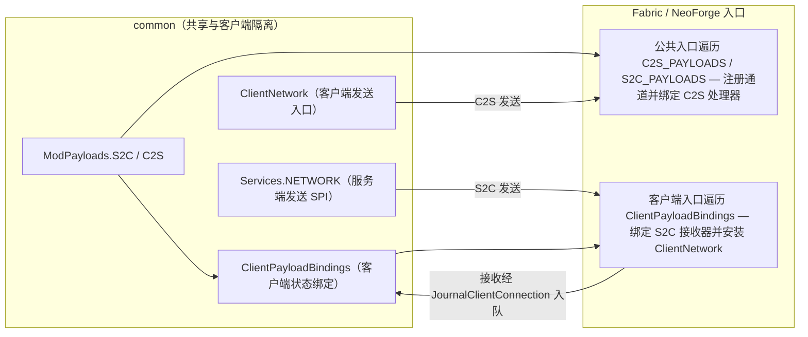

# 网络与同步

本文档规定模组的双端网络边界、`ModPayloads` 通道声明与注册机制、通用同步模式及线路容量约束。各业务状态的所有权、具体触发时机与Payload 内部字段语义以对应子系统文档为准。

## 1. 声明与数据流

[`core.network.ModPayloads`](../../../common/src/main/java/com/meteorite/unsuspiciousblock/core/network/ModPayloads.java) 集中维护全部通道声明与协议版本（`PROTOCOL_VERSION`）：

| 声明清单 | 持有内容与消费方式 |
|---|---|
| `C2S_PAYLOADS` | 包含类型、Codec 与服务端处理器；服务端校验权限与参数合法性后转交业务服务 |
| `S2C_PAYLOADS` | 仅声明类型与 Codec；客户端接收处理由 `ClientPayloadBindings` 统一绑定 |

- **通道唯一性校验**：初始化阶段检查同方向通道不重复；`ClientPayloadBindings` 校验绑定无重复且完整覆盖已声明的 `S2C` 条目，平台入口通过泛型捕获直接遍历绑定，无需查表强转。
- **公共声明隔离**：`ModPayloads` 仅依赖共享数据类型，不包含任何客户端类导入，保证专用服务端安全加载。

## 2. 端隔离与平台注册

| 平台入口 | 注册职责 |
|---|---|
| Fabric 公共入口 | 注册 C2S / S2C 类型与 Codec，并安装 C2S 接收器 |
| Fabric 客户端入口 | 遍历 `ClientPayloadBindings` 绑定 S2C 客户端接收器，并向 `ClientNetwork` 安装 `ClientPlayNetworking` |
| NeoForge 公共入口 | 注册 C2S；在专用服务端注册 S2C 类型与 Codec |
| NeoForge 客户端入口 | 遍历 `ClientPayloadBindings` 注册 S2C 类型、Codec 与客户端接收器，并安装 `PacketDistributor` |

NeoForge 握手阶段要求服务端具备客户端声明的必需通道；同一通道在一个物理端上只注册一次，两端统一使用 `ModPayloads.PROTOCOL_VERSION`。

淘洗会话通过 `panning_state` 向本人和观察者同步。Fabric 按接收方的频道能力发送，完整摇洗表现由支持该频道的客户端提供。[淘洗系统](../subsystems/panning.md)

**线程与连接代次约束**：
- Fabric C2S 接收后自动调度到服务器主线程；NeoForge 默认在主线程执行。
- S2C 回调保留原连接身份并交由 `JournalClientConnection` 在客户端 tick 内应用；断连或切服时推进连接代次（epoch），迟到的旧连接报文按归属直接丢弃。
- 源码端隔离检查规则见[仓库工具](../../../tools/README.md)。

## 3. 同步模式与线路契约

### 3.1 通用协议原则

- **协议版本与共用编解码器**：目录全量下发与按需结果共用 `CatalogStreamCodec` 和 `CatalogTableDto`。线格式字段顺序或结构调整必须成套修改读写两端并同步递增 `ModPayloads.PROTOCOL_VERSION`。
- **目录快照一致性**：全量目录下发与目录 SHA-256 计算共同消费 `CatalogGeneration.readSnapshot()` 生成的冻结字节流，确保服务端校验与客户端读取同源（构建细节见[笔记目录构建细节](../internals/journal-catalog-build.md)）。
- **按需模拟的协议不变量**（业务链路见[战利品表系统](../subsystems/loottable.md)）：
  - **共享选择值**：`ScenarioSelection` 保存原始 generation/hash、表身份、已勾选原子条件与独立参数，模拟、缓存查询和辅助请求各自拥有外层 `requestId`；参数规范化与 `ConditionPlan` / `ConditionOption` 签发校验由服务端受理入口执行；
  - **测值身份与交互身份分开**：结果按 `generation + tableHash + inputKey` 校验并进入对应输入缓存；有效旧输入结果保留供切换查看，当前选择保持原值。只有种类和 `requestId` 匹配的回执能结束对应等待。Worker 按同代 `(表, 输入)` 去重，每玩家等待关系保存最新票据，重试替换票据且只占一次额度；
  - **拒绝必回执**：`ScenarioRequestRejectedPayload` 回显原 requestId、表及 generation/hash，另带 `currentGeneration` 和原因。客户端先匹配票据结束等待，再按过期原因请求目录刷新；非法输入尚无有效 inputKey 时同样能结束等待；
  - **单表回执**：按需模拟结果单播给等待玩家。查看表时发起的基准请求可加入现有共享任务，其共享提交仍由基准任务负责；
  - **推荐范围与见证**：辅助请求使用独立通道、冷却与请求序号，携带目标级 `ITEM / CHILD_TABLE` 或同内容版本的 `BRANCH` 引用。响应回显范围、候选选择、搜索终态及路径见证；客户端核对版本、基础输入、签发域与见证归属后提供应用预览，计算由玩家另行触发。求解边界见[战利品表机制](../internals/loottable-mechanics.md#32-条件组合模型与按需规划-simulationscenarioplanner)。

### 3.2 笔记事务

| 数据流 | 发布与提交 |
|---|---|
| 玩家日志 | 登录发布摘要。打开日志页请求选中表历史，按查询票据和修订提交。摘要、查询截点和后续变更共用一个队列；日常变更发布实际增删及统计。 |
| 玩家进度 | 登录和重置发布基线，普通变更发布脏表。客户端按已提交修订处理重复数据和间隙，界面刷新版本独立推进。 |
| 共享目录 | 公告包含代次、修订和 SHA-256。公告与场景过期共用刷新入口，提交前核对请求票据、完整性与摘要。 |

服务端按数据流推进连接发送队列。客户端完整组装后提交。缺片、超时和间隙触发一次自动恢复，容量或恢复失败进入界面可见状态。日志编辑回执匹配请求 ID、操作和表，已应用回执关联权威日志修订。Fabric 检查版本化通道能力，NeoForge 通过 `ModPayloads.PROTOCOL_VERSION` 协商。 [考古笔记系统](../subsystems/journal.md)

管理页打开时按需获取公共索引。服务端按资源代次、已发布目录和规则版本复用索引分片，个人最近记录只发给请求者。世界设置状态、预览、补充表名和逐项保存回执分别刷新。补充表名在登录时同步，索引由管理页订阅。完整配置草稿及名称批次在上行组合完成后才处理写入。

### 3.3 线路预算

- **笔记下行**每个分片封装上限为 128 KiB，头部空间由 `JournalTransferPayload` 预留。事务字节预算由对应的 `Kind` 定义。日志和进度重组后按各自的 NBT 计量配额解码；目录验证身份和摘要后用同一线路 codec 解码。
- **批量删除**按 30 KiB 上行预算切分，同一请求的分片齐备后一次提交。缺片到期后释放批次并通知请求方。
- **管理数据**使用最高 128 KiB 的下行快照分片。规则草稿与名称编辑分片给上行自定义包头保留空间，名称分片按实际编码字节划分。
- **目录函数树裁剪**由 `CatalogStreamCodec` 定义。 [战利品表函数与展示规则](../internals/loottable-functions-and-display.md)

## 4. 扩展点：新增 Payload

1. 在 `core/network/payload/c2s/` 或 `core/network/payload/s2c/` 新建 Payload 类，定义 `TYPE` 与 `STREAM_CODEC`。
2. **C2S**：在 `ModPayloads.C2S_PAYLOADS` 注册条目（type + codec + handler），handler 内完成权限和参数校验后转交业务服务。
3. **S2C**：在 `ModPayloads.S2C_PAYLOADS` 声明 type 与 codec，同时在 `ClientPayloadBindings` 添加对应类型的客户端状态绑定；服务端序列化视图自动从同一声明派生。
4. **无需修改平台入口代码**：双端自动遍历上述清单完成注册。
5. 若传输战利品表目录对象，必须复用 `CatalogStreamCodec`；变更线上字段时同步更新 `ModPayloads.PROTOCOL_VERSION`。

## 5. 约束与陷阱

- **禁止在处理器中编写状态推拉循环**：Payload 处理器仅负责接收校验与事件转交，同步策略统一遵循第 3 节的三种模式。
- **严禁在 `common` 公共 S2C 声明中引用客户端类**：客户端处理逻辑必须隔离在 `ClientPayloadBindings` 中，由客户端入口装配。
- **个人展示状态禁止写入全服共享结构**：按需模拟结果、推荐预览等每玩家状态只能返回给请求者。

## 6. 相关文档

- [架构总览](architecture.md)
- [平台抽象](platform-spi.md)
- [考古笔记系统](../subsystems/journal.md)
- [战利品表系统](../subsystems/loottable.md)
- [客户端与 GUI](../subsystems/client-ui.md)
- [猫族关系系统](../subsystems/cat-favor.md)
- [附魔系统](../subsystems/enchantment.md)
