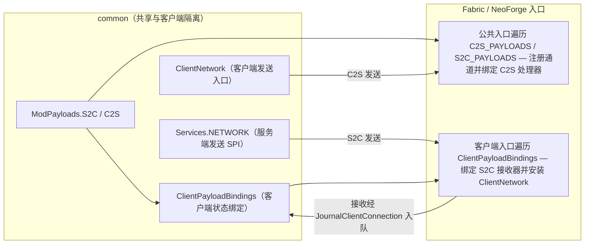

# 网络与同步

本文档规定模组的双端网络边界、`ModPayloads` 通道声明与注册机制、通用同步模式及线路容量约束。各业务状态的所有权、具体触发时机与Payload 内部字段语义以对应子系统文档为准。

## 1. 声明与数据流

[`core.network.ModPayloads`](../../../common/src/main/java/com/meteorite/unsuspiciousblock/core/network/ModPayloads.java) 集中维护全部通道声明与协议版本（`PROTOCOL_VERSION`）：

| 声明清单 | 持有内容与消费方式 |
|---|---|
| `C2S_PAYLOADS` | 包含类型、Codec 与服务端处理器；服务端校验权限与参数合法性后转交业务服务 |
| `S2C_PAYLOADS` | 仅声明类型与 Codec；客户端接收处理由 `ClientPayloadBindings` 统一绑定 |

- **通道唯一性校验**：初始化阶段检查同方向通道不重复；`ClientPayloadBindings` 校验绑定无重复且完整覆盖已声明的 `S2C` 条目，平台入口通过泛型捕获直接遍历绑定，无需查表强转。
- **公共声明隔离**：`ModPayloads` 仅依赖共享数据类型，不包含任何客户端类导入，保证专用服务端安全加载。

## 2. 端隔离与平台注册

| 平台入口 | 注册职责 |
|---|---|
| Fabric 公共入口 | 注册 C2S / S2C 类型与 Codec，并安装 C2S 接收器 |
| Fabric 客户端入口 | 遍历 `ClientPayloadBindings` 绑定 S2C 客户端接收器，并向 `ClientNetwork` 安装 `ClientPlayNetworking` |
| NeoForge 公共入口 | 注册 C2S；在专用服务端注册 S2C 类型与 Codec |
| NeoForge 客户端入口 | 遍历 `ClientPayloadBindings` 注册 S2C 类型、Codec 与客户端接收器，并安装 `PacketDistributor` |

NeoForge 握手阶段要求服务端具备客户端声明的必需通道；同一通道在一个物理端上只注册一次，两端统一使用 `ModPayloads.PROTOCOL_VERSION`。

**线程与连接代次约束**：
- Fabric C2S 接收后自动调度到服务器主线程；NeoForge 默认在主线程执行。
- S2C 回调保留原连接身份并交由 `JournalClientConnection` 在客户端 tick 内应用；断连或切服时推进连接代次（epoch），迟到的旧连接报文按归属直接丢弃。
- 源码端隔离检查规则见[仓库工具](../../../tools/README.md)。

## 3. 同步模式与线路契约

### 3.1 通用协议原则

- **协议版本与共用编解码器**：目录全量下发与按需结果共用 `CatalogStreamCodec` 和 `CatalogTableDto`。线格式字段顺序或结构调整必须成套修改读写两端并同步递增 `ModPayloads.PROTOCOL_VERSION`。
- **目录快照一致性**：全量目录下发与目录 SHA-256 计算共同消费 `CatalogGeneration.readSnapshot()` 生成的冻结字节流，确保服务端校验与客户端读取同源（构建细节见[笔记目录构建细节](../internals/journal-catalog-build.md)）。
- **按需模拟的协议不变量**（业务链路见[战利品表系统](../subsystems/loottable.md)）：
  - **传结构化字段而非拼装键**：客户端传场景 key 与独立参数字段，条件赋值由服务端从场景规划恢复，防止客户端通过构造非法字符串绕过校验；
  - **结果三要素校验**：响应携带有 `generation`（目录代次）、`tableHash`（表哈希）与 `inputKey`（输入键），任一不匹配时客户端直接丢弃，防止 `/reload` 或切换参数后的迟到包覆盖当前画面；
  - **拒绝必回执**：请求被限流、过期或越界拒绝时必须返回 `ScenarioRequestRejectedPayload`，使界面能明确区分“计算中”与“已拒绝”；
  - **结果个人独享**：按需模拟结果只单播回请求玩家，不写入全服共享目录；
  - **推荐请求与模拟分离**：辅助推荐请求与模拟请求使用独立通道、独立冷却与请求序号，只更新前端参数草稿，不跳过显式模拟确认。

### 3.2 三种可复用同步模式

| 模式 | 适用场景 | 机制要点 | 权威实现文档 |
|---|---|---|---|
| **增量 + 间隙恢复** | 玩家笔记进度 | 业务修改只标记脏表，发包时 `revision + 1`；客户端发现 `incomingRevision > lastNotified + 1` 时按 2 秒冷却主动请求全量重同步 | [考古笔记系统](../subsystems/journal.md) |
| **按需哈希比对** | 考古目录结构与静态概率 | 登录或批处理完成后只广播目录 SHA-256；客户端比对不一致时再请求全量目录，避免每次登录传输大包 | [笔记目录构建细节](../internals/journal-catalog-build.md) |
| **分片会话快照** | 玩家全量考古日志 | 携带会话 ID 与自增序号：发送 `Start` → 按表独立压缩并切分为最大 128 KiB 分片 → 发送 `End`，客户端校验完整后一次性替换本地镜像 | [考古日志存储与迁移](../internals/journal-log-storage.md) |

### 3.3 线路规模硬上限

修改以下限制等同于修改通信协议，需同步评估双端内存与原版 2 MiB 包上限：

- **日志全量快照**：单表压缩后不超过 `16 MiB`，解压后 NBT 不超过 `64 MiB`，单次快照最多 `65,536` 张表，传输分片不超过 `128 KiB`。全量快照按表流式解压读取，避开整份日志的单次原版 `readNbt` 上限。
- **日志增量操作**：`SyncJournalLogPayload`（含 `REPLACE_TABLE`）仍走原版 `readNbt` 解码路径。
- **批量删除**：删除请求与回执的 UUID 列表按单包上限自动分批拆包。
- **目录函数树裁剪**：通过 `CatalogStreamCodec` 写入时限深 `16` 层、每节点最多 `32` 项元数据与 `64` 个子函数/顶层节点，观测链每条目最多 `16` 条、每条最多 `64` 个节点（细节见[战利品表函数与展示规则](../internals/loottable-functions-and-display.md)）。

## 4. 扩展点：新增 Payload

1. 在 `core/network/payload/c2s/` 或 `core/network/payload/s2c/` 新建 Payload 类，定义 `TYPE` 与 `STREAM_CODEC`。
2. **C2S**：在 `ModPayloads.C2S_PAYLOADS` 注册条目（type + codec + handler），handler 内完成权限和参数校验后转交业务服务。
3. **S2C**：在 `ModPayloads.S2C_PAYLOADS` 声明 type 与 codec，同时在 `ClientPayloadBindings` 添加对应类型的客户端状态绑定；服务端序列化视图自动从同一声明派生。
4. **无需修改平台入口代码**：双端自动遍历上述清单完成注册。
5. 若传输战利品表目录对象，必须复用 `CatalogStreamCodec`；变更线上字段时同步更新 `ModPayloads.PROTOCOL_VERSION`。

## 5. 约束与陷阱

- **禁止在处理器中编写状态推拉循环**：Payload 处理器仅负责接收校验与事件转交，同步策略统一遵循第 3 节的三种模式。
- **严禁在 `common` 公共 S2C 声明中引用客户端类**：客户端处理逻辑必须隔离在 `ClientPayloadBindings` 中，由客户端入口装配。
- **个人展示状态禁止写入全服共享结构**：按需模拟结果、推荐预览等每玩家状态只能返回给请求者。

## 6. 相关文档

- [架构总览](architecture.md)
- [平台抽象](platform-spi.md)
- [考古笔记系统](../subsystems/journal.md)
- [战利品表系统](../subsystems/loottable.md)
- [客户端与 GUI](../subsystems/client-ui.md)
- [猫族关系系统](../subsystems/cat-favor.md)
- [附魔系统](../subsystems/enchantment.md)
