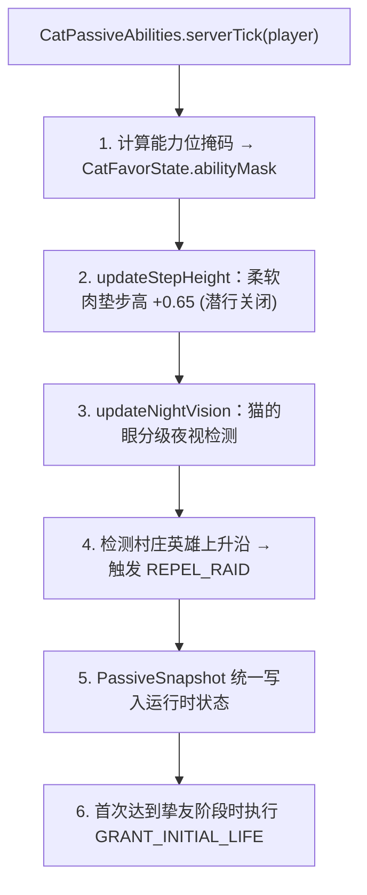

# 猫族关系机制细节

> 猫族羁绊行为数值与去重规则、被动能力的每 tick 评估与位掩码缓存、玩家持久化字段与迁移，以及纯账本写入契约。
> 本文件不参与主任务导航，由[猫族关系系统](../subsystems/cat-favor.md)按需链接。

## 1. 羁绊行为、冷却与去重 (`CatFavorAction`)

### 1.1 正向行为（建立关系后生效，独立冷却）

| 行为 | 增量 | 冷却 | 触发场景 |
|---|---|---|---|
| `FEED_CAT` | `+5` | `12000t` | 喂食普通猫（延至 tick 末结算，若同交互触发驯服则自动取消） |
| `TAME_CAT` | `+10` | `12000t` | 成功驯服普通猫 |
| `SLEEP_WITH_CAT` | `+20` | `6000t` | 与已驯服的猫一同入睡 |
| `SIT_ON_BLOCK` | `+10` | `24000t` | 驯服猫连续坐在床、箱子或燃烧熔炉上 `30s` |
| `REPEL_RAID` | `+20` | `12000t` | 获得村庄英雄效果（仅击退袭击上升沿触发） |

正向动作经 `CatFavorManager.tryAccumulate` 交给纯账本校验关系与冷却；满值时触发有效正向动作仍刷新对应冷却，避免跌出封顶后立即反弹。`CatFavorManager.apply` 消费 `Change` 后弹出 Action Bar 提示并在羁绊、命数或关系字段变更时触发网络同步。

### 1.2 惩罚行为（建立关系后无视携带与冷却，直接结算）

| 行为 | 增量 | 触发场景 |
|---|---|---|
| `HIT_CAT` | `-5` | 玩家伤害任意普通猫 |
| `OWN_CAT_DEATH` | `-10` | 玩家名下驯服猫死亡（非主人亲手击杀时） |
| `KILL_CAT` | `-50` | 玩家杀死任意普通猫 |

- **击杀去重 (`consumeMatchingCatHit`)**：账本校验同一只猫 UUID 在同一 `gameTime` 是否已扣除 `HIT_CAT` 的 `5` 分；若已扣则仅补扣 `45` 分（合计 `-50`），防止一次致命打击叠加扣分。
- **喂食延迟结算**：同一次交互可能先触发喂食消耗鱼类再立刻驯服成功。因此喂食先调用 `queueFeedReward` 入队，若同 tick 发生驯服则调用 `cancelPendingFeedReward` 取消喂食奖励，仅保留 `TAME_CAT`（`+10`）；否则由 `serverTick` 触发 `SETTLE_FEED` 结算。

## 2. 被动能力每 tick 评估 (`CatPassiveAbilities`)

[`CatPassiveAbilities.serverTick`](../../../common/src/main/java/com/meteorite/unsuspiciousblock/core/cat/CatPassiveAbilities.java) 在服务端每 tick 权威执行：

### 2.1 能力位掩码与 Mixin 查询接口

为避免高频 Mixin（生物索敌、方块踩踏、压力板触发、摔落结算）每帧扫描玩家背包，系统将权限结果预计算为 4 个位掩码标志缓存在 `CatFavorState.abilityMask`：

| 位掩码标志 | 对应静态查询方法 | Mixin 消费用途 |
|---|---|---|
| `FLAG_DETERRENCE` | `hasActiveDeterrence` / `hasPhantomDeterrence` | 苦力怕回避玩家、幻翼不生成/不索敌 |
| `FLAG_LIGHT_STEP_TRAMPLE` | `hasLightStep` | 阻止踩坏耕地 |
| `FLAG_LIGHT_STEP_NO_PRESSURE` | `hasLightStepPressurePlateIgnored` | 忽略压力板与绊线触发 |
| `FLAG_SOFT_PAWS` | `hasSoftPaws` | 减免 80% 摔落伤害 |

此外，`isNineLivesInvulnerable`（`CAT_FAVOR` 无敌窗口）与 `canSummonAncientGift` / `canTriggerNineLives` 均由 `CatPassiveAbilities` 对外提供统一查询入口。

### 2.2 猫的眼分级亮度检测

- **空闲侦测态**：每 `20 tick`（1 秒）检测一次玩家所在位置最大局部原生亮度是否 `< 9`。
- **激活维持态**：进入黑暗后授予 `320 tick`（16 秒）夜视，每 `100 tick`（5 秒）续期刷新；离开黑暗后停止续期，效果自然淡出并回退空闲态。

## 3. 状态持久化、迁移与重生保留

[`CatFavorState`](../../../common/src/main/java/com/meteorite/unsuspiciousblock/core/cat/state/CatFavorState.java) 挂载于玩家 NBT（协调器见 `PlayerDataLifecycle`）：

- **持久化字段（随存档保存，跨死亡重生复制）**：`relationshipEstablished`、`catBond`（`0–100`）、`lastTriggerGameTime`（各行为冷却表）、`deterrenceDisabled` / `lightStepDisabled`（玩家偏好）、`nineLivesCount`（`0–9`）、`initialBestFriendLifeGranted`。
- **瞬态字段（不落盘，重生与登录时重置）**：`abilityMask`、`hadHeroEffect`、`nightVisionCheckCooldown`、`pendingFeedReward`、`recentlyHitCatUuid` / `GameTime`、`activeMessengerUuid` / `activeSwordsmanUuid`。
- **数据迁移**：`CatFavorState` 向通用 `NbtMigration` 底座注册升版链路（旧版无版本 `favor` 格式迁移时清空历史冷却，并将旧压力板开关映射为统一的轻步偏好；高于当前版本的未来数据在清空前拒绝读取，转换异常时原样保留输入 NBT，详见[本地持久化与数据迁移](../foundation/persistence.md)）。

## 4. 纯账本写入契约 (`CatBondLedger`)

全部核心状态变更均收拢在 `CatBondLedger.apply(state, mutation, gameTime)` 中执行（返回包含前后值、阶段变化与 `requiresSync` 标志的 `Change`）：

- 正向/惩罚行为（含带目标 UUID 的击打与击杀去重）、命数授予/消耗、偏好切换、调试调整与喂食队列均通过显式不可变 `Mutation` 表达；不落盘的能力位掩码与状态快照通过 `PassiveSnapshot` 写入。
- 业务 mutator 限制在状态包内部；玩家管理器仅依据 `requiresSync` 触发网络下发，使游戏规则、玩家持久化与网络通信彻底解耦。

## 5. 相关文档

- [猫族关系系统](../subsystems/cat-favor.md)
- [本地持久化与数据迁移](../foundation/persistence.md)
- [Mixin 边界与接线](../foundation/mixin.md)
