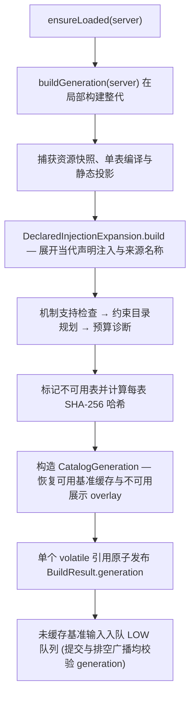

# 笔记目录构建细节

> 服务端考古笔记目录的整代构建流程、原子发布与线程模型、冻结快照与哈希同步，以及 `/usb journal` 调试命令边界。
> 本文件不参与主任务导航，由[考古笔记系统](../subsystems/journal.md)与[战利品表系统](../subsystems/loottable.md)按需链接。

## 1. 整代构建流程

入口为 [`ArchaeologyJournalServerCatalog`](../../../common/src/main/java/com/meteorite/unsuspiciousblock/core/journal/catalog/ArchaeologyJournalServerCatalog.java)，在服务端 `SERVER_STARTED` 阶段调用 `ensureLoaded(server)`：

### 核心组件协同规则

- **声明注入展开 (`DeclaredInjectionExpansion`)**：在构建期将物品级注入声明与运行时子表边合并为共同贡献，保留来源类型、接入模式、完整函数路径与第一跳子表；构建出的 `ExpandedTable` 同时固定原生、展示与规划三种视图（路径栈用于阻断循环，多父路径分别保留独立门槛）。
- **展示装配 (`CatalogDisplayDerivation` / `CatalogTableDto.assemble`)**：由静态表、约束描述、输入与只读测量快照装配最终 DTO（包含场景假设、物品、子表条件、分支与参数选项），缓存读写与 LRU 触达保留在调用方。
- **双视图口径分离**：
  - `staticTables()` / `staticTable()`、`tracked()` 与 `queryIndex()` 提供启动即完整的解析态资格，不随模拟进度变化；
  - `displayTable()` 自动优先读取模拟 overlay 并回退静态态；`simulatedTables()` 供命令校验完整模拟覆盖进度。
- **Worker 交付与重载生命周期**：工作器将去重任务的等待者汇总交付给 `CatalogSimulationSubmission`，目录校验代次、表哈希与签发输入后，仅基准输入贡献允许写入共享 overlay，随后由 `CatalogSimulationDelivery` 构造单播回执（离线等待者跳过发送），待当前代次队列排空后广播完整目录哈希。数据包重载严格按「暂停任务 → 清空队列 → 失效旧代 → 重建 → 恢复」执行。

## 2. 冻结目录与按需同步

`CatalogGeneration.readSnapshot()` 是完整目录下发与摘要计算的唯一共享快照接口，封装了当前 `generation`、`overlayRevision`、冻结的目录 Payload 及对应的 SHA-256 摘要：

- **锁与缓存失效**：模拟 overlay 提交与快照捕获共用同一把锁；每次基准结果提交时递增 `overlayRevision` 并失效摘要缓存。`JournalCatalogHandler` 的哈希比对与全量下发共用同一缓存快照（非主线程调用先切回服务端主线程）。
- **冻结编码与线格式**：快照通过 `SyncArchaeologyCatalogPayload.STREAM_CODEC` 执行一次真实的编码与解码，从而在快照内部提前剥离服务端活谓词与内部约束对象，并固化函数树裁剪结果。SHA-256 摘要直接基于该冻结字节流计算，保证与网络线格式严格同源（协议版本以 `ModPayloads.PROTOCOL_VERSION` 为准，线上限见[网络与同步](../foundation/network.md)）。
- **两级哈希分工**：每表内容哈希用于单表概率缓存准入与按需请求防伪凭据；完整目录 SHA-256 摘要（包含更新后的表数据与 `options` 代次凭据）用于客户端在登录或广播时判定是否需要全量重拉。

## 3. 调试命令与目录稳定性

`/usb journal`（由 `JournalCommand` 提供）与目录口径的交互规则如下：

- **`/usb journal reload`**：清空 `LootProbabilityData` 缓存、worker 队列与服务端内存目录后重新构建与模拟；**不删除任何玩家的笔记进度或日志**。任务完成或玩家中途离线时会立即解除进度监听器，不遗留悬空引用。
- **`/usb journal unlock table [table_id]`**：读取启动即完整的静态视图（`staticTables()`），不等待模拟队列完成。
- **`/usb journal unlock item [table_id]`**：需要动态发现物品稳定入库，因此当 worker 仍在忙碌或 `simulatedTables()` 尚未覆盖全部收录表时**拒绝执行**，防止将半成品目录写入玩家存档。
- **子树闭包去重 (`CatalogQueryIndex.subtreeItems`)**：父表介绍页、`unlock item` 与 100% 完成奖励统一计算“本表及所有后代表按 `LootResultSignature` 去重后的物品全集”，共享子表与循环引用只遍历一次。

## 4. 相关文档

- [考古笔记系统](../subsystems/journal.md)
- [战利品表系统](../subsystems/loottable.md)
- [战利品表机制细节](loottable-mechanics.md)
- [网络与同步](../foundation/network.md)
