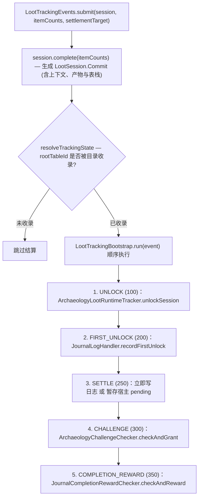

# 战利品追踪核心数据流

> 战利品发现从生成捕获到结算入库的完整内部链路：追踪上下文、捕获与宿主服务、命名结算链、兼容订阅及宿主待定状态。
> 本文件不参与主任务导航，由[考古笔记系统](../subsystems/journal.md)按需链接。新增普通追踪来源请优先阅读该篇的「扩展点」。

## 1. 追踪上下文 (`LootTrackingContext`)

[`LootTrackingContext`](../../../common/src/main/java/com/meteorite/unsuspiciousblock/core/journal/tracking/LootTrackingContext.java) 是贯穿单次抽取的不可变 record，通过 `LootTrackingContextHolder`（`ThreadLocal`）在抽取前写入：

| 字段 | 含义 |
|---|---|
| `player` | 触发本次获取的玩家 |
| `rootTableId` | 本次追踪锚定的根表 ID（签名解析与解锁归属均以此表为准） |
| `lootSource` | 战利品来源类型（钓鱼、开箱、刷拭、陶罐、淘洗、化石猎手等） |
| `gameTime` / `dayTime` | 触发时刻的游戏时间 |
| `tableStack` | 从根表到当前子表的完整引用栈；遇到嵌套调用时由 `descend(childTableId)` 派生 |
| `pos` | 触发坐标（鱼漂、容器或方块位置） |
| `sourceBlockId` | 源方块 ID（刷拭等场景使用） |

当父表在抽取中调用嵌套子表时，`NestedLootTableMixin` 自动识别活动上下文、派生子表栈并捕获子表物品产出。

## 2. 捕获入口与宿主服务

| 服务 | 覆盖场景 | 核心机制 |
|---|---|---|
| `LootCapture` | 钓鱼、淘洗、化石猎手、刷拭、容器与陶罐 | 统一资格判定、签名构建、`LootSession` 生命周期与 `ThreadLocal` 作用域 |
| `ContainerTrackingService` | 方块容器与实体容器开箱 | 借助 `MenuTrackingSnapshot` 比对玩家打开与关闭菜单时的槽位物品差值 |
| `DecoratedPotTrackingService` | 装饰陶罐 | 面向陶罐交互与破坏掉落的专属追踪路径 |

### 捕获与容器追踪细节

- **`LootCapture` 嵌套复用**：`capture(source, target, generator)` 在作用域内执行原生成函数并在返回后提交，`submitFinal` 接收外部已生成物品列表；跨多阶段 Mixin 时使用 `CaptureHandle`（`roll` 仅包住实际生成阶段，`complete` 至多提交一次，`close` 安全清理未提交捕获）。同玩家、同来源的嵌套子表抽取自动复用父会话（如 NeoForge 钓鱼 GLM 路径），由根入口提交最终合并数量；刷拭保留原触发时间。
- **方块与实体容器共链**：方块容器从 `RandomizableContainer#unpackLootTable` 接入，矿车等实体容器从 `ContainerEntity#unpackChestVehicleLootTable` 接入，两者共用 `LOOT_CONTAINER` 分类与 `ContainerTrackingService`。实体容器的追踪状态持久化于实体 NBT，仅在实体真正销毁时结算，区块卸载不提前清空。
- **Lootr 兼容链路**：Lootr 奖励箱矿车与普通 Lootr 容器均通过 `DefaultLootFiller` 创建每玩家 `LootrInventory`，Lootr 兼容 Mixin 直接在该通用 filler 上接入，无需为矿车另立分类或额外钩子。

## 3. 事件总线与命名结算链

抽取结束后由 `LootTrackingEvents.submit` 驱动结算：

### 兼容订阅与 fail-fast 语义

- **兼容优先序**：已弃用的 `LootTrackingEvents.register(priority, listener)` 保留按整数优先级（小值先执行）排序的扩展接口；与内建命名步骤同值的回调，依据其注册时间早于还是晚于 common 初始化而分别排在对应步骤之前或之后（由 `LegacyLootSubscriptions` 负责兼容映射）。
- **异常传播策略**：任一内建步骤或扩展回调抛出异常均立即中断并向提交方原样抛出，附加步骤名、根表与玩家上下文，后续奖励停止且不做隐式重放。

## 4. 结算目标 (`LootSettlementTarget`)

| 目标形态 | 结算行为 | 适用场景 |
|---|---|---|
| `IMMEDIATE` | 生成瞬间直接写入获取数量与最终日志条目 | 钓鱼、淘洗、化石猎手、装饰陶罐 |
| `Deferred(PendingTarget)` | 生成时在宿主暂存预期日志，直到玩家实际取走物品才累计取得量并转正 | 战利品容器（`PendingTarget.Container`）、可疑方块（`PendingTarget.Brush`） |

使用延迟结算的原因在于：玩家打开箱子后未必拿走全部物品，刷出的可疑方块物品也可能未被立即取走；暂存到宿主身上可保证日志真实反映玩家最终获得的战利品。

## 5. 宿主状态持久化与终结

- **待定日志宿主 (`PendingJournalHost` / `PendingJournal`)**：所有支持延迟日志的原版/Lootr 宿主统一实现 `PendingJournalHost`（封存方块只实现扫描与物品读取，不承载待定日志）。`PendingJournal` 负责暂存日志、在玩家分次拿取时按同 `entryId` 合并数量、以及在提交持久化成功后才清内存引用。
- **容器追踪状态 (`ContainerLootTracking`)**：统一维护当前表 ID、所有者、只读余量视图与 pending，普通方块容器、箱子矿车与 Lootr 每玩家库存共用一套 NBT Codec。菜单打开时先分配双箱间归属并在真实拿取提交后扣减余量；库存校准只缩减余量而不提前销毁 pending，覆盖、超时或实体/方块销毁统一经 `ContainerTrackingService.terminate` 终结。
- **可疑方块状态 (`BrushableTracking`)**：普通与 Lootr 可疑方块共享扫描状态、`ScanIdentity`（兼容普通布尔标记+UUID 与封存者 UUID；缺失 UUID 时保持已扫描但无扫描者，不做猜测修复）、表解析与 pending 逻辑；Lootr 的每玩家独立库存与临时刷拭工具状态保留在各自宿主适配器中。
- **NBT 兼容性**：既有 `unsuspiciousblock_tracked_loot_*` 与 `unsuspiciousblock_pending_journal_entry` 键保持原样读写；即使余量已清空，待定日志内部携带的原 `tableStack` 仍可用于完成最终终结归属。

## 6. 相关文档

- [考古笔记系统](../subsystems/journal.md)
- [考古日志存储与迁移](journal-log-storage.md)
- [战利品表系统](../subsystems/loottable.md)
- [Mixin 边界与接线](../foundation/mixin.md)
