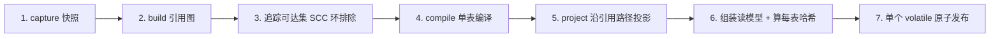
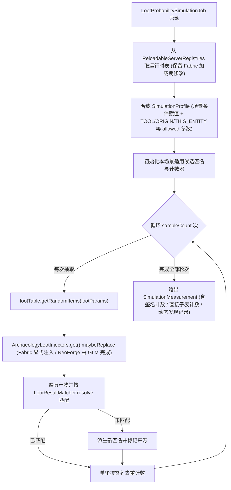
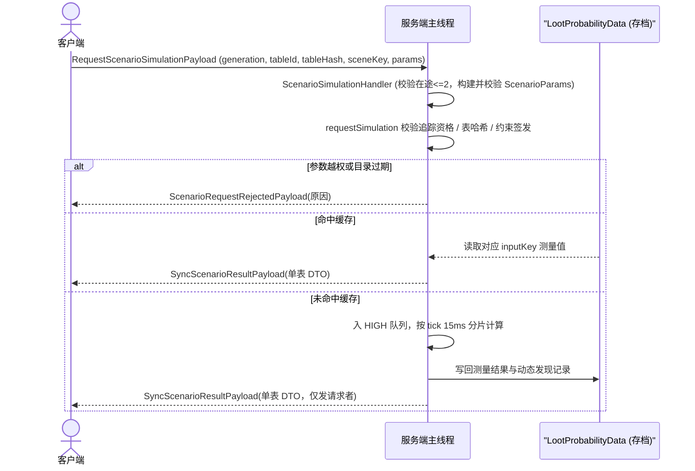

# 战利品表机制细节

> 本文档说明战利品表子系统的底层实现：四层解析管线、签名与预览缓存、单输入模拟引擎与场景规划、主线程 tick 调度、结果缓存失效与按需请求链路。
> 本文件不参与主任务导航，由[战利品表系统](../subsystems/loottable.md)按需链接；函数规则描述、执行捕获与展示派生规则见[战利品表函数与展示规则](loottable-functions-and-display.md)。

## 1. 解析管线细则

[`ArchaeologyJournalCatalog.load`](../../../common/src/main/java/com/meteorite/unsuspiciousblock/core/journal/catalog/ArchaeologyJournalCatalog.java) 按四层流水线构建静态目录：



- **快照（`LootTableSourceSnapshot.capture`）**：通过一次 `listMatchingResourceStacks` 获取全部表。栈首是当前重载生效的 JSON 原文，整个资源栈用于计算稳定内容哈希；原文与 `JsonElement` 采用惰性解析并缓存。
- **引用图（`LootTableReferenceGraph.build`）**：合并静态 JSON 引用边与平台声明注入边。合成边启用双端存在守卫（目标已被 JSON 引用覆盖时不重复加边），邻接表去重保序。
- **环排除**：仅对收录根的初始可达集计算强连通分量（SCC），将闭环成员移出目录并记录一次性告警；与考古目录无关的第三方表循环不产生噪音日志。
- **编译（`LootTableCompiler`）**：将单表 JSON 转为上下文无关的 `CompiledLootTable`。遇到 `loot_table` 引用只记录 `ReferenceSite` 而不展开；物品标签在编译期直接展开为具体物品签名。
- **投影（`LootTableProjector`）**：沿引用边拼接编译产物，落地三条投影规则：
  1. 首跳子表归属（孙表汇总回直接子表）；
  2. 条件继承顺序（外层传入 → 本表累计 → 当前条目自身）；
  3. 函数链继承与签名降级。同一子表在多处以不同条件被引用时保留各自独立路径，不合并丢失上下文。
- **静态读模型**：`StaticTableProjection` 展平出的目录只保留实际存在物品产出的表（分析会话仍保留空表投影）；未模拟条目的初始概率占位为 `Probability.unknown(UnknownReason.UNCOVERED)`。

**编译与投影解耦的原因**：同一张子表在不同父表引用点的条件与函数链各不相同，因此编译阶段绝不缓存展开后的子表结果，由投影阶段按引用路径实时合成，且条件分析、函数链拼接与多路径归并各自保持唯一实现（`LootParseUtil`、`ItemDefinitionAccumulator`）。

### 1.1 多路径物品提示合并

`ItemDefinitionAccumulator` 按 `Component` 抽象语法树（含翻译键与参数）而非渲染后文本对同签名路径的非空提示去重，按路径出现顺序使用本地化 `alternative_separator` 拼接（展示名分歧同样按组件结构判定）。不同路径若拥有相同的数量区间（如内置河流淘洗金粒的两条 `1-3` 路径）仅展示一次；不同区间则展示为 `数量: 1-3 / 数量: 3-6`。该说明表达各独立路径的函数效果，而非单次抽取总产量。

## 2. 签名机制

[`LootResultSignature`](../../../common/src/main/java/com/meteorite/unsuspiciousblock/core/loottable/signature/LootResultSignature.java) 将“目录物品定义”与“玩家实际获得的物品栈”绑定为一致的身份键：

```java
public record LootResultSignature(ResourceLocation itemId, SignatureType type, @Nullable String data) {}
```

| `SignatureType` | 语义 | 构造场景 |
|---|---|---|
| `PLAIN` | 纯物品身份，忽略组件差异 | 无特殊组件的普通物品，或含实例态排除组件的物品 |
| `COMPONENT_EXACT` | 严格组件匹配 | 含非排除 `DataComponentPatch` 的物品（`data` 存组件 JSON） |
| `ENCHANTED_APPROX` | 附魔近似归类 | 带附魔的物品与附魔书（避免海量附魔组合引起条目爆炸） |
| `ENCHANTED_RANDOM` / `ENCHANTED_LEVEL` | 历史附魔签名兼容值 | 读取旧数据时自动折叠为 `ENCHANTED_APPROX` |
| `APPROX_ITEM_ONLY` | 异常回退签名 | 组件编码失败等边界情况 |

### 2.1 实例态组件排除

配置 `ILootTableConfig.getSignatureExcludedComponents()`（默认包含 `relics:data`）声明的组件会在每次实例生成或读取时随机物化（例如 Relics 在 `verifyComponentsAfterLoad` 中随机写回品质），不属于战利品表静态定义。命中此类组件的物品在签名派生时统一退化为 `PLAIN`：

- **退化为 `PLAIN` 而非“剔除后编码 `COMPONENT_EXACT`”**：精确匹配哈希与组件比对读取未剔除的原始 `ItemStack`，双侧不对称会导致永远匹配失败。退化为 `PLAIN` 后仅比对物品 ID，并与静态路径保持同键合并，代价是不区分随机实例品质。

### 2.2 稳定存储键与附魔判定

- **存储键格式**：`toStoredKey()` 生成形如以下文本的持久化与网络键（`fromStoredKey()` 对不带 `usb_sig|` 前缀的旧键按 `PLAIN` 兼容读取）：
  ```text
  usb_sig|TYPE|itemId|base64(data)
  ```
- **附魔判定陷阱**：原版工具默认携带空的 `ENCHANTMENTS` 组件，`isActuallyEnchanted(stack)` 必须检查 `stack.isEnchanted()` 或非空 `STORED_ENCHANTMENTS`，不能使用 `stack.has(DataComponents.ENCHANTMENTS)`。

### 2.3 预览栈与缓存

`createPreviewStack()` 根据签名重构用于展示或匹配的 `ItemStack`。由于 `COMPONENT_EXACT` 需将 JSON 文本解码为组件补丁且成本较高，[`LootResultPreviewCache`](../../../common/src/main/java/com/meteorite/unsuspiciousblock/core/loottable/signature/LootResultPreviewCache.java) 在掉落追踪、容器追踪与菜单快照三条热路径共享缓存预览栈（由签名值唯一确定，仅在数据包重载时清空以控制内存）；单表模拟工作器内部仍持有独立的无锁 `HashMap` 缓存以减少并发开销。

## 3. 概率模拟：引擎与场景规划

模拟以 `SimulationInput`（场景键 `scenarioKey` + `ScenarioParams`）作为输入身份。其中场景键使用稳定字面量：`baseline` 固定代表基准场景，其余代表场景按稳定发射顺序编号为 `scene-1`、`scene-2`……。缓存键格式化为如下形式：

```text
scenario=baseline|luck=0.00|tool=minecraft:diamond_pickaxe|ench=|n=10000
```

### 3.1 模拟引擎 (`LootProbabilitySimulator`)

单个模拟任务 `LootProbabilitySimulationJob` 对一组 `(tableId, scenario, input)` 执行抽取并累积原始计数：



**关键机制说明**：
- **单次至少出现一次口径**：每轮抽取对同一签名去重后最多计数一次，统计“单次抽取出现该物品的概率”，不累计掉落堆叠总数或均值。
- **幸运处理与 `luckAffected`**：幸运值经 `LootParams.withLuck` 注入；编译器在编译阶段扫描每个池的 `bonus_rolls` 与 `quality`，若存在非零 `quality` 或无法证明恒零的 `bonus_rolls` 则标记 `LootAcquisitionPath.luckAffected = true`（用于向玩家提示“随幸运变化”，但无法静态覆盖第三方运行时注入暗读幸运的情况）。
- **钓鱼上下文判断**：依据表自身声明的 `type`（而非路径字符串）判定钓鱼表，并为其填充 `SimulationFishingHook`，使 `entity_properties` 下的 `in_open_water` 条件可正常求值。参数填充覆盖 `paramSet.allowed` 内的全部 required 与 optional 字段；缺少 `ORIGIN` 支持的 `paramSet`（如 `barter`）在构建期即被拦下。
- **热路径匹配优化**：`LootResultMatcher.CandidateIndex` 先按 `Item` 分组，再对精确组件候选按 `ItemStack.hashItemAndComponents` 分桶，同桶内仍严格执行 `ItemStack.isSameItemAndComponents` 校验，保持歧义返回 `null` 与单轮去重语义不变。

### 3.2 条件场景策略与规划 (`SimulationScenarioPlanner`)

运行时表保留完整的原版条件树，禁止通过篡改 JSON 条件并重新解码来构造模拟副本（否则会破坏 `all_of`、`any_of`、`inverted` 组合语义并绕过加载期修改）。

- **逻辑树与展示树分离**：`LootConditionInfo` 将逻辑节点（`ALL` / `ANY` / `NOT` / `LEAF` 与 `logicChildren`）与纯展示文本 `ConditionDisplayRow` 分开存储；`ConditionTree.Algebra` 为规划器、推荐求解器、玩家探测和路径提示提供统一的三值求值与需求析取代数。
- **场景控制条件处理方式**：

| 条件类型 | 模拟处理方式 |
|---|---|
| `location_check`、`weather_check`、`time_check`、`entity_scores` | 注册 `SCENARIO` 能力，由 `SimulationScenarioPlanner` 为其分配确定真假值并由单目标 Mixin 转交 `LootSimulationScope`（不修改世界状态、不访问真实区块或计分板） |
| `match_tool` | **不参与场景布尔枚举**，直接由 `SimulationProfile` 填充的真实 `TOOL` 物品栈交由原版 `ItemPredicate` 求值，使工具匹配与时运/附魔等级曲线保持一致 |
| `block_state_property`、`damage_source_properties`、`entity_properties` | 由 `SimulationProfile` 填充对应方块状态、伤害来源或假玩家/鱼钩上下文 |

- **两条独立规模预算**：
  1. **硬上界 32**：候选场景（不含先占名额的 `baseline`）按覆盖路径数降序截取至最多 `32` 个（并列时按路径枚举顺序保持确定性，防止重启后 `scene-N` 编号漂移），截断数记入 `ScenarioPlan.truncatedCount`。
  2. **展开过程预算**：单表条件与函数树共用 `4096` 访问节点上限与 `512` 中间组合上限（且函数嵌套深度超过 `8` 层记为语义不完整）。触发预算耗尽或解析不完整时，服务端保留静态条目但停用该表数值模拟（标为未知），避免缺失条件回退真实天气或时间。
- **条件语义身份 (`ConditionIdentity`)**：通过 `LootItemCondition.DIRECT_CODEC` 与实际 `RegistryOps` 编码并排序 JSON 键生成跨运行一致的摘要；无法编码的不透明条件仅保留本代去重身份，不参与场景枚举并在模拟中按真实逻辑求值。
- **注入路径规划与推荐求解**：`ArchaeologyJournalServerCatalog.constraintTable` 将已声明的注入子树与继承门槛直接并入约束与规划输入，工具与附魔统一由 `ScenarioParams` 驱动而不使用额外满级工具特判。子表与物品推荐（`SimulationAssistTarget.CHILD_TABLE`）复用 `RecommendationSolver` 从最小合法等级开始联合搜索（预算 `2,048` 次尝试 / `15ms`），仅用于查找可证明的支持输入。

### 3.3 逐路径幸运门槛 (`LuckGateAnalysis`)

[`LuckGateAnalysis`](../../../common/src/main/java/com/meteorite/unsuspiciousblock/core/loottable/analysis/LuckGateAnalysis.java) 基于编译期采集的 [`LuckSpec`](../../../common/src/main/java/com/meteorite/unsuspiciousblock/core/loottable/analysis/LuckSpec.java) 计算每条获取路径的最小幸运门槛（独立保存在 `LootAcquisitionPath.luckGate`，不跨路径合并）：

1. **原版真实公式**：同时校验权重竞争 `max(floor(weight + quality * luck), 0) >= 1` 与额外抽取 `floor(bonus_rolls * luck) >= 1`。
2. **网格对齐与回验**：代数求得候选解后向上对齐至 `0.01` 步长，并带入原版两条公式回验，必要时按 `0.01` 递增直至通过。
3. **安全降级**：遇到负 `quality` 导致的上限约束、超界、步进超时或动态 `bonus_rolls` 时，不输出误导数值，改标为“区间受限”或“未知”。
4. **编译期采集细节**：原版缺省 `bonus_rolls` 等于常量 `0`；`group` 与 `sequence` 的子节点不参与权重竞争，其 `weight` / `quality` 按缺省值处理。

### 3.4 嵌套子表观测

`NestedLootTableMixin` 在模拟作用域中直接观测父表抽取时触发的直接子表调用，使用 `IdentityHashMap` 与轻量列表统计“该直接子表至少产出一个物品”的次数（不通过物品签名反推，防止父子表共用物品产生归因错位）。NeoForge GLM 触发嵌套子表时同样显式写入观测作用域。子表入口与普通物品共用 `PathHintAnalyzer` 展示派生，其条件树取自服务端计算的共同前置条件与注入门槛（`RuntimeLootLinks`）。

## 4. 主线程调度与性能观测

[`LootProbabilitySimulationWorker`](../../../common/src/main/java/com/meteorite/unsuspiciousblock/core/loottable/simulation/LootProbabilitySimulationWorker.java) 在服务端 `END_SERVER_TICK` 调度全部模拟任务：

- **单线程安全性**：`getRandomItems` 与 `LootContextParamFiller` 访问非线程安全的 `LegacyRandomSource`，故严格在服务端主线程分片运行，每 tick 使用 `15ms` 软预算（每 32 次抽取检查一次截止时间），并在时间片内复用模拟作用域。
- **双队列与抢占**：`highQueue`（玩家按需请求与解锁插队）优先于 `lowQueue`（启动基准填充）；已排在低队列的同输入会被提升，新到达的高优先级任务可在下个 tick 边界无损抢占低优先级任务。
- **去重与限流**：任务按 `(tableId, inputKey)` 去重；多请求者命中队列中已有任务时合并登记为等待者，完成后逐个回执。`highQueue` 待处理上限 `32`、每玩家在途按需请求上限 `2`（仅约束玩家手动按需请求，不限制启动批处理与物品解锁插队）。
- **三口径完成日志**：完成日志分别报告**线程 CPU 时间**（衡量单表计算真实成本）、**有效计算耗时**（受启动阶段并发争抢影响较大）与**跨 tick 总历时**。

### 4.1 可选性能观测 (`LootSimulationMetrics`)

默认关闭；开发期可通过 JVM 参数 `-Dusb.loot.profile=true` 或环境变量 `USB_LOOT_PROFILE=true` 开启（完成日志追加 `profile=v1` 与各分段统计）：

| 字段 | 统计口径 |
|---|---|
| `SCENARIOS` / `ROLLS` | 实际准备的场景数 / 根表 `getRandomItems` 调用总次数 |
| `DROPS` | 经过注入处理后送入匹配的非空 `ItemStack` 数量 |
| `SCANS` | `resolve` 扫描候选总数（含当前场景与原始回退扫描） |
| `EXACT_SERIALIZATIONS` / `STORED_KEY_CALLS` / `PREVIEW_BUILDS` | 组件实际序列化、存储键编码与预览缓存未命中构造次数 |
| `MATCHED` / `RAW_SKIPPED` / `DERIVED` | 三个掉落处理分支计数，正常任务三者之和等于 `DROPS` |
| `CANDIDATES_ADDED` | 各场景动态新增的候选签名总数 |

各阶段 `*_ns` 字段记录 `System.nanoTime` 累计墙钟纳秒；其中 `GENERATE` 包含原版、Mixin 与 NeoForge GLM，而 `SERIALIZE_DETAIL` / `STORED_KEY_DETAIL` / `PREVIEW_DETAIL` 为嵌套子明细（已包含在父段内，不可重复叠加）。使用 [`tools/diagnostics/loot_simulation_profile.py`](../../../tools/diagnostics/loot_simulation_profile.py) 解析 `/usb journal reload` 标记后的完整测试轮次。

## 5. 结果缓存与失效机制

模拟结果通过 `LootProbabilityData`（挂载于主世界 `SavedData`）持久化，当前存储结构版本 `format_version = 5`（更早版本或 NBT 标签类型不匹配时整体按缓存未命中处理，不做迁移）。

| 缓存层级 | 键与内容 | 淘汰与失效策略 |
|---|---|---|
| `hash` | 整棵子树内容与依赖摘要（SHA-256） | 变化即整表作废 |
| `discovery` | 表级动态发现签名及来源标记（`hasDirectSource` / `sourceChildTables`） | **永不进入 LRU**（防止动态条目在重启后消失） |
| `inputs` | `inputKey → { 抽样数, 签名测量, 直接子表测量, 函数观测摘要 }` | 按参数组合（不含抽样数）执行上限 `8` 的 LRU 淘汰 |

### 内容哈希、重载盐与分析版本

- **子树摘要覆盖范围**：每表 SHA-256 包含子树完整资源栈原文、编译产物摘要、实例态排除组件配置、`SIMULATION_CACHE_VERSION`（以 `ArchaeologyJournalServerCatalog` 常量为准），以及被引用附魔 ID 与 `max_level`。
- **外部依赖重载盐**：对包含 `reference`、`furnace_smelt`（或解析超节点预算）的表及其祖先在每次目录生成时混入新的重载盐，使修饰器或配方变更在跨重载时触发重算，同时让普通静态表跨重启持久命中。
- **明确不纳入摘要的残留范围**：附魔的铁砧花费/权重字段、第三方 GLM 私有外部状态、以及（经确认已由条件身份与 Profile 隔离的）群系 Tag 和伤害类型定义。

### 启动、重载与失败保护

- **启动只算基准输入**：首次加载仅从缓存恢复或入队每表的 `baseline` 输入，按「哈希变化」与「缺少测量」分别统计未命中原因；其余场景按需触发。
- **数据包重载**：`DataPackReloadListener` 仅置脏标记，由 `ServerLootTableConfigManager` 在服务端 tick 路径统一失效重建（避免阻塞平台重载回调）。
- **构建期机制拦截**：`LootMechanismSupport` 在构建期拦截 `paramSet` 不兼容的表（如 `barter` 缺少 `ORIGIN`、或在非工具上下文引用 `enchantment_level`），直接标为 `Unknown(UNPARSED)` 并输出一次可行动日志；同时遵循原版缺省语义，将空 `type` 视为 `generic`。
- **确定性失败不自动重排**：执行异常的输入记录为失败并维持「未知」展示，直到下次数据包重载或执行 `/usb journal reload` 时才重新尝试。
- **唯一展示派生路径**：从缓存恢复与刚刚模拟完成统一调用 `ArchaeologyJournalServerCatalog.deriveTable` 装配展示结果。

## 6. 约束目录与按需请求链路

[`SimulationConstraintCatalog`](../../../common/src/main/java/com/meteorite/unsuspiciousblock/core/loottable/simulation/SimulationConstraintCatalog.java) 仅签发合法参数边界（场景列表、基座工具、被引用附魔最高等级与抽样档位），**不预先枚举笛卡尔乘积**，从源头避免数万组合造成的计算与缓存爆炸。默认工具直接复用 `JournalCategoryLoader` 分类的 `default_tool`（缺省回退空手）；基座工具列表取自整棵子树的 `match_tool`（标签谓词仅取首个成员作为代表，并随附谓词原文说明）。



- **结果包三要素校验**：客户端同时核对 `generation`、`tableHash` 与 `inputKey`，任一不符立即丢弃；客户端本地按 `(tableId, inputKey)` 有限容量缓存最近查看的结果。
- **推荐/辅助通道分离**：`SimulationAssistHandler` 独立响应辅助推荐请求，执行版本校验与每玩家 `500ms` 冷却（通过 `notes` 返回 `assist_busy` / `assist_stale`）；客户端绑定请求序号，15 秒无答复提示超时，“应用参数”只更新输入草稿，仍需玩家显式触发计算。

## 7. 相关文档

- [战利品表系统](../subsystems/loottable.md)
- [战利品表函数与展示规则](loottable-functions-and-display.md)
- [笔记目录构建细节](journal-catalog-build.md)
- [网络与同步](../foundation/network.md)
- [本地持久化与数据迁移](../foundation/persistence.md)
