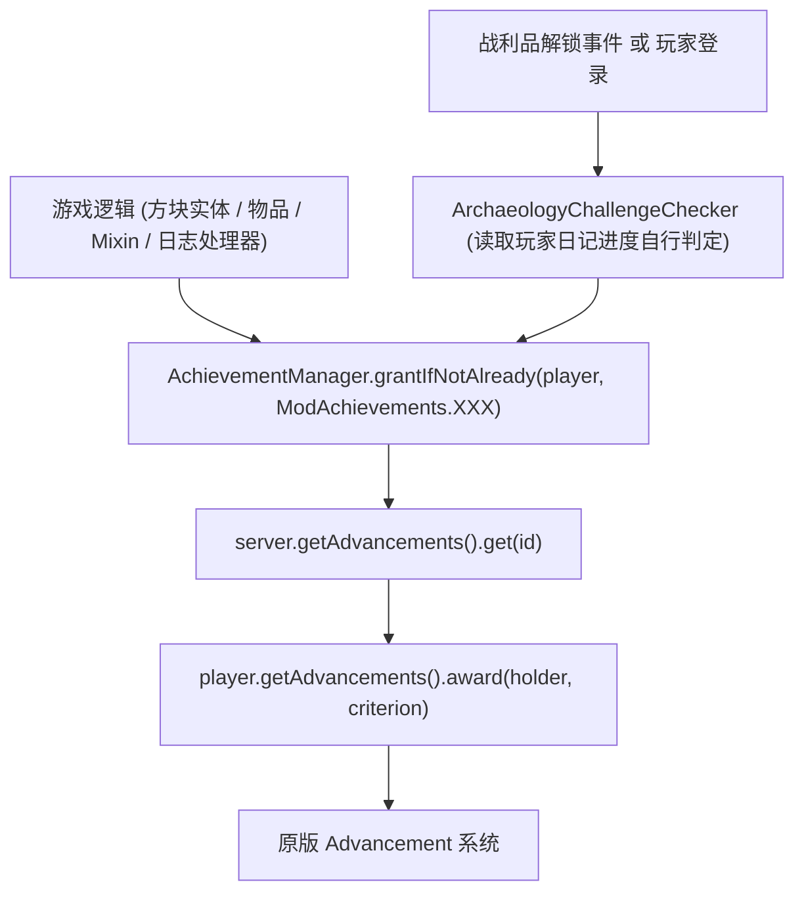
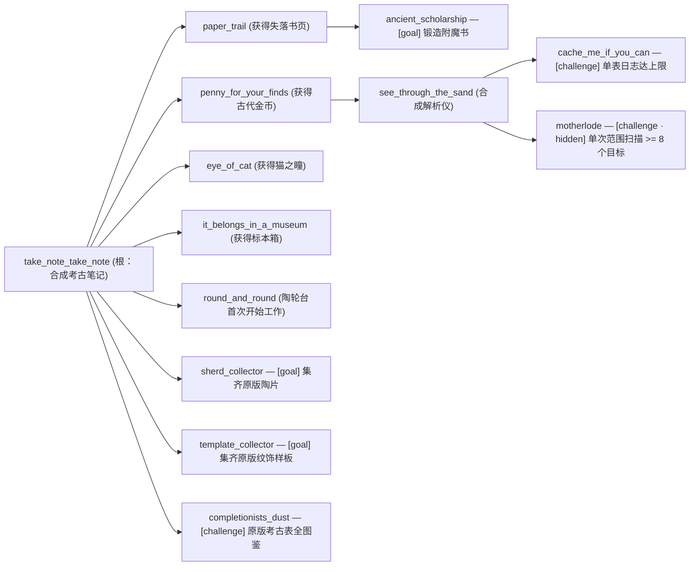

# 进度（成就）系统

> 手写进度 JSON 与代码授予桥，覆盖 `core/achievement/` 包、原版 Advancement 操作及考古收集类挑战判定。
> 玩家可见入口为原版进度树（`Esc` → 进度）及配方解锁提示。收集类进度依赖的玩家状态与目录见[考古笔记系统](journal.md)；文本与本地化键规范见[文本格式规范](../foundation/text-format.md)。

## 1. 代码地图

| 层 | 位置 |
|---|---|
| 进度数据 | `common/src/main/resources/data/unsuspiciousblock/advancement/`（`adventure/` 冒险分支、`challenges/` 挑战分支、`recipes/unsuspiciousblock/` 配方解锁） |
| 代码授予桥 | `core/achievement/AchievementManager.java`、`core/achievement/ModAchievements.java`、`core/achievement/ModAchievement.java` |
| 收集类判定器 | `core/journal/tracking/ArchaeologyChallengeChecker.java` |
| 代码授予调用点 | `PotteryWheelBlockEntity`、`SuspiciousReaderItem`、`SmithingMenuMixin`、`JournalLogHandler`、`ArchaeologyChallengeChecker` |
| 网络与平台差异 | 无（原版 Advancement API 在 Fabric 与 NeoForge 上完全一致，直接走原版同步） |
| Mixin | `core/mixin/container/SmithingMenuMixin.java`（仅用于授予 `ancient_scholarship`，见[Mixin 边界与接线](../foundation/mixin.md)） |

## 2. 数据流

### 2.1 代码授予路径

当缺少服务器实例或找不到对应 Advancement 时，`grant` 静默返回、`has` 返回 `false`；`grantIfNotAlready` 在确认此前未完成并尝试授予后返回 `true`。

### 2.2 考古进度树

`adventure/` 与 `challenges/` 共同组成玩家可见进度树；`recipes/unsuspiciousblock/` 下另有不配置 `display` 段的隐藏配方解锁进度，仅用于原版配方书提示，不参与进度树展示。

## 3. 关键类与触发方式

| 类 | 职责 |
|---|---|
| `ModAchievement` | 进度元数据接口：`path()` / `criterion()` / `id()` |
| `ModAchievements` | 仅收录**需要代码授予**的进度枚举（纯原版触发器驱动的进度如 `eye_of_cat`、`it_belongs_in_a_museum`、`see_through_the_sand` 由 JSON 自行触发，不入此枚举） |
| `AchievementManager` | 统一的进度授予与查询入口 |
| `ArchaeologyChallengeChecker` | 三项考古收集类挑战的实时与登录补发判定器 |

### 代码授予触发点对照

| 进度 | 调用类 | 判定条件 |
|---|---|---|
| `round_and_round` | `PotteryWheelBlockEntity` | 陶轮台首次**开始工作**（而非合成或放置），授予最近一次操作者 |
| `motherlode` | `SuspiciousReaderItem` | 单次范围扫描结果数量 >= 8 |
| `ancient_scholarship` | `SmithingMenuMixin` | 从锻造台取出失落书页锻造出的附魔书 |
| `cache_me_if_you_can` | `JournalLogHandler` | 任意单张战利品表的日志条目数达到上限 |
| `sherd_collector` / `template_collector` / `completionists_dust` | `ArchaeologyChallengeChecker` | 见下文收集类判定规则 |

## 4. 收集类进度的判定范围

`ArchaeologyChallengeChecker` 挂载于两个入口：战利品解锁事件（`LootTrackingBootstrap`）实时判定，以及玩家登录（`ArchaeologyJournalNetwork`）全量补发；若三项均已解锁则直接短路返回。

- **陶片 / 样板集齐**：目标范围取原版标签 `#minecraft:decorated_pot_sherds` 与 `#minecraft:trim_templates` 中**仅属于 `minecraft` 命名空间**的条目（忽略其他模组追加项）。每次判定实时读取标签以兼容 `/reload`，若标签尚未绑定（空集合）则跳过授予，防止空集被误判为「已集齐」。实际拥有基准读取玩家考古日记（`ArchaeologyJournalState`）中的 `LootResultSignature.plain(itemId)` 解锁记录。
- **原版考古全图鉴 (`completionists_dust`)**：范围取 `ArchaeologyJournalServerCatalog.staticTables()` 中前缀为 `minecraft:archaeology/` 的原版考古表（不依赖模拟 worker 进度）；须至少存在一张表，且每张表及其内含全部物品均已解锁至少一次。

## 5. 扩展点：新增进度

1. 在 `data/unsuspiciousblock/advancement/<adventure|challenges>/` 新建 JSON，设置 `parent`（根进度须提供 `display.background`）。
2. 若原版触发器（如 `inventory_changed`、`recipe_crafted`）可表达，直接写入 JSON `criteria.conditions`；否则写为 `minecraft:impossible`，在 `ModAchievements` 追加枚举项（路径与 criterion 键须与 JSON 完全一致），并在对应游戏逻辑调用 `AchievementManager.grantIfNotAlready(...)`。
3. 如属新的收集类挑战，在 `ArchaeologyChallengeChecker` 追加判定分支并复用现有两条入口。
4. 在 `en_us.json` 与 `zh_cn.json` 同步添加 `advancement.unsuspiciousblock.<文件名>` 与 `.desc`。

## 6. 约束与陷阱

- `grantIfNotAlready` 具有幂等性，重复调用安全；`grant` 不做前置查询。
- `minecraft:impossible` 进度**只能由代码授予**，数据包与命令触发均无效，新增时务必核对调用点已接线。
- **禁止改动已有进度的文件名或路径**：改名或移动会导致玩家旧存档中已解锁记录失效。
- **中文标题采用意译而非直译**：双关英文原名须按中文语感重写（如「私人博物馆」「吱悠~吱悠~」「好记性不如烂笔头」），新增文本前先遵循[文本格式规范](../foundation/text-format.md)。

## 7. 相关文档

- [考古笔记系统](journal.md)
- [战利品表系统](loottable.md)
- [文本格式规范](../foundation/text-format.md)
- [Mixin 边界与接线](../foundation/mixin.md)
