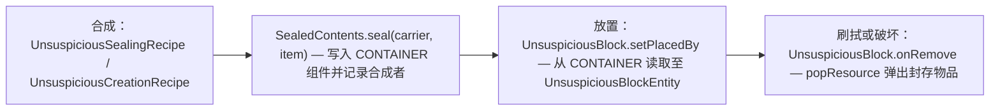
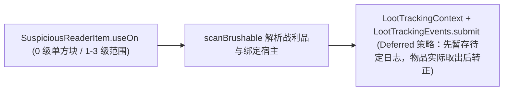
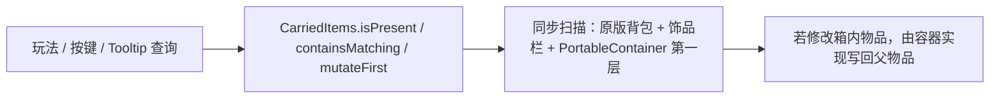

# 方块与物品

> `core/block/`、`core/blockentity/`、`core/item/`、`core/specimen/`、`core/pottery/`、`core/recipe/` 与 `core/inventory/` 包的架构：不可疑方块封存、制陶工作站、可疑解析仪与考古铲、标本箱便携代理、回溯粉与自定义配方。
> 本文件是上述内容的权威入口。通用清单注册模式见[注册架构](../foundation/registration.md)；淘盘变体与淘洗点系统见[淘洗系统](panning.md)；结构回溯的随机重放细节见[方块与物品机制细节](../internals/blocks-items-details.md)。

## 1. 代码地图

**方块与方块实体**

| 内容 | 类位置 | 角色 |
|---|---|---|
| 不可疑的沙子 / 沙砾 | `core/block/UnsuspiciousBlock` + `core/blockentity/UnsuspiciousBlockEntity` | 可放置的伪装可疑方块，封存玩家放入的物品，具重力与碎裂掉落 |
| 纹饰陶轮台 | `core/block/PotteryWheelBlock` + `core/blockentity/PotteryWheelBlockEntity` + `core/pottery/PotteryWheelMenu` | 制陶工作站，支持漏斗自动化 |
| 未烧制陶罐 | `core/block/UnfiredDecoratedPotBlock` + `core/blockentity/UnfiredDecoratedPotBlockEntity` | 携带四面纹饰数据的半成品方块 |
| 扫描与容器状态注入 | `ScanStateHost`、`BrushableBlockEntityScanState`、`TrackedContainerLootState`、`ContainerLootTracking`、`DecoratedPotLootState` | 注入原版方块实体与容器的鸭子接口及持久状态（见[Mixin 边界与接线](../foundation/mixin.md)） |

**物品**（统一登记在 `core/item/ModItems.REGISTRY_MANIFEST`）

| 物品 | 类位置 | 角色 |
|---|---|---|
| 可疑解析仪 | `core/item/SuspiciousReaderItem` | 扫描单方块/范围战利品与容器高亮，含能量系统 |
| 考古铲 | `core/item/ArchaeologicalShovelItem` | 直接取出已扫描战利品、向下连挖与潜行防误挖保护 |
| 淘盘（铜/金/黑曜石） | `core/item/PanItem` + `core/item/PanProfile` | 长按淘洗（详见[淘洗系统](panning.md)） |
| 考古笔记 | `core/item/ArchaeologyJournalItem` | 打开笔记 GUI 的无状态入口 |
| 猫之瞳 | `core/item/EyeOfCatItem` | 驱动附魔台候选揭示与铁砧/砂轮分解预览 |
| 猫之手 | `core/item/HandOfCatItem` | 绑定玩家 UUID 的猫族信物（详见[猫族关系系统](cat-favor.md)） |
| 标本箱 | `core/item/SpecimenBoxItem` | 5 格便携容器，代理箱内随身物品、图腾与饰品效果 |
| 回溯粉 | `core/item/RewindDustItem` | 在原位置重新放置世界生成结构 |
| 古代金币 / 失落书页 / 基页 / 花火粉 | `ModItems` 工厂返回 `Item` 或 `DescribedItem` | 货币、合成材料与燃料（`DescribedItem` 统一单行灰色简介） |

**数据资源与平台差异**

- **数据资源**：配方位于 `data/unsuspiciousblock/recipe/*.json`；模型、方块状态与语言文件位于 `assets/unsuspiciousblock/`。
- **网络与客户端**：扫描结果同步使用 `SyncReaderScanResultPayload`（见[网络与同步](../foundation/network.md)）；GUI、HUD 与模型渲染位于 `client/`（见[客户端与 GUI](client-ui.md)）。
- **平台差异**：花火粉燃料时间（Fabric `FuelRegistry` vs NeoForge `FurnaceFuelBurnTimeEvent`）；标本箱不死图腾代理（Fabric `ServerLivingEntityEvents.ALLOW_DEATH` vs NeoForge `LivingDeathEvent`）。

## 2. 核心数据流

### 2.1 不可疑方块封存（合成 → 放置 → 取出）

### 2.2 解析仪扫描与笔记追踪

### 2.3 便携容器携带检测

## 3. 关键类

| 类 | 职责 |
|---|---|
| `UnsuspiciousBlock` | 不可疑的沙子与沙砾共用实现，继承 `FallingBlock` + `EntityBlock` |
| `SealedContents` / `SealedContentsDisplay` | 封存物品与合成者读写（`seal` / `getSealedItem` / `recordCrafter`）；物品 Tooltip 与 Jade 共用的封存展示行 |
| `UnsuspiciousBlockInteractions` | 不可疑方块上的交互收敛点 |
| `SuspiciousReaderItem` | 能量管理、扫描等级、范围扫描与主副手协作 |
| `ArchaeologicalShovelItem` | 已扫描取物、向下连挖与沙砾掘金 |
| `PanItem` / `PanProfile` | 淘盘共同基类与三把盘的能力数据 |
| `SpecimenBoxItem` / `SpecimenBoxContents` / `SpecimenBoxMenu` / `SpecimenBoxTooltip` / `SpecimenBoxTotemProxy` | 标本箱本体、读写封装、5 格菜单、悬浮预览与图腾死亡代理 |
| `RewindDustItem` / `StructureRewindService` / `StructureRewindCooldownData` | 结构回溯入口、逐区块调度服务与维度冷却账本 |
| `PortableContainer` / `CarriedItems` | 便携容器第一层内容暴露接口与全携带范围查询入口 |
| `AncientCoinRepair` | 双端共用的古代金币铁砧修复计算逻辑 |
| `ModRecipeSerializers` | 4 个自定义配方序列化器注册清单 |

## 4. 不可疑方块与制陶系统

### 4.1 不可疑方块与封存

[`UnsuspiciousBlock`](../../../common/src/main/java/com/meteorite/unsuspiciousblock/core/block/UnsuspiciousBlock.java) 复制原版可疑沙子/沙砾的方块属性（`ofFullCopy`）与下落碎裂物理：

- **重力与数据保留**：`tick` 检测到下方为空时按沙子逻辑掉落；`setPlacedBy` 将物品 `CONTAINER` 组件同步到 `UnsuspiciousBlockEntity`，`onRemove` 弹出封存物品。
- **合成者记录**：`SealedContents.recordCrafter` 保存 `CrafterIdentity{uuid, name}`，用于解析仪展示“由谁封存”。

### 4.2 纹饰陶轮台与半成品

- **纹饰陶轮台**：`PotteryWheelBlock` 与 `PotteryWheelBlockEntity` 实现制陶工作站及漏斗自动化，由 `PotteryWheelMenu` / `PotteryWheelScreen` 提供界面与预览，`PotteryWheelRenderer` 渲染方块实体状态。
- **未烧制陶罐与陶片**：`UnfiredDecoratedPotBlock`（配 `UnfiredDecoratedPotItem` 与方块实体）及 `UnfiredDecoratedSherdItem` 承载四面纹饰数据，烧制后经 `UnfiredDecoratedPotSmeltingRecipe` / `UnfiredDecoratedSherdSmeltingRecipe` 转为成品。

## 5. 可疑解析仪与考古铲

### 5.1 可疑解析仪 (`SuspiciousReaderItem`)

能量与扫描等级存储在物品 `CUSTOM_DATA` 组件中（`MAX_ENERGY = 512`、`ENERGY_PER_COIN = 256`、`MAX_SCAN_LEVEL = 3`）：

- **扫描模式（`V` 键切换）**：`0` 级免费单方块查看内容；`1–3` 级以点击面反向偏移 `scanLevel` 格为中心扫描 `(2*level+1)^3` 立方体并高亮战利品容器，消耗 `等级数 + 新扫描可疑方块数` 点能量（已扫描过的不重复计费）。
- **充能与浪费保护**：耐久条按绿/黄/红显示电量，范围扫描能量不足时自动消耗背包古代金币充能（`tryRecharge`）；潜行右键空气手动充能时，若已损能量不足 `256`，先提示可能浪费并在 `20` tick 窗口内再次操作才强制确认。
- **主副手让位**：主手解析仪、副手考古铲面对**已扫描**的可疑方块时，`useOn` 开头识别并让位给副手取物（客户端须返回 `PASS` 以触发原版副手交互）。
- **扫描宿主与追踪接线**：`ScanStateHost` 统一查询、标记与清除；清除扫描身份时，普通与 Lootr 宿主丢弃 pending（Lootr 另清临时库存），封存宿主仅清身份；`BlockEntitySync` 统一标脏同步。`scanBrushable` 仅为 `PendingJournalHost` 以 `Deferred` 策略接入考古笔记（封存方块只扫描，不入待定日志）。

### 5.2 考古铲 (`ArchaeologicalShovelItem`)

- **直接取物与防误挖保护**：右键已由自己扫描的可疑方块立即取出战利品；普通左键挖掘可疑方块仅显示裂纹而无法破坏、也不触发连挖，**必须按住 Shift 潜行**才能单格破坏。
- **向下连挖与掘金**：非潜行挖掘沙子/红沙/砂砾等铲类方块时向下连挖最多 `3` 格，自动避开可疑方块及其下方支撑方块；挖掘沙子/红沙/砂砾有 `0.3%` 概率额外掉落古代金币。

## 6. 淘盘、标本箱与便携容器

- **淘盘 (`PanItem` + `PanProfile`)**：铜、金、黑曜石三把盘共享基类，差异全部由 `PanProfile` 声明（耐久、铁砧材料、可采变体集合、幸运加成与再生概率），通过能力交集判定保证不支持的组合直接让位原版；详情见[淘洗系统](panning.md)。
- **标本箱与 `CarriedItems`**：[`SpecimenBoxItem`](../../../common/src/main/java/com/meteorite/unsuspiciousblock/core/item/SpecimenBoxItem.java) 为 `5` 格便携容器（`SpecimenBoxContents` 封装 `CONTAINER` 读写，`SpecimenBoxTooltip` 提供悬停预览）。放于背包、饰品栏时，箱内**第一层**可随身生效物品（如考古笔记、猫之瞳、猫之手绑定、兼容 Artifacts 饰品）经 `CarriedItems` 纳入个人携带范围；箱内不死图腾经 `SpecimenBoxTotemProxy` 代理原版死亡保护（详情见[方块与物品机制细节](../internals/blocks-items-details.md)）。

## 7. 结构回溯 (`RewindDustItem`)

对世界生成结构的任意部件包围盒内方块右键，消费一份回溯粉（创造模式不消耗），由 `StructureRewindService` 在服务端逐区块（每 tick 一区块）重新放置整个结构（客户端仅预测交互；未命中结构、处于冷却或已有任务时均不消耗）。

> **重要语义**：结构回溯是重新运行结构放置而非历史快照，会覆盖玩家改建并重复生成战利品与实体。合成配方、双层冷却（物品 `20t` / 结构 `48000t`）、随机序列重放与行为边界详见[方块与物品机制细节](../internals/blocks-items-details.md)。

## 8. 其他材料物品与金币修复

`AncientCoinRepair.calculate` 统一计算古代金币铁砧修复（每枚恢复 `25%` 最大耐久、包含命名与 `REPAIR_COST`）：Fabric 经 `AnvilMenuMixin`、NeoForge 经 `LOW` 优先级 `AnvilUpdateEvent` 在原版未产出结果时写回。

| 物品 | 用途说明 |
|---|---|
| 古代金币 | 解析仪充能、铁砧万能修复、流浪商人交易（1 换 5 绿宝石）、猫猫商人货币 |
| 失落书页 / 基页 | 基页由瓶子草合成；两者与书在锻造台合成为随机附魔书（见[附魔系统](enchantment.md)） |
| 猫之手 | 绑定玩家 UUID 的猫族信物（见[猫族关系系统](cat-favor.md)） |
| 猫之瞳 | 置于背包、饰品栏或标本箱内激活附魔揭示与铁砧/砂轮成本分解 |
| 花火粉 | 2 火把花无序合成为 4 花火粉；作燃料可烧炼 `800t`（4 个物品）；与木棍合成 2 火把（**刻意不加入 `minecraft:coals` 标签**，防止被原版配方识别为煤炭而产出 4 个火把） |
| 考古笔记 | 右键或按 `C` 打开笔记 GUI（数据挂接于玩家存档而非物品自身） |

## 9. 自定义配方序列化器 (`ModRecipeSerializers`)

[`ModRecipeSerializers`](../../../common/src/main/java/com/meteorite/unsuspiciousblock/core/recipe/ModRecipeSerializers.java) 沿用「清单 + 回调」注册 4 个自定义合成/烧炼序列化器：

- **不可疑方块合成**：`UnsuspiciousCarrier`（`SAND` / `GRAVEL`）作为空方块制作（`UnsuspiciousCreationRecipe`）与封存（`UnsuspiciousSealingRecipe`）的共用载体；序列化器清单以 `(UnsuspiciousCarrier, CraftingKind)` 为键建立映射，初始化时校验重复与缺失组合，配方直接从同一映射获取对应序列化器。
- **制陶烧炼**：`UnfiredDecoratedPotSmeltingRecipe` 与 `UnfiredDecoratedSherdSmeltingRecipe` 保留独立注册以传递四面纹饰组件数据。
- **失落书页锻造**：不走此清单，由数据配方 `enchant_book_smithing.json` 与 `SmithingMenuMixin` 协同触发（见[附魔系统](enchantment.md)）。

## 10. 扩展点

- **新增物品 / 方块**：按[注册架构](../foundation/registration.md)在 `ModItems` / `ModBlocks` 清单添加一行。
- **新增便携容器**：实现 `PortableContainer` 接口提供第一层物品流与写回逻辑，`CarriedItems` 自动将其纳入查询范围。
- **新增封存方块**：参考 `UnsuspiciousBlock` 与 `SealedContents` 读写 `CONTAINER` 组件。
- **新增自定义配方序列化器**：实现 `RecipeSerializer` 并在 `ModRecipeSerializers` 清单登记，同步添加 `data/unsuspiciousblock/recipe/*.json`。
- **新增淘盘**：新增 `PanProfile` 并在 `ModItems` 选用 `Category.PAN`（见[淘洗系统](panning.md)）。

## 11. 约束与陷阱

- **花火粉禁止加入 `minecraft:coals` 标签**：否则会命中原版火把配方，导致火把产出翻倍。
- **考古铲必须潜行才能破坏可疑方块**：非潜行下仅显示裂纹而不完成破坏或连挖，属防误操作刻意设计。
- **淘盘 `canHarvest` 校验须三处一致**：起手、持续使用与结算必须共用能力交集判定。
- **结构回溯不是快照回档且不跨停服续跑**：任务仅驻留内存，停服即取消且已写入区块不回滚；会覆盖玩家建筑并重新产生容器/实体。

## 12. 相关文档

- [方块与物品机制细节](../internals/blocks-items-details.md)
- [注册架构](../foundation/registration.md)
- [考古笔记系统](journal.md)
- [战利品表系统](loottable.md)
- [淘洗系统](panning.md)
- [猫族关系系统](cat-favor.md)
- [附魔系统](enchantment.md)
- [客户端与 GUI](client-ui.md)
- [配置与第三方联动](../foundation/config-and-integrations.md)
