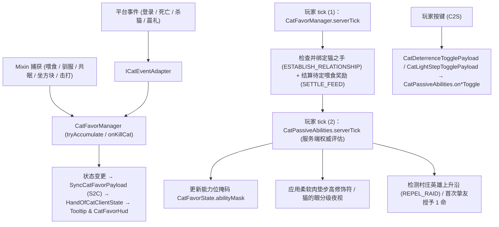
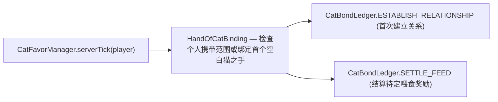
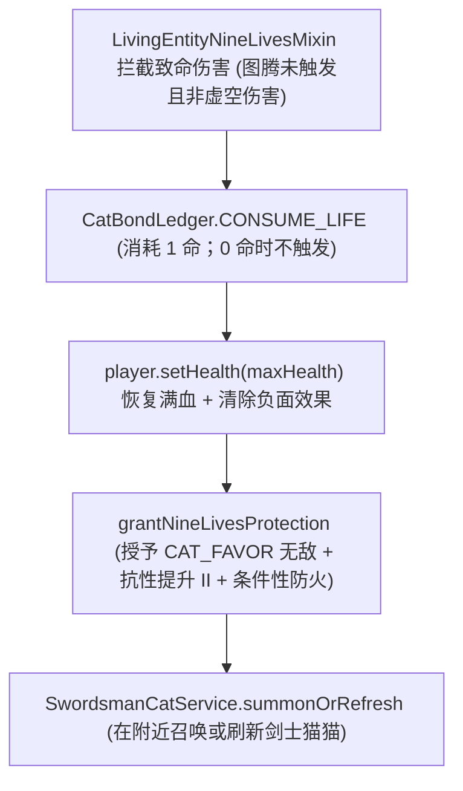
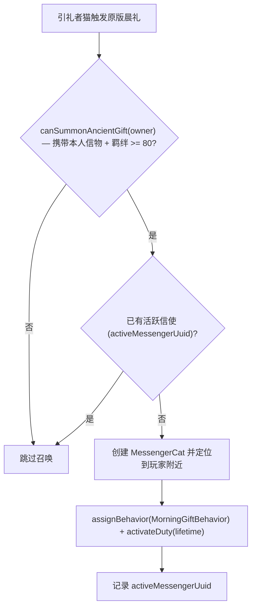

# 猫族关系系统

> `core/cat/` 包的架构：玩家与猫族长期关系的建立、羁绊累积与惩罚、猫之恩惠被动能力及灵体猫召唤服务。
> 本文件是猫族关系子系统的技术路线入口。行为数值与冷却、每 tick 被动评估与持久化字段见[猫族关系机制细节](../internals/cat-favor-mechanics.md)；灵体实体、AI 与世界结构见[实体与 AI](entities-world.md)；纯玩法规则与体验规格见[猫族关系规格](../../design/cat-bond.md)与[猫国灵体规格](../../design/spirit-cat-npc.md)。

## 1. 代码地图

| 层 | 位置 |
|---|---|
| 入口与管理器 | `core/cat/CatFavorManager.java`（消费账本变更、提示消息与状态同步） |
| 规则枚举 | `core/cat/CatFavorAction.java`（正负行为增量、冷却与惩罚标记）、`core/cat/CatFavorAbility.java`（恩惠与阶段绑定）、`core/cat/CatBondStage.java`（羁绊刻度与 HUD 颜色） |
| 被动能力中枢 | `core/cat/CatPassiveAbilities.java`（每 tick 评估位掩码与供 Mixin 查询的静态方法） |
| 灵体召唤服务 | `core/cat/CatGiftService.java`（猫国往礼）、`core/cat/SwordsmanCatService.java`（九命护卫）、`core/cat/SpiritCatDebugRegistry.java`（调试实体登记） |
| 猫猫商人 | `core/cat/merchant/`：`MerchantCatSpawner`、`MerchantCatTradeManager`、`MerchantCatTradeDefinition`、`MerchantCatTradePool`、`TaggedMerchantOffer`、`MerchantCatSpawnData` |
| 纯账本与状态 | `core/cat/state/CatBondLedger.java`（纯规则记账）、`CatFavorView`（只读视图）、`CatFavorState`（持久化状态）、`CatFavorStateHolder`（Mixin 接口） |
| 信物绑定 | `core/cat/HandOfCatBinding.java`（本人携带校验与首次绑定） |
| 网络处理 | `core/cat/CatNetworkHandler.java`；Payload 包括 `SyncCatFavorPayload`（S2C）、`CatDeterrenceTogglePayload` / `CatLightStepTogglePayload`（C2S） |
| 数据资源 | `data/unsuspiciousblock/merchant_cat_trades/*.json`、`data/unsuspiciousblock/loot_table/gameplay/cat/ghost_gift.json` |
| 客户端 | `client/hud/CatFavorHud`、`client/state/HandOfCatClientState`、`client/ui/toast/CatBondToast`、`core/item/HandOfCatItem` |
| Mixin | `core/mixin/catfavor/` 下的喂食、共眠、坐方块、驯服、苦力怕回避、幻翼威慑、轻步、摔落减伤与九命触发注入（清单见[Mixin 边界与接线](../foundation/mixin.md)） |
| 平台差异 | `platform/services/ICatEventAdapter`（SPI）由 `FabricCatEventAdapter` / `NeoForgeCatEventAdapter` 实现，接入玩家登录、死亡、杀猫与晨礼事件 |

## 2. 核心数据流

> **tick 内执行顺序约束**：`CatFavorManager.serverTick`（建立关系与喂食结算）**必须先于** `CatPassiveAbilities.serverTick` 执行，否则同 tick 刚建立的羁绊不会立即生效。

## 3. 关键类

| 类 | 职责 |
|---|---|
| `CatFavorManager` | 玩家侧记账入口：收集动作与游戏刻，调用 `CatBondLedger` 消费变更并发送提示与同步包 |
| `CatBondLedger` | 纯规则账本（不引用玩家、世界、网络或背包扫描）：处理目标去重、冷却、喂食队列、命数、偏好与调试变更 |
| `CatFavorAction` | 行为定义枚举（增量、独立冷却与惩罚属性） |
| `CatFavorAbility` | 恩惠枚举（解锁阶段与本地化键；**枚举声明顺序决定 Tooltip 展示顺序**） |
| `CatBondStage` | 羁绊刻度与 HUD 阶段色；按当前数值实时映射，不保存历史最高 |
| `CatPassiveAbilities` | 每 tick 评估并缓存位掩码，向 Mixin 提供低开销静态查询接口 |
| `CatGiftService` / `SwordsmanCatService` | 古国往礼（召唤猫猫信使）与九命保护（召唤/刷新剑士猫猫）服务 |
| `CatNetworkHandler` | 处理威慑与轻步 C2S 开关切换请求 |
| `CatFavorState` | 玩家持久化与瞬态状态载体；只读视图通过 `CatFavorView` 暴露 |
| `MerchantCatSpawner` / `MerchantCatTradeManager` / `TaggedMerchantOffer` | 服务端 tick 末尾驱动商人村庄生成、JSON 交易池加载及标签化随机商品支持 |

## 4. 关系建立与信物绑定

- **信物归属规则**：[`HandOfCatItem`](../../../common/src/main/java/com/meteorite/unsuspiciousblock/core/item/HandOfCatItem.java) 绑定玩家 UUID，他人可持有但无法使用或改绑；已随身携带本人信物时，新获得的空白信物保持未绑定以供转赠。
- **携带校验范围**：关系一旦建立后不依赖随身携带即可增减羁绊，但**猫之恩惠被动能力与灵体召唤要求本人猫之手位于个人携带范围内**。`HandOfCatBinding.hasOwned` 经 `CarriedItems.containsMatching` 统一检查背包、饰品栏与标本箱第一层（HUD 与服务端共用同一口径）。

## 5. 羁绊阶段与恩惠能力

[`CatBondStage`](../../../common/src/main/java/com/meteorite/unsuspiciousblock/core/cat/CatBondStage.java) 将 `0–100` 羁绊实时划分为 6 个阶段，[`CatFavorAbility`](../../../common/src/main/java/com/meteorite/unsuspiciousblock/core/cat/CatFavorAbility.java) 绑定对应阶段下界：

| 阶段 | 羁绊范围 | HUD 颜色 | 解锁恩惠 | 能力说明 |
|---|---|---|---|---|
| `ACQUAINTED`（初识） | `0–19` | 灰 | `CAT_EYE`（猫的眼） | 黑暗环境分级夜视 |
| `CLOSE`（亲近） | `20–39` | 绿 | `DETERRENCE`（猫之威慑） | 苦力怕回避 + 幻翼不生成/不索敌（含玩家开关） |
| `TRUSTED`（信赖） | `40–59` | 青 | `LIGHT_STEP`（轻步） | 不踩坏耕地、不触发压力板与绊线（含玩家开关） |
| `FAVORED`（眷顾） | `60–79` | 黄 | `SOFT_PAWS`（柔软肉垫） | 减免 80% 摔落伤害 + 步高提升（潜行取消） |
| `HONORED_GUEST`（猫国贵客） | `80–99` | 红 | `ANCIENT_GIFT`（猫国往礼） | 晨礼触发猫猫信使送来额外礼物 |
| `BEST_FRIEND`（猫国挚友） | `100` | 紫 | `NINE_LIVES`（猫之九命）+ 商人 | 储存命数抵挡致命伤害，并获得猫猫商人交易资格 |

## 6. 猫之九命与古国往礼

### 6.1 猫之九命 (`CatPassiveAbilities.triggerNineLives`)

- **命数规则**：首次成为猫国挚友授予 `1` 命；猫猫信使成功投放礼物时补充 `1` 命（上限 `9` 命）；**羁绊一旦跌破 `100`，全部残存命数立即清空**。每名玩家同时至多存在一只剑士猫猫（`activeSwordsmanUuid` 去重）。

### 6.2 古国往礼 (`CatGiftService.tryGhostGift`)

引礼者仅用于信使显现时的叙事注视，**配送目标始终为收礼玩家**；礼物取自数据驱动战利品表 `gameplay/cat/ghost_gift`，成功投放至少一件物品后结算，并在玩家仍处满值时补充 `1` 命（每名玩家同时最多一只信使）。灵体实体与 AI 细节见[实体与 AI](entities-world.md)。

## 7. 猫猫商人 (`core/cat/merchant/`)

- `MerchantCatSpawner` 在服务端 tick 末尾检查符合条件（羁绊 `100` 且携带本人信物）的玩家，尝试在其附近村庄生成商人（每维度至多一名）。
- `MerchantCatTradeManager` 从 `data/unsuspiciousblock/merchant_cat_trades/` 加载交易 JSON，`TaggedMerchantOffer` 支持 `#unsuspiciousblock:random/*` 包装 Tag（统一纳入 `c:` 通用标签）。商人全服共享库存，主要回收古代金币并限量供应高成本换币交易。

## 8. 扩展点

- **新增正向/惩罚行为**：在 `CatFavorAction` 添加枚举项（增量、冷却、惩罚标记），并在对应事件或 Mixin 调用 `CatFavorManager.tryAccumulate`。
- **新增恩惠能力**：在 `CatFavorAbility` 添加枚举（注意声明顺序即 Tooltip 顺序），在 `CatPassiveAbilities.serverTick` 实现效果；若供 Mixin 高频查询，按[猫族关系机制细节](../internals/cat-favor-mechanics.md)追加位掩码标志与静态查询方法。
- **新增灵体职责**：继承 `SpiritCat` 并注册到 `ModEntities`（预览实体同步登记到 `SpiritCatDebugRegistry`，见[实体与 AI](entities-world.md)）。
- **新增商人交易或调整时长**：在 `data/unsuspiciousblock/merchant_cat_trades/` 新增 JSON，或通过 `ISpiritCatConfig` 调整现世与保护时长。

## 9. 约束与陷阱

- **顺序约束**：同一 tick 内关系建立与喂食结算必须先于被动能力评估。
- **跌破 `100` 清空全部九命**：属核心关系设计，降到 `99` 时不保留历史命数。
- **偏好与 HUD 归属**：威慑与轻步开关保存于服务端玩家存档；猫之恩惠 HUD 始终按携带状态绘制，不设客户端隐藏开关。
- **高频 Mixin 查询必须走位掩码**：禁止在碰撞、耕地踩踏或 AI 索敌 Mixin 中直接遍历背包。
- **猫之手绑定不可覆盖**：他人信物不可接管，遗失后只能绑定新的空白信物。
- **猫之手结构自然生成当前停用**：自 `1.4.1` 起已停用自然生成（见[实体与 AI](entities-world.md)）。

## 10. 相关文档

- [猫族关系机制细节](../internals/cat-favor-mechanics.md)
- [本地持久化与数据迁移](../foundation/persistence.md)
- [实体与 AI](entities-world.md)
- [方块与物品](blocks-items.md)
- [网络与同步](../foundation/network.md)
- [Mixin 边界与接线](../foundation/mixin.md)
- [配置与第三方联动](../foundation/config-and-integrations.md)
- [客户端与 GUI](client-ui.md)
- [猫族关系规格](../../design/cat-bond.md)
- [猫国灵体规格](../../design/spirit-cat-npc.md)
