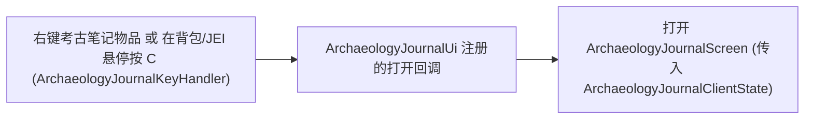
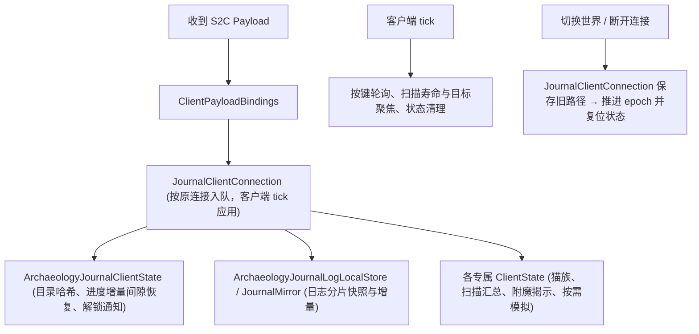

# 客户端与 GUI

> `client/` 包的架构：客户端生命周期与清单装配、客户端状态管理、HUD、实体与世界渲染、成本分解预览、附魔揭示展示、Toast 通知与按键绑定。
> 本文件是**客户端基础设施与公共表现层**的权威入口。考古笔记与管理界面的分层排版、输入路由、场景浮层与阅读状态持久化见[笔记 GUI 内部机制](../internals/journal-ui-internals.md)；UI Kit 消费边界见[UI kit 公开 API 与兼容策略](../internals/ui-kit-api.md)；猫族 HUD、淘洗动画与附魔揭示的服务端机制权威分别位于对应子系统文档。

## 1. 代码地图

| 层 | 位置 |
|---|---|
| 平台客户端入口 | `fabric/.../client/UnsuspiciousBlockFabricClient`、`neoforge/.../client/UnsuspiciousBlockNeoForgeClient` |
| 共享生命周期 | `client/ModClientLifecycle`（`install` / `tick` / `disconnect`） |
| 笔记 UI 入口与分层 | `client/ui/ArchaeologyJournalUi`、`JournalBookBackground`、`PotteryPreviewRenderer`；分层包 `client/ui/{entry,layout,panel,screen,support,toast,widget,tooltip,overlay,theme}/`（详情见[笔记 GUI 内部机制](../internals/journal-ui-internals.md)） |
| 独立 UI Kit | 消费 `com.meteorite.meteosuikit.api`；`client/ui/theme/` 提供宿主主题与皮肤 |
| 客户端业务状态 | `client/state/`：`ArchaeologyJournalKeyHandler`、`HandOfCatClientState`、`CatHandClientState`、`ReaderScanHudState`、`SuspiciousReaderClientState`、`ScenarioSimulationClientState`、`SimulationPreferenceStore`、`JournalHoveredItemProvider` |
| UI 侧状态 | `client/ui/support/`：`ArchaeologyJournalClientState`、`LootTableManagementClientState`、`ClientLootTableLanguageStore`、`JournalUiPreferencesStore`、`UiPanelRegistry` 等 |
| HUD 与模型 | `client/hud/`：`CatFavorHud`、`SuspiciousReaderHud`；`client/model/MessengerCatClothesModel`、`client/renderer/layer/` |
| 渲染器与世界渲染 | `client/renderer/`：`ModEntityRenderers`、`ModModelLayers`、各实体/方块实体渲染器、`SuspiciousReaderRangeHighlight`、`CatFavorShieldRenderer`、`ShimmerSurfaceRenderer`（见[淘洗系统](panning.md)） |
| 成本分解预览 | `client/anvil/`、`client/grindstone/`、`client/tooltip/BreakdownPreview` |
| 文本与 Tooltip 桥 | `core/text/TooltipBuilder`（语义色表见[文本格式规范](../foundation/text-format.md)）；`client/tooltip/ClientTooltipHooks` |
| 按键与网络 | `client/keybind/ModKeyBindings`；S2C 绑定清单 `client/network/ClientPayloadBindings`（见[网络与同步](../foundation/network.md)） |
| 客户端 Mixin | `client/mixin/`：`AbstractContainerScreenAccessor`、`EnchantmentScreenMixin`、`ClientLanguageMixin`、`HumanoidPanningMixin`；Fabric 专用 `client/mixin/fabric/ItemInHandPanningMixin` |
| 平台差异 | 按键注册（`KeyBindingHelper` vs `RegisterKeyMappingsEvent`）；GUI 按键事件（`ScreenKeyboardEvents` vs `ScreenEvent.KeyPressed.Pre`）；第一人称淘盘动画（Mixin vs `RenderHandEvent`）；世界/HUD 渲染阶段事件名 |

## 2. 数据流

### 2.1 考古笔记打开入口

### 2.2 状态同步与连接生命周期

## 3. 关键类

| 类 | 职责 |
|---|---|
| `ModClientLifecycle` | 双端共用的安装（Tooltip 桥、语言存储、淘洗表现、笔记打开器、通知回调）、tick 驱动与断连复位 |
| `ArchaeologyJournalClientState` | 服务端目录与玩家进度的客户端只读模型，以及解锁/完成/删除结果通知分发 |
| `JournalClientConnection` | 管理当前连接 `epoch`、日记本地镜像与偏好加载，按连接身份应用报文并丢弃迟到旧包 |
| `JournalUiPreferencesStore` | 按存档与玩家隔离持久化 UI 偏好和面板状态（`journal_ui_preferences.dat`） |
| `CatFavorHud` / `SuspiciousReaderHud` | 猫之恩惠 HUD；可疑解析仪扫描汇总与准星目标详情 HUD |
| `ReaderScanHudState` | 维护范围扫描结果、图标分组、聚焦目标及世界透视描边的单调时钟生命周期 |
| `ModKeyBindings` | 集中定义客户端按键绑定清单 |
| `BreakdownPreview` | 统一编排铁砧与砂轮成本分解行的容器登记清单 |

## 4. 客户端初始化与窄清单装配

双端客户端入口遵循对称职责，全部客户端能力均拆分为独立窄清单交由平台事件按阶段遍历注册（清单列表与遍历方法见[注册架构](../foundation/registration.md)）：

- 按键：`ModKeyBindings.MANIFEST`
- 渲染与模型：`ModEntityRenderers`、`ModBlockEntityRenderers`、`ModModelLayers`
- 界面与提示组件：`ModMenuScreens`、`ModTooltipComponents`
- HUD 与世界叠加层：`ModHudRenderers`、`ModWorldRenderers`
- S2C 接收器：`ClientPayloadBindings`

`ModClientLifecycle.install` 在初始化期安装 `ClientTooltipBridge` 能力实现与三条解锁/完成 Toast 回调。

## 5. 客户端状态管理

| 状态类 | 职责与生命周期 |
|---|---|
| `ArchaeologyJournalClientState` | 持有当前连接的目录、结构、进度、哈希与同步状态；`receiveCatalogHash` 比对不一致时请求全量目录；全量同步首次不弹 Toast，增量同步检测到 `incomingRevision > lastNotifiedRevision + 1` 时按 2 秒冷却请求全量重同步（`detectAndNotifyUnlocks` 仅对追踪目录内表触发） |
| `JournalUiPreferencesStore` | 管理排序、搜索、收藏、分组、右页选择与本次会话展开状态；切换连接先冻结并保存旧路径待写数据，再恢复默认值并加载新世界数据 |
| `ArchaeologyJournalLogLocalStore` / `JournalMirror` | 管理分片快照重组、序号递增增量合并与本地镜像持久化 |
| `LootTableManagementClientState` | 持有服务端战利品表索引、权限与自定义表名内存快照，断连时 `reset()` 清空 |
| `ClientLootTableLanguageStore` | 组合游戏资源语言、服务端内存表名与动态语言补充 |
| `SuspiciousReaderClientState` / `ReaderScanHudState` | 解析仪扫描等级切换、整批扫描汇总、目标聚焦与描边过期清理 |
| `HandOfCatClientState` / `CatHandClientState` | 缓存服务端同步的猫族羁绊/命数及快捷按键状态 |
| `EnchantmentRevealClientState` | 缓存服务端计算的附魔台完整候选列表 |
| `JournalHoveredItemProvider` / `ArchaeologyJournalKeyHandler` | 优先读取 JEI 悬停原料，否则读取容器槽位，以完整注册名预检后打开笔记搜索 |

> 笔记界面内部的页面组装（`RightPageContainer`、`ArchaeologyPage`）、输入焦点路由与偏好读写细则见[笔记 GUI 内部机制](../internals/journal-ui-internals.md)。

## 6. HUD 表现

### 6.1 猫之恩惠 HUD (`CatFavorHud`)

在快捷栏**左侧**渲染，数据来自 `SyncCatFavorPayload` 更新的 `HandOfCatClientState`：

- 展示取自 `UiAtlas.CAT_FAVOR_HUD` 的可染色猫爪图标、羁绊数值（带 `CatBondStage` 阶段语义色）与残存九命角标（`> 0` 时显示）。
- 羁绊未达封顶前图标按呼吸节拍调制透明度，并在单次绘制内部成对恢复渲染状态，不污染后续原版 HUD。

### 6.2 可疑解析仪 HUD (`SuspiciousReaderHud`)

采用**左下角扫描汇总**与**准星右下方目标详情**双面板设计，位置独立于 Jade HUD（不检测或隐藏 Jade）。按 `H` 键仅开关解析仪自身双面板及聚焦强调，不影响 Jade 或基础世界描边；打开其他 GUI 或按下 `F1` 时自动隐藏。

- **汇总面板**：每次新范围扫描整批替换旧结果，展示仍有效的可疑方块与容器总数。按物品 ID、展示名及封存来源分组后最多展示 `3` 组，其余组数与空方块数汇总于底部（空范围扫描同样发送 `SyncReaderScanResultPayload` 清空旧标记并显示“未发现目标”，不再刷屏聊天栏）。
- **目标详情**：仅主手或副手持可疑解析仪时显示；沿相机视线在 `32` 格内忽略表层沙子遮挡求交已扫描目标（优先最近目标，切换确认延迟 `100ms`）。显示物品/数量、距离及相对玩家脚部高度差（按需附封存者）；容器仅显示内容未知，不剧透箱内战利品。长物品名最多两行，数量保留在首行。
- **自适应布局与缓存**：两面板自适应宽度（最大 `180` GUI 像素，受可用窗口宽度约束），靠边向内收且小窗口重叠时优先保留目标详情。派生文本、测量宽度与矩形缓存在 `Snapshot.hud`（`HudLayout`）中，仅扫描内容、语言或窗口尺寸变化时重建；alpha 字节低于 `4` 时跳过绘制以避免原版字体渲染器强制回退不透明。
- **生命周期与世界描边**：扫描结果与透视描边共用 `10` 秒单调时钟寿命（淡入 `150ms`、淡出 `500ms`），持续注视目标可延长至整批最多 `30` 秒；跨维度、断连或每客户端 tick 检测到已加载区块内目标方块实体消失时即时清理（不强制加载未加载区块）。基础描边区分高透明青色（有物可疑方块）、弱灰色（空方块）与紫色（容器），聚焦目标追加浅色外框（线宽 `3` 像素，不写深度）。

## 7. 实体、方块实体与世界渲染

### 7.1 实体与装饰层

`ModEntityRenderers` 注册以下渲染器：

- **`SpiritCatRenderer` 基类**：统一 `MessengerCatRenderer`、`SwordsmanCatRenderer` 与 `MerchantCatRenderer` 的半透明悬浮、满光照与无阴影渲染配方，`alpha` 由 `SpiritCat.getRenderAlphaProgress` 控制。
- **装饰层姿态同步 (`MessengerCatClothesModel`)**：`MessengerCatRenderer` 在保留睡眠偏移的同时叠加 `MessengerCatCollarLayer` 与 `MessengerCatClothesLayer`；装饰模型与原版 `CatModel` 共享同一烘焙根部件，每帧通过 `ModelPart.copyFrom` 拷贝头部、身体与四肢姿态，搭配独立 64×64 贴图绘制。
- **其他实体**：`LanternPetRenderer`（灵魂提灯宠物）、`ShimmerRenderer`（空实现占位，淘洗波光由世界渲染阶段接管）。

### 7.2 方块实体与世界渲染 (`ModWorldRenderers`)

- **方块实体**：`PotteryWheelRenderer` 渲染纹饰陶轮台上的旋转坯体与完成态预览。
- **世界半透明后渲染**：`ModWorldRenderers` 在 Fabric `AFTER_TRANSLUCENT` 与 NeoForge `AFTER_TRANSLUCENT_BLOCKS` 阶段依次绘制：`SuspiciousReaderRangeHighlight`（范围扫描描边）→ `CatFavorShieldRenderer`（保护罩）→ `ShimmerSurfaceRenderer`（淘洗水面波光）。所有专用 `RenderType` 集中管理在 `ModRenderTypes` 中，明确隔离深度测试、深度写入与面剔除状态。

## 8. 成本分解、附魔揭示与 Toast

- **铁砧 / 砂轮成本分解**：`client/anvil/` 与 `client/grindstone/` 各自维护独立的计算器与行构建器；共用编排（持有检测、通用行拼接与容器槽位登记清单）集中于 [`BreakdownPreview`](../../../common/src/main/java/com/meteorite/unsuspiciousblock/client/tooltip/BreakdownPreview.java)，平台在 Tooltip 事件中调用 `BreakdownPreview.appendRegistered`，仅当玩家个人携带范围内存在**猫之瞳**时追加分解说明。
- **附魔揭示展示**：客户端仅做展示，`EnchantmentRevealClientState` 接收服务端通过 `SyncEnchantmentRevealListPayload` 下发的完整候选列表，`EnchantmentScreenMixin` 反推悬停槽位后交由 `EnchantmentRevealTooltipBuilder` 绘制（机制权威见[附魔系统](enchantment.md)）。
- **Toast 通知**：`JournalUnlockToast`（表解锁、物品解锁、100% 完成奖励）与 `CatBondToast`（猫族羁绊阶段变化）均基于 UI Kit 面板、文本裁剪与图标组件构建，保留原有队列合并、轮换与时长控制；标本箱富 Tooltip 同样基于 UI Kit 绘制并遵守 `ClientTooltipComponent` 生命周期。

## 9. 按键绑定 (`ModKeyBindings`)

| 用途 | 默认键位（以代码为准） | 接入方式 |
|---|---|---|
| 切换可疑解析仪扫描等级 | `V` | 客户端 tick 检测 |
| 打开考古笔记；在背包或 JEI 物品上按注册名搜索 | `C` | tick + GUI 内键盘事件（`ScreenKeyboardEvents` / `ScreenEvent.KeyPressed.Pre`） |
| 开关猫之威慑 | 未绑定 | 发送 C2S Payload 至 `CatPassiveAbilities` |
| 开关轻步 | 未绑定 | 发送 C2S Payload 至 `CatPassiveAbilities` |
| 开关可疑解析仪 HUD | `H` | 客户端 tick 检测 |

## 10. 扩展点

- **新增渲染器 / 模型层 / HUD / 按键**：在对应窄清单（`ModEntityRenderers`、`ModModelLayers`、`ModBlockEntityRenderers`、`ModHudRenderers`、`ModWorldRenderers`、`ModKeyBindings.MANIFEST`）登记条目；HUD 在自身实现类持有显示门禁。
- **新增 Tooltip 成本分解**：在 `BreakdownPreview` 登记容器与槽位映射，取色统一使用 `TooltipBuilder`（见[文本格式规范](../foundation/text-format.md)）。
- **新增 Toast 通知**：参考 `JournalUnlockToast`，在对应客户端状态类登记触发回调并在 `ModClientLifecycle.install` 装配。
- **新增 GUI 面板、列表、模态或容器自有交互**：在 `client/ui/panel/` 实现并遵循 UI Kit 契约与唯一 `UiInputRouter`（详见[笔记 GUI 内部机制](../internals/journal-ui-internals.md)与[UI kit 公开 API 与兼容策略](../internals/ui-kit-api.md)）。

## 11. 约束与陷阱

- **严格物理端隔离**：`core` 与公共 `platform` 严禁静态引用 `client/` 下的任何类；物品/方块需要读取客户端能力（Shift 按键、打开笔记界面、猫族客户端缓存）时，必须通过 `core/text/ClientTooltipBridge` 调用由客户端入口安装的桥接实现。
- **禁止逐帧重建 UI 节点树**：文档与投影缓存随目录版本、语言、字体或尺寸变化失效，避免每帧重复排版。
- **唯一输入所有权与焦点隔离**：当前顶层 `UiInputScope` 独占焦点与持续交互会话（如拖动/按压），切域、隐藏或关屏时必须由作用域结清会话，禁止维护第二套平行输入分发。
- **超宽文本与取色**：交互区使用滚动或完整 Tooltip，非交互行使用省略号裁剪；Tooltip 取 `TooltipBuilder`，自绘界面取 `UiTextScheme` 与 `JournalTextColors`。

## 12. 相关文档

- [笔记 GUI 内部机制](../internals/journal-ui-internals.md)
- [UI kit 公开 API 与兼容策略](../internals/ui-kit-api.md)
- [UI 图标与控件皮肤图集](../internals/toolbar-icon-atlas.md)
- [文本格式规范](../foundation/text-format.md)
- [架构总览](../foundation/architecture.md)
- [网络与同步](../foundation/network.md)
- [注册架构](../foundation/registration.md)
- [考古笔记系统](journal.md)
- [战利品表系统](loottable.md)
- [猫族关系系统](cat-favor.md)
- [附魔系统](enchantment.md)
- [淘洗系统](panning.md)
