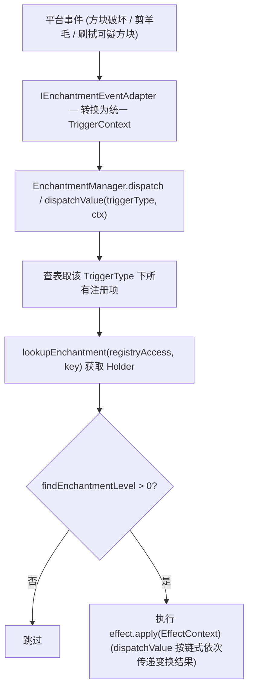
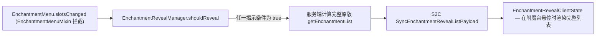
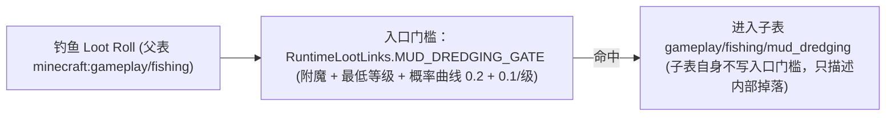
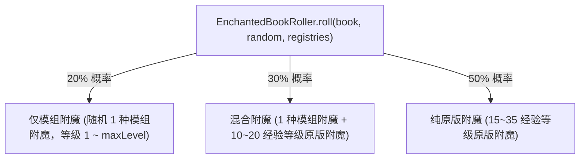

# 附魔系统

> `core/enchantment/` 包的架构：数据驱动附魔定义、统一效果调度框架、泥底打捞条件注入、失落书页锻造随机池及猫之瞳附魔台揭示。
> 本文件是附魔子系统的权威入口。Mixin 注入点见[Mixin 边界与接线](../foundation/mixin.md)；平台事件 SPI 见[平台抽象](../foundation/platform-spi.md)。

## 1. 代码地图

| 层 | 位置 |
|---|---|
| 附魔数据 | `data/unsuspiciousblock/enchantment/*.json`（1.21 数据驱动附魔定义） |
| 附魔 Key | `core/enchantment/ModEnchantments.java`（4 个 `ResourceKey<Enchantment>`） |
| 效果框架 | `core/enchantment/framework/`：`EnchantmentManager`、`EnchantmentEffects`、`effect/`、`trigger/`、`builtin/`（`FossilHunterEffect`、`TextileRecoveryEffect`、`PrecisionExcavationEffect`） |
| 平台事件适配 | `platform/services/IEnchantmentEventAdapter.java`；由 `FabricEnchantmentEventAdapter` 与 `NeoForgeEnchantmentEventAdapter` 实现 |
| 泥底打捞门槛 | `core/loottable/condition/ToolEnchantmentCondition.java` + `core/loottable/graph/RuntimeLootLinks.java` |
| 失落书页锻造 | `core/enchantment/EnchantedBookRoller.java`；配方 `data/unsuspiciousblock/recipe/enchant_book_smithing.json` |
| 附魔揭示 | `core/enchantment/reveal/`：`EnchantmentRevealManager`、`EnchantmentRevealConditions`、`IEnchantmentRevealCondition` |
| 客户端展示 | `client/enchantment/EnchantmentRevealClientState.java`、`client/mixin/EnchantmentScreenMixin` |
| 网络 | `SyncEnchantmentRevealListPayload`（见[网络与同步](../foundation/network.md)） |
| Mixin | `core/mixin/enchantment/EnchantmentMenuMixin`、`core/mixin/container/SmithingMenuMixin`、`client/mixin/EnchantmentScreenMixin`；Fabric 端另有 `platform/mixin/interaction/{BrushableBlockEntityMixin,SheepMixin}` |

## 2. 核心数据流

### 2.1 效果框架（副作用与值变换）



### 2.2 附魔揭示（猫之瞳）



### 2.3 泥底打捞（条件注入，不走效果框架）



## 3. 关键类

| 类 | 职责 |
|---|---|
| `ModEnchantments` | 集中定义 4 个附魔的 `ResourceKey` |
| `EnchantmentManager` | 调度中枢，维护按 `TriggerType` 分组的 `EFFECT_REGISTRY` 与 `VALUE_EFFECT_REGISTRY` |
| `EnchantmentEffects` | 内建效果集中注册入口，由 `UnsuspiciousBlockCommon.init()` 调用 |
| `EnchantmentEffect` / `EnchantmentValueEffect<T>` | 副作用接口（`void apply`）与值变换接口 |
| `TriggerType` / `TriggerContext` / `EffectContext<T>` | 触发类型、触发上下文与执行效果上下文 |
| `FossilHunterEffect` / `TextileRecoveryEffect` / `PrecisionExcavationEffect` | 化石猎手（`BLOCK_BREAK`）、织物采集（`ENTITY_SHEAR`）、精准发掘（`BRUSH_ITEM_DROP`） |
| `EnchantedBookRoller` | 失落书页锻造随机附魔生成（仅服务端运行） |
| `EnchantmentRevealManager` | 附魔揭示条件注册表与综合判定 |
| `EnchantmentRevealClientState` | 接收并缓存附魔台完整候选列表 |

## 4. 数据驱动附魔定义

[`ModEnchantments`](../../../common/src/main/java/com/meteorite/unsuspiciousblock/core/enchantment/ModEnchantments.java) 仅持有以下 4 个 `ResourceKey<Enchantment>`，具体属性（适用物品、稀有度、最大等级与互斥 Tag）完全定义在 `data/unsuspiciousblock/enchantment/*.json` 中，运行期经 `RegistryAccess` 查找 `Holder<Enchantment>`：

| Key | 附魔名称 | 适用工具 | 实现机制 |
|---|---|---|---|
| `mud_dredging` | 泥底打捞 I–III | 钓鱼竿 | 战利品表条件注入 |
| `textile_recovery` | 织物采集 | 剪刀 | 效果框架（副作用） |
| `precision_excavation` | 精准发掘 I–III | 刷子 | 效果框架（值变换） |
| `fossil_hunter` | 化石猎手 | 镐 | 效果框架（副作用） |

## 5. 效果框架与内建附魔

[`TriggerType`](../../../common/src/main/java/com/meteorite/unsuspiciousblock/core/enchantment/framework/trigger/TriggerType.java) 目前包含三种触发类型，在 [`EnchantmentEffects.registerAll`](../../../common/src/main/java/com/meteorite/unsuspiciousblock/core/enchantment/framework/EnchantmentEffects.java) 中注册绑定：

```java
EnchantmentManager.register(BLOCK_BREAK, FOSSIL_HUNTER, new FossilHunterEffect());
EnchantmentManager.register(ENTITY_SHEAR, TEXTILE_RECOVERY, new TextileRecoveryEffect());
EnchantmentManager.registerValueEffect(BRUSH_ITEM_DROP, PRECISION_EXCAVATION, new PrecisionExcavationEffect());
```

平台事件经 SPI 接口 [`IEnchantmentEventAdapter`](../../../common/src/main/java/com/meteorite/unsuspiciousblock/platform/services/IEnchantmentEventAdapter.java) 统一转换为 `TriggerContext` 后交给调度器。

### 5.1 化石猎手 (`FossilHunterEffect`)

破坏方块事件到达 [`FossilHunterEffect`](../../../common/src/main/java/com/meteorite/unsuspiciousblock/core/enchantment/framework/builtin/FossilHunterEffect.java) 后按以下顺序结算：

1. 仅响应骨块（Bone Block）破坏；
2. 调用 `NaturalBoneBlockTracker.consumeNatural` **消费自然生成标记**（无论后续是否命中奖励都必须清除标记）；
3. 排除创造模式、关闭方块掉落、非自然生成（玩家或机器放置的骨块不触发）与 `50%` 未命中分支；
4. `rollExtraLoot` 按维度选择 `overworld_bone_block` 或 `nether_bone_block` 战利品表，构造 `BLOCK` 参数集的 `LootParams`，并通过 `LootTrackingContext.root(..., FOSSIL_HUNTER, ...)` 与 `LootTrackingEvents.submit(..., immediate())` 结算产出并自动解锁考古笔记。

### 5.2 织物采集与精准发掘

- **`TextileRecoveryEffect`**：剪羊毛时额外掉落 `1–3` 根线（副作用）。
- **`PrecisionExcavationEffect`**：刷拭可疑方块出物时，按等级（`28%` / `44%` / `60%`）使本次掉落列表翻倍（值变换）。

## 6. 泥底打捞（条件注入）

泥底打捞**不通过效果框架触发**，而是在钓鱼抽取时通过自定义条件 [`ToolEnchantmentCondition`](../../../common/src/main/java/com/meteorite/unsuspiciousblock/core/loottable/condition/ToolEnchantmentCondition.java) 注入额外掉落（底层机制见[战利品表系统](loottable.md)的「自定义条件」一节）：

- **单一入口声明**：Fabric 的 `FishingLootInjection` 与 NeoForge 的 `FishingLootModifier` 共用 `RuntimeLootLinks.MUD_DREDGING_GATE`（绑定附魔、最低等级 `1` 及概率曲线 `0.2 + 0.1/级`），GLM 数据仅保留 `loot_table_id` 过滤，确保玩法逻辑与笔记展示严格同源。
- **哈希与分支职责**：`injectionGateEnchantments` 记录在发起注入的父表上，确保修改附魔 `max_level` 时关联父表缓存自动失效；开放水域与沼泽群系分支条件（`entity_properties` 与 `#c:is_swamp`）保留在子表 `gameplay/fishing/mud_dredging` 的条目上，因此展示为「需要条件」。
- **时序前提**：`ToolEnchantmentCondition` 类型必须在 `UnsuspiciousBlockCommon.init()` 之前注册完成（见[架构总览](../foundation/architecture.md)）。

## 7. 失落书页锻造 (`EnchantedBookRoller`)

玩家在锻造台放入**基页 + 书 + 失落书页**（数据配方 `enchant_book_smithing.json` 产出带 `unsuspiciousblock_pending_enchant` 标记的临时附魔书），取出成品时由 `SmithingMenuMixin` 拦截并调用服务端的 `EnchantedBookRoller.roll` 写入随机附魔（写入 `STORED_ENCHANTMENTS`，不经过 `ModRecipeSerializers`）：



原版附魔从 `EnchantmentTags.IN_ENCHANTING_TABLE` 池中抽取（以普通书作为探针调用 `EnchantmentHelper.selectEnchantment` 以接受全部附魔台可用附魔）。

## 8. 附魔揭示（猫之瞳）

- **服务端权威**：完整附魔候选列表由服务端计算并通过网络包下发，客户端仅缓存渲染，防止双端 `RegistryAccess` 差异引起预测不一致。
- **条件扩展**：[`EnchantmentRevealConditions.register`](../../../common/src/main/java/com/meteorite/unsuspiciousblock/core/enchantment/reveal/EnchantmentRevealConditions.java) 默认注册“个人携带范围（含标本箱/饰品栏）存在猫之瞳”条件；外部可通过 `EnchantmentRevealManager.registerCondition` 注册更多揭示条件。
- 猫之瞳驱动的铁砧与砂轮成本分解预览见[客户端与 GUI](client-ui.md)。

## 9. 扩展点

- **新增附魔**：在 `data/unsuspiciousblock/enchantment/` 添加定义 JSON → 在 `ModEnchantments` 添加 `ResourceKey` → 同步补充 `en_us.json` 与 `zh_cn.json`（遵循[文本格式规范](../foundation/text-format.md)）。
- **新增附魔效果**：实现 `EnchantmentEffect` 或 `EnchantmentValueEffect<T>` 并在 `EnchantmentEffects.registerAll` 注册；如需新触发时机，先在 `TriggerType` 新增枚举并在 Fabric/NeoForge 双端 `IEnchantmentEventAdapter` 接入对应事件。
- **新增附魔揭示条件**：实现 `IEnchantmentRevealCondition` 并向 `EnchantmentRevealManager.registerCondition` 登记。
- **调整失落书页分布**：修改 `EnchantedBookRoller.roll` 的概率分支与经验等级范围。

## 10. 约束与陷阱

- **附魔数值属性保留在数据包**：代码层仅持有 `ResourceKey`，禁止在 Java 代码中硬编码附魔等级上限或互斥列表。
- **新触发类型必须双端接入**：缺一端事件适配会导致该附魔在对应 Loader 下完全失效。
- **泥底打捞不走效果框架**：任何钓鱼相关改动均面向 `RuntimeLootLinks` 与 `ToolEnchantmentCondition`，不要往 `EnchantmentManager` 写入钓鱼分支。
- **修改附魔上限会使笔记缓存失效**：`max_level` 参与战利品表内容哈希计算，改动后关联表重新模拟属正常设计行为。

## 11. 相关文档

- [战利品表系统](loottable.md)
- [考古笔记系统](journal.md)
- [实体与 AI](entities-world.md)
- [网络与同步](../foundation/network.md)
- [客户端与 GUI](client-ui.md)
- [Mixin 边界与接线](../foundation/mixin.md)
