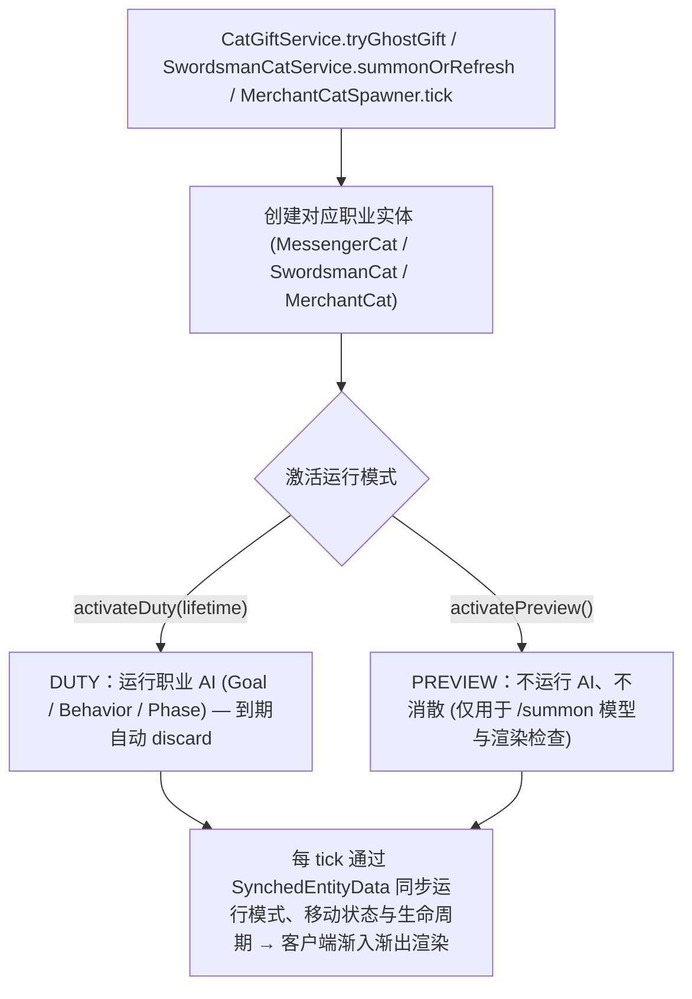
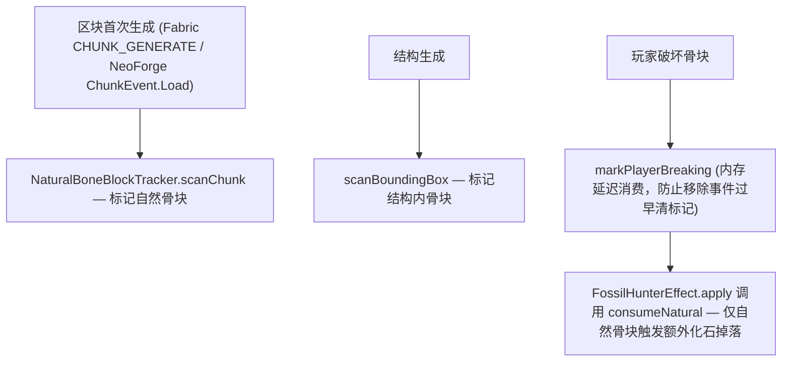

# 实体与 AI

> `core/entity/` 与 `core/world/` 包的实体架构：猫国灵体基类与三种职业实体、灵体 AI 框架、灵魂提灯宠物、自然骨块追踪及猫之手结构。
> 本文件是上述实体的权威入口。淘洗点实体 `ShimmerEntity` 归属[淘洗系统](panning.md)；`core/world/` 下属笔记与战利品的持久化类仅在此作包索引，机制权威见对应子系统文档。

## 1. 代码地图

| 层 | 位置 |
|---|---|
| 灵体基类与职业 | `core/entity/SpiritCat.java`（继承原版 `Cat`）、`MessengerCat.java`、`SwordsmanCat.java`、`MerchantCat.java` |
| 其他实体 | `core/entity/LanternPet.java`（独立宠物）；`WaterShimmerEntity` / `GlimmerEntity` / `ShimmerEntity`（见[淘洗系统](panning.md)） |
| 灵体 AI | `core/entity/ai/spiritcat/`：`SpiritRunMode`、`SpiritCatRole`、`SpiritMovementState`、`SpiritFlightController`、各职业 `*Phase`、`MessengerCatBehavior`、`MorningGiftBehavior`、`MessengerCatGiftGoal`、`MessengerCatPositioning` |
| 宠物 AI | `core/entity/ai/lantern/`：`LanternPetFollowSoulCarrierGoal`、`LanternPetWanderGoal` |
| 注册 | `core/entity/ModEntities.java`（`REGISTRY_MANIFEST` 清单见[注册架构](../foundation/registration.md)）、`core/entity/EntityRegistrar.java` |
| 自然骨块追踪 | `core/world/NaturalBoneBlockTracker.java`（静态门面）、`platform/services/IBoneBlockTracker.java`（SPI） |
| 世界结构与生成 | `data/unsuspiciousblock/structure/hand_of_cat_cache.nbt`、`worldgen/{structure,template_pool}/hand_of_cat_cache.json`、`tags/worldgen/biome/has_structure/` |
| 客户端渲染 | `client/renderer/`（`ModEntityRenderers` / `ModModelLayers`、各职业渲染器、`ShimmerSurfaceRenderer`）、`client/model/MessengerCatClothesModel`、`client/renderer/layer/` |
| 网络 | 无专属 Payload（灵体不保存、不跨会话同步，运行态走 `SynchedEntityData`） |
| Mixin | `StructureTemplateMixin`（结构生成骨块扫描）；Fabric 骨块追踪使用 `platform/mixin/chunk/{ChunkAccess,ChunkSerializer,LevelChunk}Mixin` |
| 平台差异 | 骨块追踪：Fabric 使用 Mixin + 区块事件；NeoForge 使用 `DataAttachment`（`NeoForgeBoneBlockTracker`） |

## 2. 核心数据流

### 2.1 猫国灵体生命周期（召唤 → 职责 → 消散）



### 2.2 自然骨块追踪



## 3. 关键类

| 类 | 职责 |
|---|---|
| `SpiritCat` | 猫国灵体抽象基类，统一运行模式、生命周期、无重力飞行与无碰撞物理边界 |
| `MessengerCat` / `SwordsmanCat` / `MerchantCat` | 信使、剑士与商人三种职责实体 |
| `LanternPet` | 独立灵魂提灯飞行宠物（继承 `PathfinderMob`，非灵体体系） |
| `SpiritRunMode` | 运行模式枚举（`PREVIEW` / `DUTY` / `DEBUG_DUTY`） |
| `SpiritCatRole` | 职业标识枚举，供调试指令、槽位绑定与筛选共用（`matches(SpiritCat)` 基于 `instanceof`） |
| `SpiritFlightController` / `SpiritMovementState` | 灵体飞行控制器与离散移动状态（仅状态改变时触发同步） |
| `*Phase` | `MessengerCatPhase` / `SwordsmanCatPhase` / `MerchantCatPhase` 职业行为阶段枚举 |
| `NaturalBoneBlockTracker` / `IBoneBlockTracker` | 屏蔽平台存储差异的自然骨块追踪门面与 SPI |

## 4. 猫国灵体基类 (`SpiritCat`)

[`SpiritCat`](../../../common/src/main/java/com/meteorite/unsuspiciousblock/core/entity/SpiritCat.java) 继承原版 `Cat`，定义三种职业实体的共性能力：

- **三种运行模式**：
  - `PREVIEW`（`activatePreview()`）：原版 `/summon` 默认模式，不运行 AI 且永不自动消散；
  - `DUTY`（`activateDuty(lifetime)`）：正常运行职责 AI，达到 `expiresAtGameTime` 后 `discard()`；
  - `DEBUG_DUTY`（`activateDebugDuty(lifetime)`）：运行调试职责 AI，不受正式最长现世时间语义限制。
- **生命周期与渐隐**：`getRenderAlphaProgress(partialTick)` 实现显现 `10 tick` 渐入与消散前 `15 tick` 渐出；`shouldBeSaved()` 返回 `false`（不随正常区块存档保存，但保留 `addAdditionalSaveData` / `readAdditionalSaveData` 以兼容旧数据迁移）。
- **飞行与交互免疫**：`isNoGravity()` 恒为 `true`，`travel()` / `move()` 仅在职责模式生效；信使默认启用 `clampToSpawnHeight()` 防止穿墙沉底（需追击低处目标的子类可显式关闭）。禁用推挤、流体/活塞推动、普通伤害（`hurt` 返回 `false`）、命名、拴绳、骑乘与维度传送。
- **同步优化**：`setSpiritMovementState` 仅在离散状态变更时更新 `SynchedEntityData`。

## 5. 三种灵体职业与 AI 框架

| 职业 | 核心职责 | 召唤者 | 数量上限与槽位规则 |
|---|---|---|---|
| 猫猫信使 (`MessengerCat`) | 向羁绊 `>= 80` 玩家配送古国往礼 | `CatGiftService.tryGhostGift` | 每玩家至多一只 |
| 剑士猫猫 (`SwordsmanCat`) | 九命触发时护卫主人并主动迎战敌对生物 | `SwordsmanCatService.summonOrRefresh` | 每玩家至多一只（再次触发刷新寿命而不重叠） |
| 猫猫商人 (`MerchantCat`) | 挚友阶段在附近村庄提供全服共享库存交易 | `MerchantCatSpawner.tick(server)` | 每维度 `ServerLevel` 至多一只（在村庄中心活动，不跟随玩家） |

- **职业特征与渲染**：`MessengerCat` 由 `MessengerCatGiftGoal` 与 `MessengerCatPositioning` 驱动，送礼成功调用 `CatFavorManager.onMessengerGiftDelivered` 补命；渲染叠加「邮差帽 + 邮包」装饰层。`SwordsmanCat` 通过 `configureProtection` 与 `notifyOwnerHurt` 绑定保护目标与优先仇恨来源，使用灵体半透明渲染。`MerchantCat` 交易池由 `MerchantCatTradeManager` 加载。
- **AI 与调试基础设施**：`ai/spiritcat/` 提供通用的 `SpiritFlightController`、状态机阶段与行为基类；调试指令对应的实体注册由 [`SpiritCatDebugRegistry`](../../../common/src/main/java/com/meteorite/unsuspiciousblock/core/cat/SpiritCatDebugRegistry.java) 统一管理。详细玩家可见规则见[猫国灵体规格](../../design/spirit-cat-npc.md)。

## 6. 灵魂提灯宠物 (`LanternPet`)

[`LanternPet`](../../../common/src/main/java/com/meteorite/unsuspiciousblock/core/entity/LanternPet.java) 为继承 `PathfinderMob` 的独立飞行宠物（非 `SpiritCat`）：

- 使用 `FlyingMoveControl` 与 `FlyingPathNavigation`（无重力，施加轻微正弦垂直浮动）。
- AI 优先级：`FloatGoal` → `LanternPetFollowSoulCarrierGoal`（跟随半径 16 格内手持灵魂沙/灵魂土/灵魂灯笼/灵魂火把的玩家）→ `LanternPetWanderGoal` → `LookAtPlayerGoal`。
- 客户端与服务端配合生成灵魂火苗/灵魂粒子及环境音，具全无碰撞边界且设置 `setPersistenceRequired()` 避免自然刷掉。

## 7. 自然骨块追踪与 `core/world/` 索引

- **自然骨块追踪**：[`NaturalBoneBlockTracker`](../../../common/src/main/java/com/meteorite/unsuspiciousblock/core/world/NaturalBoneBlockTracker.java) 经 `IBoneBlockTracker` 标记新生成区块与结构中的骨块，供 `FossilHunterEffect` 消费判定。方法清单、双端实现与内存延迟消费 `PENDING_PLAYER_BREAKS` 见[实体与 AI 机制细节](../internals/entities-world-details.md)。
- **`core/world/` 包内其他持久化类的权威文档**：
  - `LootProbabilityData` → [战利品表系统](loottable.md)
  - `JournalLogStorage` / `JournalLogSavedData` / `GameTimeFormatHelper` → [考古笔记系统](journal.md)
  - `StructureRewindService` / `StructureRewindCooldownData` → [方块与物品](blocks-items.md)

## 8. 世界生成：猫之手藏宝点

猫之手藏宝点（`hand_of_cat_cache`）为数据驱动结构。**自 1.4.1 起已移除 `structure_set` 暂行停用自然生成**（待正式结构资产就绪后恢复），现有定义与模板保留在：

```text
data/unsuspiciousblock/
├── structure/hand_of_cat_cache.nbt              结构 NBT 模板
└── worldgen/
    ├── structure/hand_of_cat_cache.json         结构定义
    └── template_pool/hand_of_cat_cache.json     模板池
```

当前测试与获取需使用 `/place structure` 手动放置；结构生成时同样触发 `NaturalBoneBlockTracker.scanBoundingBox` 标记内部骨块，生物群系范围受 `tags/worldgen/biome/has_structure/` 控制。

## 9. 扩展点

- **新增灵体职业**：继承 `SpiritCat` 并编写职责 AI → 在 `ModEntities.REGISTRY_MANIFEST` 注册（见[注册架构](../foundation/registration.md)）→ 按需在 `SpiritCatRole` 与 `SpiritCatDebugRegistry` 登记 → 在 `ModEntityRenderers` 与 `ModModelLayers` 注册渲染器。
- **新增世界结构**：在 `data/unsuspiciousblock/worldgen/` 与 `structure/` 添加 JSON/NBT 并配置生物群系标签；若需开启自然生成则补充 `structure_set`。
- **调整灵体时长**：修改服务端配置 `ISpiritCatConfig`（见[配置与第三方联动](../foundation/config-and-integrations.md)）。

## 10. 约束与陷阱

- **灵体不随世界存档保存**：`shouldBeSaved` 返回 `false`，调试时请区分实体的持久性；`PREVIEW` 灵体不会运行 AI 或自然消失。
- **追击低处目标的职业需关闭 `clampToSpawnHeight`**：否则灵体会卡在初始召唤高度无法下潜追敌。
- **活跃灵体槽位 (`ActiveSpiritSlot`) 的所有权语义**：玩家分别按 `SpiritCatRole` 持有信使与剑士槽位（仅保存 UUID，重生与重新加载时重置），商人槽位保存在当前 `ServerLevel` 的 `MerchantCatSpawnData` 中；仅当实体成功加入世界后才占槽，释放旧 UUID 时不误删新占用者。
- **骨块自然标记必须用完即删 (`consumeNatural`)**：无论随机掉落是否命中均须消耗标记，且玩家或机器后放的骨块绝不触发化石猎手。

## 11. 相关文档

- [实体与 AI 机制细节](../internals/entities-world-details.md)
- [猫族关系系统](cat-favor.md)
- [附魔系统](enchantment.md)
- [注册架构](../foundation/registration.md)
- [客户端与 GUI](client-ui.md)
- [Mixin 边界与接线](../foundation/mixin.md)
- [淘洗系统](panning.md)
- [方块与物品](blocks-items.md)
- [猫国灵体规格](../../design/spirit-cat-npc.md)
