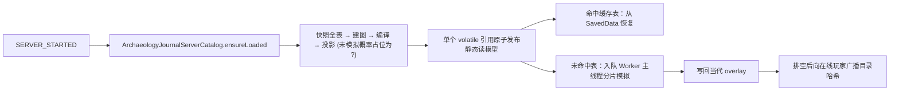
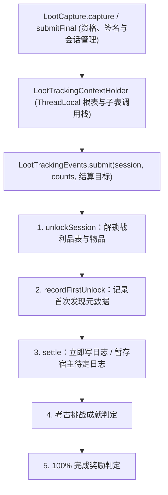
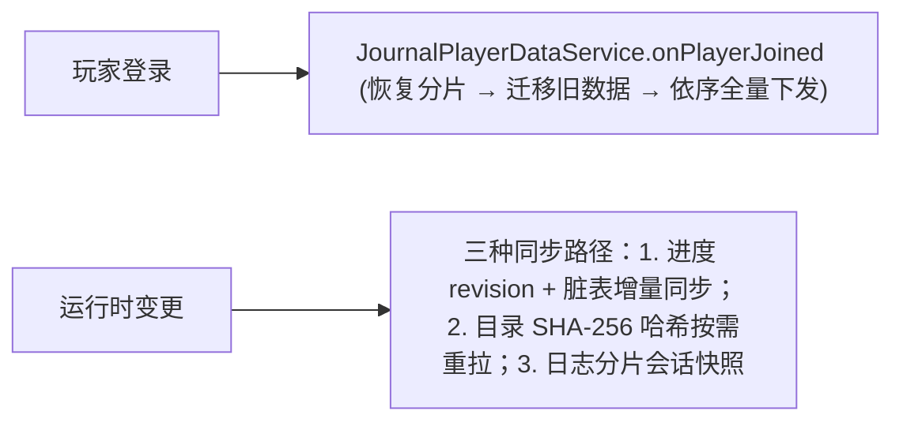
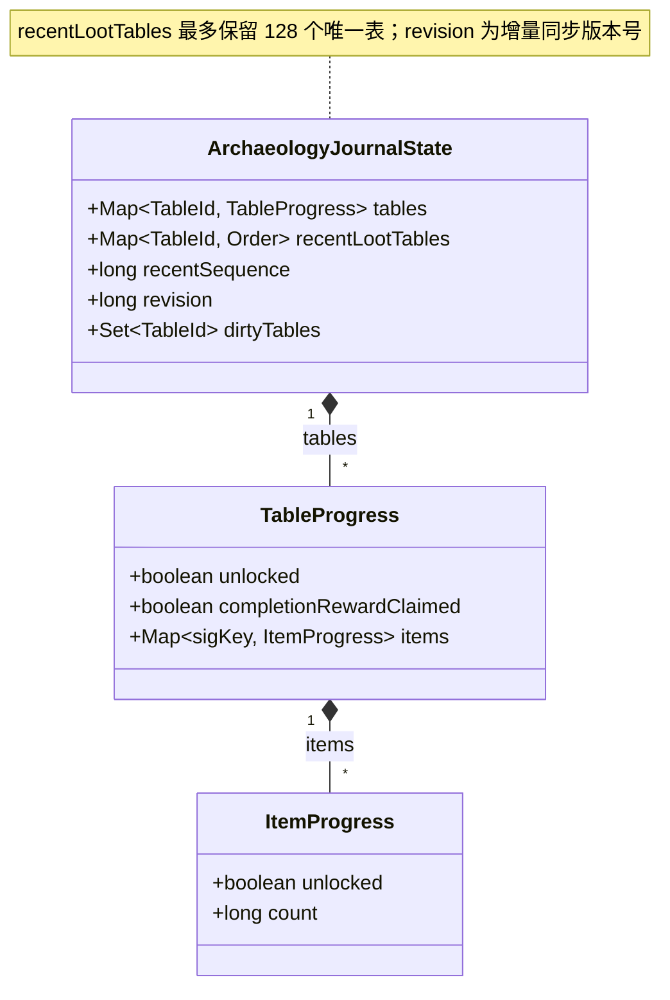
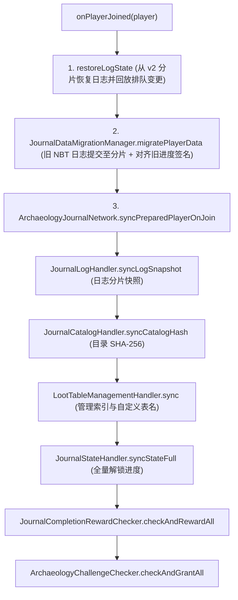

# 考古笔记系统

> `core/journal/` 包的架构：服务端目录构建流程、玩家进度持久化、战利品发现追踪结算及双端状态同步。
> 本文件是考古笔记子系统的技术路线入口。底层表解析、签名与概率模拟见[战利品表系统](loottable.md)；日志分片存储与保留策略见[考古日志存储与迁移](../internals/journal-log-storage.md)；追踪上下文与宿主结算链见[战利品追踪核心数据流](../internals/journal-tracking.md)；目录整代构建细则见[笔记目录构建细节](../internals/journal-catalog-build.md)。

## 1. 代码地图

| 层 | 位置 |
|---|---|
| 生命周期入口 | `core/journal/JournalPlayerDataService.java`（服务端启停、登录/退出、重生与迁移统一协调） |
| 目录构建 | `core/journal/catalog/`：`ArchaeologyJournalServerCatalog`、`ArchaeologyJournalCatalog`、`LootTableAnalysisSession`、`CatalogGeneration`、`CatalogReadSnapshot`、`DeclaredInjectionExpansion`、`JournalCategoryLoader` |
| 玩家状态 | `core/journal/state/`：`ArchaeologyJournalState`、`ArchaeologyJournalStateHolder`、`ArchaeologyJournalLogState`、`JournalLogMutation`、`ExcavationLogEntry`、`LootSourceType` |
| 数据迁移 | `core/journal/migration/`：`JournalDataMigrationManager`、`JournalDataVersion`、`JournalNbtMigrator`、`LegacyJournalLogAccess` |
| 战利品追踪 | `core/journal/tracking/`：`LootCapture`、`LootTrackingContext(+Holder)`、`LootSession`、`ArchaeologyLootRuntimeTracker`、`RecentLootTableService`、`ContainerTrackingService`、`DecoratedPotTrackingService`、`MenuTrackingSnapshot(Service)`、`WorldContextResolver`、`JournalLogRecorder`、`ArchaeologyChallengeChecker`、`JournalCompletionRewardChecker`、`PendingJournal`、`ContainerLootTracking`、`BrushableTracking`、`event/`、`settlement/` |
| 日志存储与同步 | `core/world/JournalLogStorage.java`（分片权威存储）、`core/world/JournalLogSavedData.java`（旧单文件迁移读桥）、`core/journal/sync/ArchaeologyJournalLogSyncSession(Holder)` |
| 网络处理 | `core/network/journal/`（各 Handler；Payload 定义见[网络与同步](../foundation/network.md)） |
| 数据资源 | `data/<namespace>/journal_categories/*.json`（目录分类规则，支持任意命名空间扩展） |
| 调试命令 | `core/command/JournalCommand.java`（`/usb journal ...`） |
| Mixin | `PlayerDataMixin`、`ServerPlayerDataMixin`、`NestedLootTableMixin`、`container/*`、`FishingHookMixin`（清单见[Mixin 边界与接线](../foundation/mixin.md)） |
| 平台差异 | 无核心分叉（各平台触发事件均转交同一份 `common` 追踪实现） |

## 2. 核心数据流

### 2.1 目录构建与增量回填

### 2.2 战利品发现与结算

### 2.3 双端同步概览

完整目录下发与哈希计算共同读取 `CatalogGeneration.readSnapshot()` 的冻结快照，确保与线上编解码严格一致（见[笔记目录构建细节](../internals/journal-catalog-build.md)）。

## 3. 关键类

| 类 | 职责 |
|---|---|
| `JournalPlayerDataService` | 玩家笔记数据生命周期入口：服务端启停与 tick、登录恢复、退出落盘与重生复制 |
| `ArchaeologyJournalServerCatalog` | 服务端目录入口：构建、模拟调度、缓存恢复与查询索引 |
| `CatalogGeneration` | 一代目录不可变静态部分与模拟 overlay 的原子发布容器 |
| `JournalLogMutation` | 日志变更领域意图（即时/延迟策略）与失败时的同对象恢复 |
| `ArchaeologyJournalState` | 玩家进度核心模型（表/物品解锁状态、最近遇到表、`revision`、脏表集合） |
| `LootTrackingContext` | 描述单次抽取的根表、来源、位置与子表栈的不可变记录 |
| `LootSession` | 单次抽取会话，由 `complete(...)` 生成 `Commit` 提交给事件链 |
| `LootTrackingEvents` | 战利品追踪事件总线与兼容订阅入口 |
| `LootSettlementTarget` | sealed 结算目标（`IMMEDIATE` 立即写入 / `Deferred` 延迟暂存） |
| `JournalLogStorage` | 按玩家 UUID 与表 ID 哈希分片的服务端权威日志存储 |
| `JournalDataVersion` / `JournalNbtMigrator` | NBT 与存储布局双版本轴及连续升级迁移链 |
| `ArchaeologyJournalClientState` | 客户端目录快照与玩家进度读模型 |

## 4. 目录构建与分类规则

服务端启动后由 [`ArchaeologyJournalServerCatalog.ensureLoaded`](../../../common/src/main/java/com/meteorite/unsuspiciousblock/core/journal/catalog/ArchaeologyJournalServerCatalog.java) 完成整代构建与原子发布；并发发布、冻结快照与调试命令口径见[笔记目录构建细节](../internals/journal-catalog-build.md)。

目录分类结构（`CatalogGeneration.structure()`）由 [`JournalCategoryLoader`](../../../common/src/main/java/com/meteorite/unsuspiciousblock/core/journal/catalog/JournalCategoryLoader.java) 扫描所有命名空间的 `data/<namespace>/journal_categories/` 加载，数据格式规范见[笔记分类格式](../../api/journal-categories.md)。

## 5. 玩家进度状态

### 5.1 状态模型 (`ArchaeologyJournalState`)

[`ArchaeologyJournalState`](../../../common/src/main/java/com/meteorite/unsuspiciousblock/core/journal/state/ArchaeologyJournalState.java) 采用三层进度映射，物品键使用 `LootResultSignature.toStoredKey()` 区分不同组件变体（实例态组件自动退化为 `PLAIN`，见[战利品表系统](loottable.md)）：

父表完成度涵盖其全部后代表物品，并按物品签名去重统计。

### 5.2 持久化与最近记录

- **玩家 NBT 挂载**：通过 `ArchaeologyJournalStateHolder` 与 `PlayerDataMixin` / `PlayerDataLifecycle` 附加在 `ServerPlayer` 上；`ServerPlayerDataMixin` 在玩家重生时协调进度复制并保留日志共享状态引用。
- **格式迁移**：旧版字段迁移统一由 `JournalDataVersion` 与 `JournalNbtMigrator` 执行（见[本地持久化与数据迁移](../foundation/persistence.md)），状态类反序列化只解析当前字段。
- **最近遇到表 (`RecentLootTableService`)**：仅在开启容器、刷拭或用考古铲取出可疑方块物品、钓鱼收杆或打破战利品陶罐时更新容量为 `128` 的 LRU 映射（不创建 `LootSession`，跳过 `entities/` 与 `blocks/` 路径）。

### 5.3 增量同步 (`revision` + 脏表)

- 业务修改仅调用 `markDirty(tableId)` 登记脏表，**不立即递增 `revision`**。
- 实际构造增量同步包时调用 `drainDirtyTables()`，收集脏表并统一执行一次 `revision + 1`，确保单次业务操作内的多次解锁不引起版本号跳跃，使客户端能通过 `incomingRevision > lastNotifiedRevision + 1` 准确检测丢包间隙。
- 客户端 `mergeFromIncremental` 采用**服务端权威语义**，直接以增量条目覆盖本地条目；全量重置（`clear` / `removeTable`）同样递增 `revision` 并触发全量下发。

## 6. 日志存储与追踪链路

- **分片存储与保留策略**：日志以按玩家 UUID、表 SHA-256 分片压缩存储在 `<world>/data/unsuspiciousblock/journal_logs/` 下，支持延迟写盘（每 200 tick 最多提交 4 个分片）、每表保留上限与注解保护（详见[考古日志存储与迁移](../internals/journal-log-storage.md)）。
- **捕获与命名结算链**：通过 `LootCapture` 统一资格与作用域管理、经 `LootTrackingEvents` 按固定顺序执行解锁、首记、结算、挑战与奖励步骤，并在容器与可疑方块上使用 `Deferred` 待定日志直到物品真正被玩家取走（详见[战利品追踪核心数据流](../internals/journal-tracking.md)）。

## 7. 加入时同步序列

玩家加入世界时，[`JournalPlayerDataService.onPlayerJoined`](../../../common/src/main/java/com/meteorite/unsuspiciousblock/core/journal/JournalPlayerDataService.java) 按严格顺序恢复与下发数据：

奖励与成就补发置于全量进度同步之后，确保客户端目录已准备就绪并能正确弹出提示。

### 运行时同步场景一览

| 同步类型 | 触发时机 | 同步机制 |
|---|---|---|
| 进度增量 | `drainDirtyTables` | `revision` + 脏表增量（客户端检测到间隙后主动申请全量） |
| 进度全量 | 登录 / 数据包重载 / 清空 | 一次性全量进度下发 |
| 目录按需 | 哈希不匹配 | 客户端收到哈希通知且本地不一致时请求全量目录 |
| 日志分片 | 登录 / 客户端重同步请求 | 会话 ID + 递增序号分片下发 |
| 日志删除 | 玩家确认删除 | 服务端校验后回传权威表日志及结果回执 |
| 扫描结果 | 可疑解析仪扫描 | 单次扫描汇总与目标坐标下发 |
| 完成奖励 | 某张表解锁度达 100% | 发放古代金币并发送一次性完成通知 |

全部 Payload 声明及线路字节上限（如分片 `128 KiB`、单表限制等）以[网络与同步](../foundation/network.md)为权威。

## 8. 客户端接入概要

客户端由 `JournalClientConnection` 管理连接代次与本地日志镜像实例化，`ArchaeologyJournalClientState` 对 UI 暴露目录、进度与通知回调（详见[客户端与 GUI](client-ui.md)）。

## 9. 扩展点：新增追踪来源

- **直接包裹生成逻辑**：定义 `LootCapture.Source`，在生成调用外层使用 `LootCapture.capture(source, target, generator)`，或对已生成掉落调用 `submitFinal`；需要跨越不同 Mixin 钩子生命周期时持有 `CaptureHandle` 并在结束时完成提交或中止。
- **选择结算目标**：钓鱼、淘洗、陶罐与化石猎手等即时落入玩家行为使用 `LootSettlementTarget.IMMEDIATE`；可疑方块与战利品容器等可能不取走物品的场景使用 `Deferred(PendingTarget)`。
- **扩展回调订阅**：优先融入固定命名结算步骤；遗留的 `LootTrackingEvents.register(priority, listener)` 兼容语义见[战利品追踪核心数据流](../internals/journal-tracking.md)。

## 10. 约束与陷阱

- **目录整代原子发布**：新增全代派生数据必须放入 `CatalogGeneration` 的静态部分同步构建，禁止在多字段上分步赋值。
- **禁止混用静态视图与模拟视图**：解锁、管理、完成度与挑战判定必须读取启动即完整的 `staticTables()`；`simulatedTables()` 仅用于展示覆盖率检查与严格要求动态条目就绪的指令。
- **状态反序列化只读当前字段**：所有旧存档兼容转换必须注册到 `JournalNbtMigrator`，不得在状态类的 `readFrom` / `fromTag` 编写回退分支。
- **迁移必须连续且拒绝降级**：遇到高于当前版本的数据立即拒绝；非幂等布局迁移必须使用 `ABORT_IF_INTERRUPTED`。
- **延迟写盘是有意性能取舍**：普通日志写入每 200 tick 批量落盘（崩溃可能损失约 10 秒最近普通变更），禁止改为每次记录同步刷盘。
- **最近遇到表跳过实体/方块默认掉落**：`RecentLootTableService` 不记录 `entities/` 与 `blocks/` 表，也不创建会话。
- **显式删除日志不回退累计进度**：GUI 删除日志仅删条目，不回退生命周期计数、表解锁、物品计数、完成奖励与成就。
- **实体容器追踪状态在销毁时终结**：状态保存于实体 NBT 中，区块卸载时不可提前清空。

## 11. 相关文档

- [考古日志存储与迁移](../internals/journal-log-storage.md)
- [战利品追踪核心数据流](../internals/journal-tracking.md)
- [笔记目录构建细节](../internals/journal-catalog-build.md)
- [战利品表系统](loottable.md)
- [网络与同步](../foundation/network.md)
- [Mixin 边界与接线](../foundation/mixin.md)
- [客户端与 GUI](client-ui.md)
- [配置与第三方联动](../foundation/config-and-integrations.md)
- [进度（成就）系统](advancement.md)
- [笔记分类格式](../../api/journal-categories.md)
