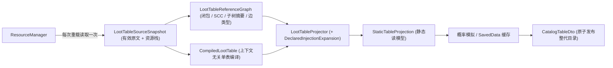
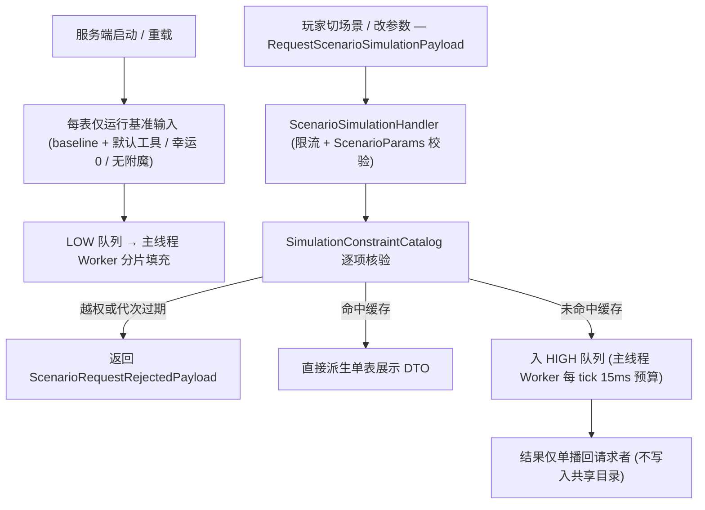
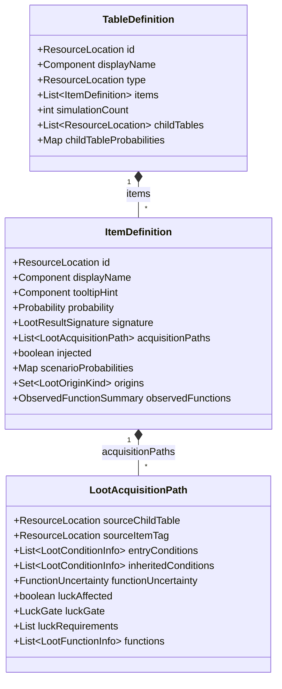

# 战利品表系统

> `core/loottable/` 包的架构：战利品表的解析收录、平台注入、物品稳定签名与概率模拟估算。
> 本文件是战利品表子系统的技术路线入口。解析细则、签名机制、场景规划与缓存设计见[战利品表机制细节](../internals/loottable-mechanics.md)；函数规则、执行捕获与展示派生见[战利品表函数与展示规则](../internals/loottable-functions-and-display.md)；目录整代构建与玩家进度见[考古笔记系统](journal.md)。

## 1. 代码地图

| 层 | 位置 |
|---|---|
| 资源快照 | `core/loottable/source/LootTableSourceSnapshot.java`（一次列举获取全表有效原文与完整资源栈） |
| 引用图 | `core/loottable/graph/`：`LootTableReferenceGraph`（直接子表、可达集、子树、强连通环与子树摘要）、`LootTableEdge`（边类型）、`RuntimeLootLinks`（平台注入边与钓鱼上下文判定的唯一来源） |
| 编译 | `core/loottable/analysis/`：`LootTableCompiler`、`CompiledLootTable`、`LuckSpec`、`LuckGateAnalysis`、`LuckGate`、`LootConditionHandler(s)`、`LootConditionInfo`、`LootFunctionHandler(s)`、`LootFunctionInfo`、`LootFunctionDescriptions`、`LootFunctionDescribeSupport`、`LootParseUtil` |
| 读模型与查询 | `core/loottable/catalog/`：`LootTableCatalog`（跨模块共享记录类型）、`LootOriginKind`、`Probability`、`DeclaredChance`、`LootTableProjector`、`StaticTableProjection`、`ItemDefinitionAccumulator`、`CatalogQueryIndex`、`CatalogTableDto`、`LootTablePattern`、`LootTableNames`、`LootTableTranslationStore`、`MissingTranslationKeyExporter` |
| 签名 | `core/loottable/signature/`：`LootResultSignature`、`LootResultMatcher`、`LootResultPreviewCache`、`LootCounts`、`SignatureExcludedComponents` |
| 模拟 | `core/loottable/simulation/`：输入参数（`SimulationInput` / `ScenarioParams` / `SimulationInputKey`）、场景规划（`SimulationScenarioPlanner` / `SimulationScenario`）、引擎调度（`LootProbabilitySimulator` / `LootProbabilitySimulationJob` / `SimulationMeasurement` / `LootProbabilitySimulationWorker`）、约束目录（`SimulationConstraintCatalog` / `ToolOption`）、上下文填充（`SimulationProfile` / `LootContextParamFiller` / `SimulationFakePlayer` / `SimulationFishingHook` / `LootSimulationScope` / `PlayerStateProbe`）、推荐与捕获（`SimulationAssistTarget` / `RecommendationSolver` / `FunctionTraceSession` / `ObservedFunctionChain`）、展示派生（`PathHintAnalyzer` / `ProbabilityFormat`） |
| 注入 | `core/loottable/injection/`：`ArchaeologyLootInjector`、`ArchaeologyLootInjectors` |
| 自定义条件 | `core/loottable/condition/`：`ModLootConditions`、`ToolEnchantmentCondition` |
| 诊断 | `core/loottable/diagnostics/`：`LootSimulationMetrics`、`LootDebugMode` |
| 上层组装 | `core/journal/catalog/`：`ArchaeologyJournalCatalog`、`LootTableAnalysisSession`、`CatalogGeneration`、`DeclaredInjectionExpansion` |
| 数据资源 | `data/unsuspiciousblock/loot_table/`；补充表名位于 `config/unsuspiciousblock/loot_table_lang/<language>.json` |
| 网络 | `CatalogTableDto` 经 `CatalogStreamCodec` 编解码（见[网络与同步](../foundation/network.md)） |
| Mixin | `NestedLootTableMixin`（嵌套表观测）、7 个单目标 `Simulation*ConditionMixin`、`LootItemConditionalFunctionMixin`、`LootTableSplitterMixin` |
| 平台差异 | 注入器：Fabric 显式调用 `maybeReplace`，NeoForge 空实现（由 GLM 在 `getRandomItems` 内完成）；重载监听：`ResourceManagerHelper` vs `AddReloadListenerEvent` |

## 2. 核心数据流

### 2.1 静态目录四层管线

每次资源加载只读取一次原文快照，随后按层推导并由 `DeclaredInjectionExpansion` 展开声明注入，每层仅依赖上一层：

**编译产物上下文无关**：同一个子表在不同父表引用点拥有不同的前置条件与函数链，因此编译层只记录“本表直接路径 + 引用位点”，不缓存展开后的子表结果，而是在投影期沿实际路径拼接父表条件与函数链。

### 2.2 概率模拟与按需请求分流

## 3. 关键类

| 类 | 职责 |
|---|---|
| `LootTableSourceSnapshot` | 一次性捕获全表有效原文与完整资源栈，供建图、编译与哈希共用 |
| `LootTableReferenceGraph` | 引用关系权威：直接子表、可达集、子树、强连通环（SCC）与子树摘要 |
| `RuntimeLootLinks` | 平台注入边与钓鱼上下文判定的唯一事实源，同时声明 `MUD_DREDGING_GATE` 门槛 |
| `LootTableCompiler` | 将单表 JSON 编译为上下文无关的 `CompiledLootTable` |
| `LootParseUtil` | 条件分析、函数链拼接与表类型规范化的唯一实现 |
| `LootTableProjector` | 沿引用图链接编译产物（首跳归属、条件继承顺序、函数继承与签名降级） |
| `Probability` | sealed 概率值类型（4 种互斥状态），构造即执行不变量校验 |
| `CatalogQueryIndex` | 子树物品集合等跨表聚合查询的唯一入口 |
| `LootResultSignature` | 玩家进度匹配与存档持久化的物品身份核心 |
| `LootProbabilitySimulator` | 单输入抽取模拟引擎 |
| `LootProbabilitySimulationWorker` | 主线程 tick 调度器（双优先级队列、`(表, 输入键)` 去重） |
| `SimulationConstraintCatalog` | 签发单表可选约束（场景、工具、附魔上限、抽样档位），不预先枚举组合 |
| `PathHintAnalyzer` | 静态获取提示生成与「基准测值 → 展示模型」派生 |
| `ProbabilityFormat` | 概率与声明触发率的展示格式化唯一入口（仅在 UI 边界调用） |
| `ArchaeologyLootInjectors` | 全局平台注入器单例 |
| `ModLootConditions` | 自定义条件类型注册与展示描述符绑定 |

## 4. 目录数据结构与概率类型

### 4.1 共享目录读模型

[`LootTableCatalog`](../../../common/src/main/java/com/meteorite/unsuspiciousblock/core/loottable/catalog/LootTableCatalog.java) 定义跨 `journal`、`network`、`client` 与 `command` 模块共用的只读数据模型：

- **`origins` 与 `injected`**：`origins` 为 `LootOriginKind`（`STATIC` / `MOD_INTEGRATION` / `UNKNOWN_RUNTIME`）集合，同一签名可兼有多个来源；`injected` 仅是其兼容投影。**模拟期动态发现不等于平台注入**。
- **`sourceChildTable`**：仅记录**第一跳**直接子表（孙表的条件归并到直接子表下），确保父表页签中的子表入口与归属一一对应。

### 4.2 四态概率值 (`Probability`)

[`Probability`](../../../common/src/main/java/com/meteorite/unsuspiciousblock/core/loottable/catalog/Probability.java) 以 sealed 类型表达四种互斥语义：

| 状态 | 含义 | 网格展示文本 |
|---|---|---|
| `Unknown(reason)` | 缺少可展示的测量值（`UNCOVERED` / `UNPARSED` / `NOT_SIMULATED` / `SIMULATION_FAILED`），**不表示不可达** | `?` |
| `Unreachable` | 经静态分析证明在任何可表示输入下有效权重恒为 0 | `0%` |
| `Measured(lower, upper?)` | 实际抽样比例；非空 `upper` 表示跨场景区间；`0.0` 表示适用但零命中 | `12%` / `3%-7%` / `未命中` |
| `NeedsCondition(hints)` | 当前输入不可用或零命中，但获取路径引用了可调整旋钮或场景条件 | 「需要条件」 |

- **可适用性与计算状态双轴分离**：均由服务端派生，客户端严格按显示优先级渲染（不可用状态 → 可展示的声明触发率 → 模拟测值）。
- **窄类型落盘**：存档持久化只保存窄类型 `SimulatedValue`（`Unknown` / `Measured`），排序、比较与网络传输全程使用数值；格式化只发生在 UI 边界 `ProbabilityFormat`。

## 5. 收录范围与自定义表名

[`LootTablePattern`](../../../common/src/main/java/com/meteorite/unsuspiciousblock/core/loottable/catalog/LootTablePattern.java) 解析配置中的追踪前缀与精确排除规则：

| 语法 | 匹配语义 | 示例 |
|---|---|---|
| `namespace:path` | 限定命名空间 | `minecraft:gameplay/fishing` |
| `path`（裸路径） | 匹配任意命名空间 | `archaeology/` |
| 以 `/` 结尾 | 前缀匹配 | `archaeology/` 命中全部考古表 |
| 不以 `/` 结尾 | 精确 ID 匹配 | `minecraft:chests/buried_treasure` |

默认规则定义在 `ILootTableConfig.DEFAULT_ARCHAEOLOGY_PATH_PREFIXES`。命中规则的表纳入目录并沿引用闭包递归收录子表。

### 追踪管理与自定义名称

- **权威表集合**：候选清单仅取服务端 `ReloadableServerRegistries` 中已注册的战利品表（排除 `entities/` 与 `blocks/` 前缀），修改追踪规则与排除项需权限等级 `2`。
- **名称覆写规则**：翻译键由 `LootTableNames.createTranslationKey(ResourceLocation)` 统一生成；游戏资源语言为只读优先来源，服务端补充表名保存在 `config/unsuspiciousblock/loot_table_lang/<language>.json`，经 `ClientLanguageMixin` 仅在资源缺失时补齐（断连即清除内存快照）。
- **管理页草稿与导入**：支持按 `(languageCode, tableId)` 暂存草稿并批量写入，也支持预览并导入标准语言 JSON；仅已注册、可管理且键名符合自动规则的条目允许提交。

## 6. 战利品注入与自定义条件

### 6.1 平台差异化注入

[`ArchaeologyLootInjectors`](../../../common/src/main/java/com/meteorite/unsuspiciousblock/core/loottable/injection/ArchaeologyLootInjectors.java) 提供统一注入接口（Fabric 实现位于 `fabric/.../loot/`，NeoForge GLM 位于 `neoforge/.../loot/`）：

| 平台 | 实现机制 | 模拟期行为 |
|---|---|---|
| Fabric | `FabricArchaeologyLootInjector` | 模拟器在每次抽取后显式调用 `maybeReplace`，将模组注入物品纳入统计与签名 |
| NeoForge | 默认空实现 | 注入由 `IGlobalLootModifier` 在 `LootTable.getRandomItems` 内部自动执行 |

因此模拟引擎**必须调用普通 `LootTable.getRandomItems`** 而非 `getRandomItemsRaw`（原版嵌套表采用 `getRandomItemsRaw`，保证 GLM 仅在根表触发一次）。

### 6.2 自定义条件 (`unsuspiciousblock:tool_enchantment`)

- `ModLootConditions` 注册模组唯一的自定义战利品条件 `unsuspiciousblock:tool_enchantment`（[`ToolEnchantmentCondition`](../../../common/src/main/java/com/meteorite/unsuspiciousblock/core/loottable/condition/ToolEnchantmentCondition.java)），同时表达 `enchantment`（必填）、`min_level`（可选，默认 `1`）与 `chance`（可选 `LevelBasedValue`）。
- **单一门槛声明**：钓鱼额外掉落门槛 `RuntimeLootLinks.MUD_DREDGING_GATE` 由 Fabric 注入池与 NeoForge `FishingLootModifier` 共用；被注入子表 `gameplay/fishing/mud_dredging` 自身不重复书写该门槛。
- **时序前提**：条件类型注册必须在 `UnsuspiciousBlockCommon.init()` 之前完成（见[架构总览](../foundation/architecture.md)）。未注册的条件类型会导致整张表 JSON 解析失败。

## 7. 函数规则与运行时观测概要

战利品函数存在两条相互独立、不可互相推导的信息轴，详细捕获机制、策略模型与展示派生规则见[战利品表函数与展示规则](../internals/loottable-functions-and-display.md)：

- **静态规则 (`LootFunctionInfo`)**：编译投影阶段从表结构与 `LootFunctionPreviewContext` 解析“声明了什么效果与生效条件”，用于客户端展示物品获取规则与推导空操作（`display_no_op`）。
- **运行时观测 (`FunctionObservationSummary`)**：模拟抽取时通过 Mixin 捕获“实际进入了哪些执行体”，按输入随测量结果下发用于开发与诊断（不在玩家普通 Tooltip 展示）。

## 8. 扩展点

- **调整收录范围或实例态排除组件**：修改 `ILootTableConfig` 默认前缀或 `signature_excluded_components`（默认 `relics:data`）。变更排除组件会改变表哈希并触发重算，但旧存档里已记录的精确变体键成为孤儿键，不参与完成度计算。
- **新增签名类型**：扩展 `LootResultSignature.SignatureType` 与 `fromStoredKey` 解析，并在 `JournalNbtMigrator` 补充连续迁移步骤。
- **新增战利品条件 / 场景控制类型**：在 `ModLootConditions` 注册类型，并在 `LootConditionHandlers` 统一登记描述器、能力标识与所需上下文参数；需受代表场景控制的叶子条件须登记 `SCENARIO` 能力并补写单目标 `test` 转交 Mixin。
- **新增函数描述或预览**：在 `LootFunctionHandlers` 注册 `LootFunctionDescription` 与可选 `LootFunctionPreview`，通过 `withSemantics` 提供类型化策略，并在 `en_us.json` / `zh_cn.json` 同步 `function.*` 键（详见[战利品表函数与展示规则](../internals/loottable-functions-and-display.md)）。
- **新增模拟参数旋钮（四处同步扩展）**：`ScenarioParams` 加字段 → `SimulationInputKey.of` 按固定顺序编码 → `SimulationConstraintCatalog.resolve` 加校验 → `SimulationProfile` 加 `withXxx` 并在 `ScenarioParams.applyTo` 套用。
- **新增运行时联动边**：在 `RuntimeLootLinks` 声明边并选用 `LootTableEdge.Kind`（`RUNTIME_INJECTION` 仅参与收录闭包与哈希，不构建静态路径；合成边带双端存在守卫）。
- **调整平台注入器或开发调试表**：Fabric 端实现 `ArchaeologyLootInjector` 并在初始化注册；开发核对表放入 `archaeology/debug/` 并通过 `LootDebugMode` 开关验证。

## 9. 约束与陷阱

- **禁止从原始 JSON 重建模拟表**：必须从服务端 `ReloadableServerRegistries` 读取运行时表，否则会丢失 Fabric `LootTableEvents.MODIFY` 修改。
- **模拟必须在服务端主线程 tick 分片运行**：原版 `getRandomItems` 触碰非线程安全的 `LegacyRandomSource`，禁止丢入后台线程并发执行。
- **参数填充须覆盖 `allowed` 内的 required 与 optional 参数**：遗漏 optional 参数会把“未填充”伪装成“条件不成立”。
- **空 `type` 等价于 `generic`**：判断 `paramSet` 时遵循原版缺省语义，避免误伤未显式写 `type` 的第三方模组表。
- **不可用 `stack.has(ENCHANTMENTS)` 判定附魔**：工具默认携带空组件，应使用 `isActuallyEnchanted`。
- **展示值只能由服务端派生**：客户端不得本地重推概率或注入门槛。
- **按需结果绝不写入共享目录**：避免多人模式下玩家界面互相覆盖。
- **函数条件不并入物品掉落条件**：函数自身条件只决定效果是否生效，不阻塞基础物品掉落（可能改变物品身份的变换除外）。

## 10. 相关文档

- [战利品表机制细节](../internals/loottable-mechanics.md) —— 解析管线、签名、场景规划、调度与缓存失效
- [战利品表函数与展示规则](../internals/loottable-functions-and-display.md) —— 静态规则描述、执行捕获、展示派生与调试模式
- [笔记目录构建细节](../internals/journal-catalog-build.md) —— 整代原子构建、快照摘要与按需同步
- [考古笔记系统](journal.md) —— 上层目录管理、进度与追踪入口
- [附魔系统](enchantment.md) —— `ToolEnchantmentCondition` 与泥底打捞玩法
- [配置与第三方联动](../foundation/config-and-integrations.md) —— 追踪配置与 Lootr 兼容
- [网络与同步](../foundation/network.md) —— `CatalogStreamCodec` 与通用协议限制
- [Mixin 边界与接线](../foundation/mixin.md) —— 嵌套观测与条件捕获 Mixin
- [客户端与 GUI](client-ui.md) —— 目录网格、场景页面与管理界面
- [笔记分类格式](../../api/journal-categories.md)
