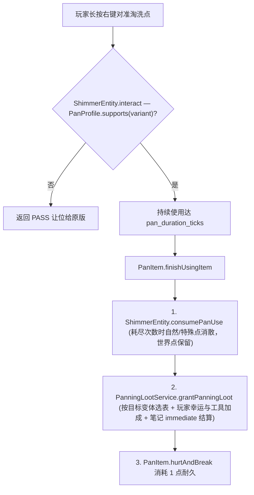
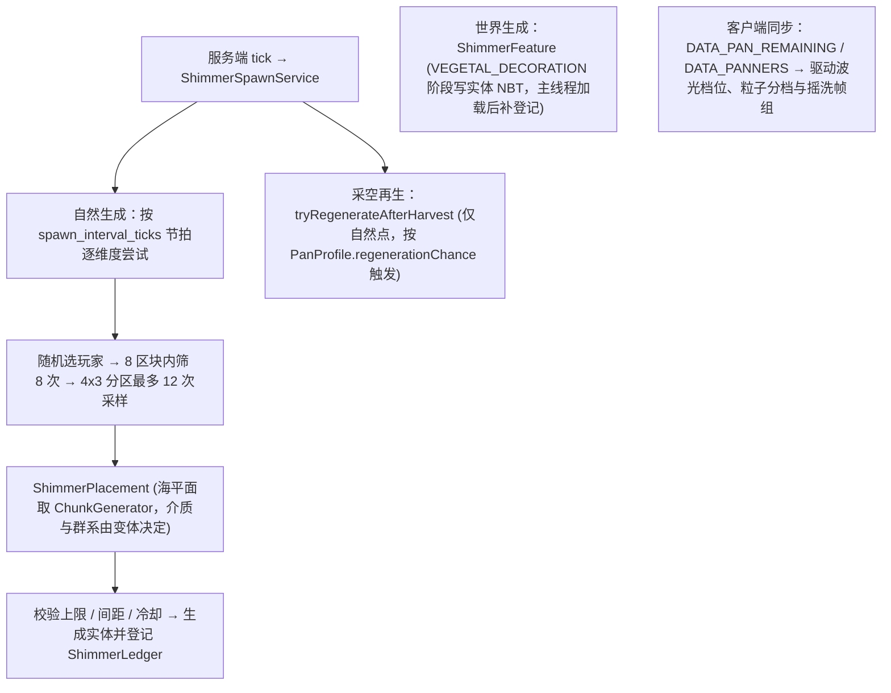

# 淘洗系统

> `core/pan/` 包（含变体注册表）、`PanItem` 与三把淘盘、`ShimmerEntity` 及其子类，以及客户端波光/动作表现、配置与调试指令。
> 本文件是淘洗子系统的权威入口。逐项配置参数见[配置与第三方联动](../foundation/config-and-integrations.md)；Mixin 注入点见[Mixin 边界与接线](../foundation/mixin.md)；自然生成与世界生成算法、账本一致性、客户端渲染细则与 `/usb shimmer` 指令见[淘洗生成、账本与客户端细节](../internals/panning-details.md)。

## 1. 代码地图

| 层 | 位置 |
|---|---|
| 淘洗点实体 | `core/entity/ShimmerEntity.java`（基类）、`WaterShimmerEntity.java`、`GlimmerEntity.java` |
| 变体系统 | `core/pan/variant/`：`ShimmerVariant`、`ShimmerVariants`、`AnchorRule`、`SpawnDomain`、`GlowStyle`、`PanningMedium`、`RiverDomain`/`WaterAnchor`、`NetherDomain`/`LavaAnchor` |
| 生成与采样 | `core/pan/ShimmerSpawnService.java`、`core/pan/ShimmerSpawnStatistics.java`、`core/pan/ShimmerFeature.java`、`ShimmerFeatureConfig.java`、`ShimmerPlacement.java` |
| 维度账本 | `core/pan/ShimmerLedger.java`（`SavedData`，每维度文件名 `unsuspiciousblock_shimmer`） |
| 结算与物品 | `core/pan/PanningLootService.java`、`core/item/PanItem.java`、`core/item/PanProfile.java` |
| 数据资源 | `data/unsuspiciousblock/loot_table/gameplay/panning/{river,lava}.json`、`worldgen/{configured_feature,placed_feature}/*shimmer*.json`、`assets/minecraft/atlases/blocks.json` |
| 客户端 | `client/pan/`（`PanningAnimation` / `PanningVisuals` / `PanningSound` / `PanningSoundController` / `PanningMediumIndex`）、`client/renderer/ShimmerSurfaceRenderer`、`client/renderer/ShimmerRenderer` |
| 调试指令 | `core/command/ShimmerDebugCommand.java`（`/usb shimmer`，OP 2） |
| Mixin | `client/mixin/HumanoidPanningMixin`（第三人称）、`client/mixin/fabric/ItemInHandPanningMixin`（Fabric 第一人称） |
| 平台差异 | 世界生成注入（`BiomeModifications` vs `neoforge/biome_modifier/*.json`）；第一人称动画（Mixin vs `RenderHandEvent`）；配置实现（`IPanningConfig`） |

## 2. 核心数据流

### 2.1 玩家淘洗操作

### 2.2 生成调度与客户端表现

## 3. 关键类

| 类 | 职责 |
|---|---|
| `ShimmerEntity` | 淘洗点非生物实体基类（继承深度固定为 1 层），核心保障位置与介质锚定 |
| `ShimmerVariant` / `ShimmerVariants` | 变体不可变描述与注册表（含编解码器与指令用路径索引） |
| `ShimmerSpawnService` | 自然生成与再生服务（`SpawnTrigger` 区分 `NATURAL` / `SPECIAL` / `MANUAL` / `WORLDGEN`） |
| `ShimmerPlacement` | 自然与世界生成共用的区块落点采样器，保证可生成位置与可存活位置一致 |
| `ShimmerLedger` | 维度持久化账本，维护区块空间索引、按变体自然计数、寿命到期与采空冷却 |
| `PanningLootService` | 按目标变体与综合幸运抽取并抛出战利品 |
| `PanItem` / `PanProfile` | 全部淘盘共同基类及各把淘盘的能力差异配置 |
| `ShimmerDebugCommand` | `/usb shimmer` 调试与速率统计命令 |

## 4. 数据驱动变体系统

淘洗点之间的差异收敛为**依附介质、生成域、表现参数、产出表与实体类型**五项可注册数据，因此**子类内部严禁出现介质分支判断**（发现分支即应下沉至 `ShimmerVariant`）：

| 变体组件 | 职责 |
|---|---|
| `AnchorRule` | 识别介质方块、冰面冻结条件、演出高度与调试代表方块 |
| `SpawnDomain` | 落点基准高度、群系校验与区块级预筛条件 |
| `GlowStyle` | 波光双色、三类粒子、三类音效与摇洗帧组 |

| 变体 ID | 实体子类 | 依附介质 | 生成域 | 产出表 |
|---|---|---|---|---|
| `water`（闪烁的光） | `WaterShimmerEntity` | 水源与河水冻结的普通冰 | 河流群系、生成器海平面 | `gameplay/panning/river` |
| `glimmer`（幽微的光） | `GlimmerEntity` | 岩浆（不区分流体等级） | `#minecraft:is_nether`、生成器海平面 `32` | `gameplay/panning/lava` |

**变体本身不占用实体同步字段**：波光颜色、粒子与音效由 `entity.getType()` 在双端各自查表获取；仅当实体正被淘洗时，通过 `DATA_PANNERS` 同步淘洗者 UUID 列表以驱动全客户端可见的摇洗帧动画。

## 5. 淘洗点实体 (`ShimmerEntity`) 与来源

- **锚定与免疫**：实体位置每 tick 通过 `snapToAnchor` 锚定到 `anchorPos`，当依附介质失效或上方被占据（`AnchorRule.isValid` 返回 `false`）时立即 `discard()`。免疫碰撞、推挤与普通伤害，但保持 `isPickable() == true` 以便淘盘射线命中。
- **三种来源区分**（兼容保留 NBT `NaturalSpawn` 与 `SpecialSpawn`）：

| 来源 | 计入上限 | 寿命与恢复规则 |
|---|---|---|
| 自然生成 | 计入每维度上限 | 寿命随机 `20–40` 分钟（按绝对游戏时间计时，停服暂停），耗尽或到期即消散释放名额 |
| 世界生成 | 不计入 | 永不自然消散；采空后保留实体，按生成时固定的恢复周期（默认 `20–40` 分钟）逐步恢复次数至初值 |
| 特殊生成 | 不计入 | 由自然点采空后按概率再生而来；寿命与外观同自然点，耗尽不再触发再生 |

- **冰面依附与防越界机制**：水源冻结为普通冰（`minecraft:ice`，不含浮冰/蓝冰）后实体不销毁、计时照常推进，但冰面波光贴合顶面固定为静态且停止工作水花与音效。淘洗点包围盒高度 `0.9` 落在实心冰块内部，原版视线检测在冰块顶面即被碰撞箱截断，**使冰中的点自然不可淘洗**（解冻后恢复）。起手、持续与结算三阶段均重检依附面，途中结冰立即中断且不消耗耐久。
- **工作状态与账本对齐**：`DATA_PANNING` 属于瞬态演出状态不写 NBT（停手最多两 tick 自动复原）；实体的消散与首 tick 加载主动向 `ShimmerLedger` 注销或补登记，不一致时永远以实体为准。

## 6. 淘盘 (`PanItem`) 与战利品结算 (`PanningLootService`)

- **能力交集判定 (`canHarvest`)**：`PanProfile.harvestTargets` 声明每把盘可采的变体集合（三把盘耐久、修复材料与加成对比见[方块与物品](blocks-items.md)），`canHarvest` 在起手、持续使用与最终结算三处统一调用，确保铜盘/金盘无法越界淘洗岩浆变体，且移动减速直接复用原版「正在使用物品」逻辑。
- **幸运分化机制**：三把盘共用变体对应的同一张战利品表（采用 `LootContextParamSets.BLOCK` 且接入笔记 `immediate` 立即结算），通过 `玩家自身幸运 + PanProfile.luckByVariant` 配合原版 `weight` / `quality` / `bonus_rolls` 分化掉落（`bonus_rolls` 必须独立成池，防止负幸运清零基础掉落池）。产出物体从液面朝玩家方向抛射掉落（水平 `0.3` 格/刻，竖直 `0.4` 格/刻）。

## 7. 配置要求

- `IPanningConfig` 在 Fabric 对应 `config/unsuspiciousblock/panning.json`，在 NeoForge 对应独立文件 `unsuspiciousblock-panning-server.toml`（必须显式命名以防 `ConfigTracker` 冲突）。
- 工具标量 `gold_pan_luck_bonus`、`obsidian_pan_luck_penalty` 与 `gold_pan_regeneration_chance` **必须经 `DoubleSupplier` 延迟读取**，避免 NeoForge 物品注册期间因 `SERVER` 规格尚未加载而崩溃。

## 8. 扩展点

- **新增淘洗点变体**：
  1. 在 `ShimmerVariants` 注册新变体（指定 id、`AnchorRule`、`SpawnDomain`、`GlowStyle`、产出表与实体类型）；
  2. 新增 `ShimmerEntity` 子类并在 `ModEntities.REGISTRY_MANIFEST` 登记；
  3. 添加产出表 JSON 并纳入 `ILootTableConfig` 默认追踪前缀；
  4. 按需配置 `configured_feature`、`placed_feature` 与双端群系修改器；
  5. 补齐贴图帧、粒子与音效。生成、账本、调试指令与客户端渲染全部自动适配。
- **新增淘盘**：在 `ModItems` 新增条目并传入自定义 `PanProfile`（类别选 `Category.PAN`），`PanningVisuals` 与 `PanningLootService` 无需改动。
- **调整产出**：直接修改对应变体的战利品表（利用原版 `weight`/`quality`/`bonus_rolls`），不在代码增加分支。

## 9. 约束与陷阱

- **子类禁止出现介质判断**：变体差异必须通过 `ShimmerVariant` 数据驱动表达。
- **海平面必须调用 `ChunkGenerator.getSeaLevel()`**：`Level.getSeaLevel()` 硬编码返回 `63`，在下界维度会导致落点采样静默失败。
- **冰中不可淘洗依赖隐式几何约束**：实体包围盒高 `<= 1.0` 且依附介质拥有完整方块碰撞箱，改动 `.sized(...)` 前须重新验证射线截断效果。
- **账本与实体不一致时以实体为准**；世界生成 Feature 不读冷却、上限与间距；采空再生只在同水平面采样；`bonus_rolls` 严禁写入基础掉落池。

## 10. 相关文档

- [淘洗生成、账本与客户端细节](../internals/panning-details.md)
- [实体与 AI](entities-world.md)
- [方块与物品](blocks-items.md)
- [考古笔记系统](journal.md)
- [战利品表系统](loottable.md)
- [配置与第三方联动](../foundation/config-and-integrations.md)
- [Mixin 边界与接线](../foundation/mixin.md)
- [文本格式规范](../foundation/text-format.md)
