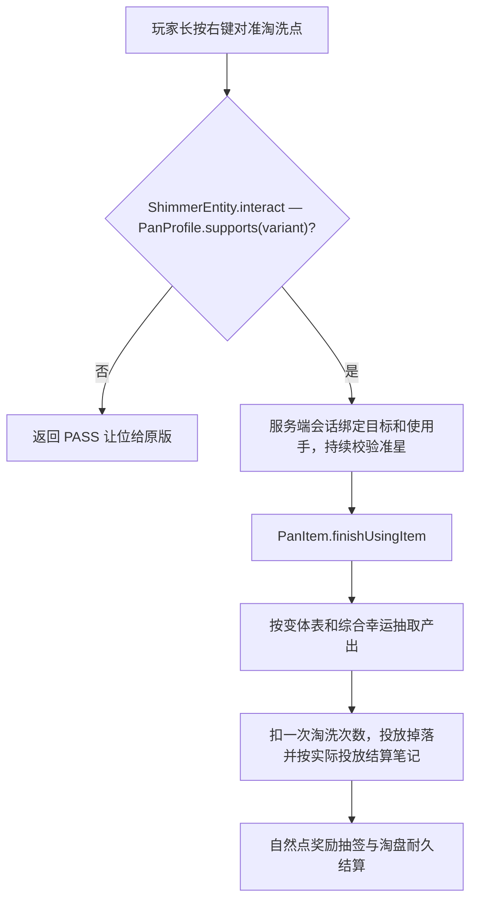
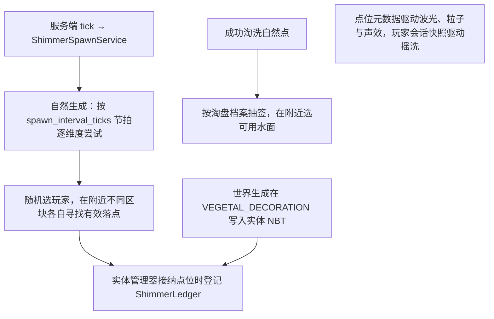

# 淘洗系统

> `core/pan/` 包（含变体注册表）、`PanItem` 与三把淘盘、`ShimmerEntity` 及其子类，以及客户端波光/动作表现、配置与调试指令。
> 本文件是淘洗子系统的权威入口。逐项配置参数见[配置与第三方联动](../foundation/config-and-integrations.md)；Mixin 注入点见[Mixin 边界与接线](../foundation/mixin.md)；自然生成与世界生成算法、账本一致性、客户端渲染细则与 `/usb shimmer` 指令见[淘洗生成、账本与客户端细节](../internals/panning-details.md)。

## 1. 代码地图

| 层 | 位置 |
|---|---|
| 淘洗点实体 | `core/entity/ShimmerEntity.java`（基类）、`WaterShimmerEntity.java`、`GlimmerEntity.java` |
| 变体系统 | `core/pan/variant/`：`ShimmerVariant`、`ShimmerVariants`、`AnchorRule`、`SpawnDomain`、`GlowStyle`、`PanningMedium`、`RiverDomain`/`WaterAnchor`、`NetherDomain`/`LavaAnchor` |
| 生成与采样 | `core/pan/ShimmerSpawnService.java`、`core/pan/ShimmerSpawnStatistics.java`、`core/pan/ShimmerFeature.java`、`ShimmerFeatureConfig.java`、`ShimmerPlacement.java` |
| 维度账本 | `core/pan/ShimmerLedger.java`（`SavedData`，每维度文件名 `unsuspiciousblock_shimmer`） |
| 会话与结算 | `core/pan/PanningSession.java`、`core/pan/PanningLootService.java`、`core/item/PanItem.java`、`core/item/PanProfile.java` |
| 数据资源 | `data/unsuspiciousblock/loot_table/gameplay/panning/{river,lava}.json`、`worldgen/{configured_feature,placed_feature}/*shimmer*.json`、`assets/minecraft/atlases/blocks.json` |
| 客户端 | `client/pan/`（`PanningAnimation` / `PanningVisuals` / `PanningSound` / `PanningSoundController` / `ClientPanningState`）、`client/renderer/ShimmerSurfaceRenderer`、`client/renderer/ShimmerRenderer` |
| 调试指令 | `core/command/ShimmerCommand.java`（`/usb shimmer`，OP 2） |
| Mixin | `client/mixin/HumanoidPanningMixin`（第三人称）、`client/mixin/fabric/ItemInHandPanningMixin`（Fabric 第一人称） |
| 平台差异 | 世界生成注入（`BiomeModifications` vs `neoforge/biome_modifier/*.json`）；第一人称动画（Mixin vs `RenderHandEvent`）；配置实现（`IPanningConfig`） |

## 2. 核心数据流

### 2.1 玩家淘洗操作

### 2.2 生成调度与客户端表现

## 3. 关键类

| 类 | 职责 |
|---|---|
| `ShimmerEntity` | 淘洗点非生物实体基类（继承深度固定为 1 层），核心保障位置与介质锚定 |
| `ShimmerVariant` / `ShimmerVariants` | 变体不可变描述与注册表（含编解码器与指令用路径索引） |
| `ShimmerSpawnService` | 自然生成与再生服务（`SpawnTrigger` 区分 `NATURAL` / `SPECIAL` / `MANUAL` / `WORLDGEN`） |
| `ShimmerPlacement` | 自然与世界生成共用的区块落点采样器，保证可生成位置与可存活位置一致 |
| `ShimmerLedger` | 维度持久化账本，维护区块空间索引、按变体自然计数、寿命到期与采空冷却 |
| `PanningLootService` | 按目标变体与综合幸运抽取并抛出战利品 |
| `PanItem` / `PanProfile` | 全部淘盘共同基类及各把淘盘的能力差异配置 |
| `ShimmerCommand` | `/usb shimmer` 调试与速率统计命令 |

## 4. 数据驱动变体系统

淘洗点之间的差异收敛为**依附介质、生成域、表现参数、产出表与实体类型**五项可注册数据，因此**子类内部严禁出现介质分支判断**（发现分支即应下沉至 `ShimmerVariant`）：

| 变体组件 | 职责 |
|---|---|
| `AnchorRule` | 识别介质方块、冰面冻结条件、演出高度与调试代表方块 |
| `SpawnDomain` | 落点基准高度与候选位置的群系条件 |
| `GlowStyle` | 波光双色、三类粒子、三类音效与摇洗帧组 |

| 变体 ID | 实体子类 | 依附介质 | 生成域 | 产出表 |
|---|---|---|---|---|
| `water`（闪烁的光） | `WaterShimmerEntity` | 水源与河水冻结的普通冰 | 河流群系、生成器海平面 | `gameplay/panning/river` |
| `glimmer`（幽微的光） | `GlimmerEntity` | 岩浆（不区分流体等级） | `#minecraft:is_nether`、生成器海平面 `32` | `gameplay/panning/lava` |

变体表现由实体类型决定。点位同步剩余次数、永久标记和工作状态，淘洗会话按玩家同步使用手、介质和服务端时钟。

## 5. 淘洗点实体 (`ShimmerEntity`) 与来源

- **锚定与免疫**：实体位置每 tick 通过 `snapToAnchor` 锚定到 `anchorPos`，当依附介质失效或上方被占据（`AnchorRule.isValid` 返回 `false`）时立即 `discard()`。免疫碰撞、推挤与普通伤害，但保持 `isPickable() == true` 以便淘盘射线命中。
- **三种来源区分**（兼容保留 NBT `NaturalSpawn` 与 `SpecialSpawn`）：

| 来源 | 计入上限 | 寿命与恢复规则 |
|---|---|---|
| 自然生成 | 计入每维度上限 | 寿命随机 `20–40` 分钟（按绝对游戏时间计时，停服暂停），耗尽或到期即消散释放名额 |
| 世界生成 | 不计入 | 永不自然消散；采空后保留实体，按生成时固定的恢复周期（默认 `20–40` 分钟）逐步恢复次数至初值 |
| 特殊生成 | 不计入 | 金淘盘每次成功淘洗自然点后按概率生成。寿命与外观同自然点，特殊点不会触发再生 |

- **冰面依附与防越界机制**：水源冻结为普通冰（`minecraft:ice`，不含浮冰/蓝冰）后实体不销毁、计时照常推进，但冰面波光贴合顶面固定为静态且停止工作水花与音效。淘洗点包围盒高度 `0.9` 落在实心冰块内部，原版视线检测在冰块顶面即被碰撞箱截断，**使冰中的点自然不可淘洗**（解冻后恢复）。起手、持续与结算三阶段均重检依附面，途中结冰立即中断且不消耗耐久。
- 最后一名玩家结束会话时清除点位工作状态。实体管理器接纳点位时向 `ShimmerLedger` 登记，实体消散时注销。

## 6. 淘盘 (`PanItem`) 与战利品结算 (`PanningLootService`)

- `PanProfile.harvestTargets` 声明可采变体，起手时校验工具能力。持续与结束时验证会话原有目标、手、工具和有效命中。移动减速复用原版使用状态。[淘盘数值](blocks-items.md)
- 淘洗上下文以玩家幸运和工具档案加成为 LootContext luck，按变体选择战利品表。缺表时显示提示并终止，合法空表按正常淘洗处理。考古笔记即时结算成功加入世界的掉落。
  - **三盘分化与默认阈值**：默认配置 `gold_pan = +1.0`、`copper_pan = 0.0`、`obsidian_pan(水) = -1.0`，在水域形成对称整数幸运三档。
  - **河流 `river.json`**：6 池结构，每次固定产出 `3–6` 个黏土球并抽取河床粗砂（沙子、沙砾、燧石）、冲积矿砂（空/铁粒/粗铜/煤/金粒）与零星遗物（`ancient_coin`、`lost_page`、`nautilus_shell` 与区分 `river` / `frozen_river` 的地区陶片）。
  - **子表梯度与门槛**：矿晶子表 `usb/panning/minerals` 使用平滑梯度权重（`weight: 15, quality: 35`，父池配合 `empty` `weight: 85, quality: -25`），在黑曜石盘（`-1.0`）下关闭、铜盘（`0.0`）占 `15%`、金盘（`+1.0`）升至 `45.5%`；高幸运遗物子表 `usb/panning/relics` 入口使用 `weight: 0, quality: 1`，在总幸运达到 `+1.0` 后解锁且与主表零星遗物零重叠。各池每次最多抽取一次，子表直接列出物品结果。
  - **岩浆 `lava.json`**：Pool 1/2 抽取下界沉渣与熔火矿晶（含 `obsidian` 就地修复黑曜石盘）；Pool 3 降低空项权重、略提 `netherite_scrap` 并补充下界五大群系各自风味掉落。
  - 不展开通用陶片标签，直接物品条目按类别权重参与地区池。新增纹样时按对应地区修改条目。
- **产出抛射与拾取**：产出使用原版 `ItemEntity`，从液面上方飞向结算时玩家的位置；按物品实体逐刻施加重力、移动与空气阻力的顺序，反算固定飞行时长的初速度，统一处理距离与高差。生成后即可按原版规则拾取，使近距产出在进入拾取范围时及时入包。

## 7. 配置要求

- `IPanningConfig` 在 Fabric 对应 `config/unsuspiciousblock/panning.json`，在 NeoForge 对应独立文件 `unsuspiciousblock-panning-server.toml`（必须显式命名以防 `ConfigTracker` 冲突）。
- 工具标量 `gold_pan_luck_bonus`、`obsidian_pan_luck_penalty` 与 `gold_pan_regeneration_chance` **必须经 `DoubleSupplier` 延迟读取**，避免 NeoForge 物品注册期间因 `SERVER` 规格尚未加载而崩溃。

## 8. 扩展点

- **新增淘洗点变体**：
  1. 在 `ShimmerVariants` 注册新变体（指定 id、`AnchorRule`、`SpawnDomain`、`GlowStyle`、产出表与实体类型）；
  2. 新增 `ShimmerEntity` 子类并在 `ModEntities.REGISTRY_MANIFEST` 登记；
  3. 添加产出表 JSON 并纳入 `LootTrackingRules.BUILTINS` 的淘洗前缀；
  4. 按需配置 `configured_feature`、`placed_feature` 与双端群系修改器；
  5. 补齐贴图帧、粒子与音效。生成、账本、调试指令与客户端渲染全部自动适配。
- **新增淘盘**：在 `ModItems` 新增条目并传入自定义 `PanProfile`（类别选 `Category.PAN`），`PanningVisuals` 与 `PanningLootService` 无需改动。
- **调整产出**：直接修改对应变体的战利品表（利用原版 `weight`/`quality`/`bonus_rolls`），不在代码增加分支。

## 9. 约束与陷阱

- **子类禁止出现介质判断**：变体差异必须通过 `ShimmerVariant` 数据驱动表达。
- **海平面必须调用 `ChunkGenerator.getSeaLevel()`**：`Level.getSeaLevel()` 硬编码返回 `63`，在下界维度会导致落点采样静默失败。
- **冰中不可淘洗依赖隐式几何约束**：实体包围盒高 `<= 1.0` 且依附介质拥有完整方块碰撞箱，改动 `.sized(...)` 前须重新验证射线截断效果。
- **账本与实体不一致时以实体为准**；世界生成 Feature 不读冷却、上限与间距；特殊再生选择同高的最近可用水面；`bonus_rolls` 严禁写入基础掉落池。

## 10. 相关文档

- [淘洗生成、账本与客户端细节](../internals/panning-details.md)
- [实体与 AI](entities-world.md)
- [方块与物品](blocks-items.md)
- [考古笔记系统](journal.md)
- [战利品表系统](loottable.md)
- [配置与第三方联动](../foundation/config-and-integrations.md)
- [Mixin 边界与接线](../foundation/mixin.md)
- [文本格式规范](../foundation/text-format.md)
