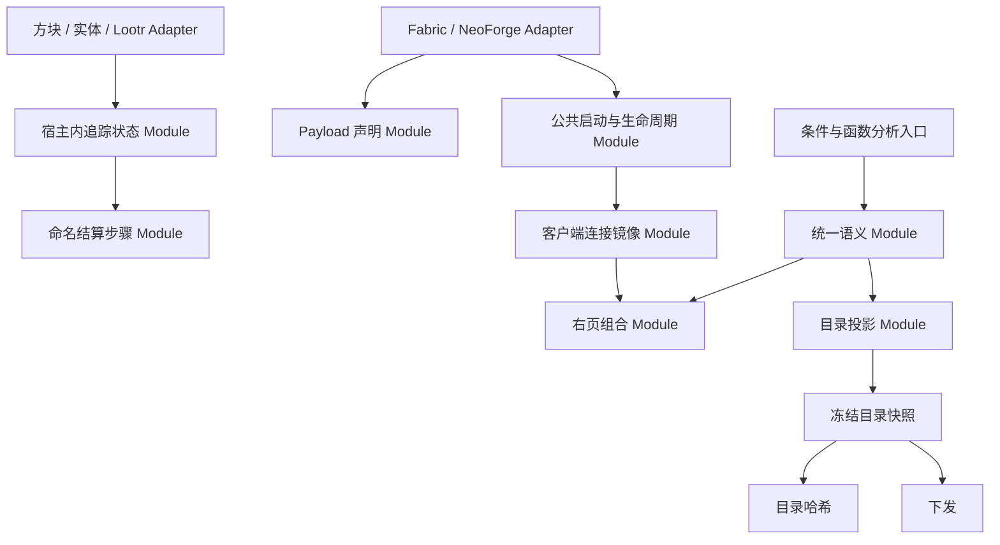

# 架构改造执行计划

> 状态：S1—S7 自动实施完成，待用户实机验收。规划与自动交付日期：2026-11-10；源码基线：`ef5dac3`。
> 当前机制以 [开发者文档](../dev/README.md) 及源码为准；本文与配套 spec、issue 均为计划文档，描述目标结构与执行约束。
> 规划依据：本地 `.local/architecture-review/`。执行入口：`.scratch/architecture-execution/README.md`。

## 一、现状

本节记录实施前状态。审查主线覆盖平台编排、目录投影、日志镜像、条件与函数语义、结算、附加状态、网络声明及右页组合。

下表路径中的 `common/`、`fabric/`、`neoforge/` 均省略 `src/main/java/com/meteorite/unsuspiciousblock/`；行号用于定位本次基线。

| 审查项 | 源码核实的耦合点 | 规划处理 |
|---|---|---|
| P-01 | `fabric/UnsuspiciousBlockFabric.java:286` 与 `neoforge/UnsuspiciousBlockNeoForge.java:417` 重复服务器生命周期；两端客户端重复 tick、通知和断连编排 | 铁砧规则先收敛；注册与生命周期再统一到 common 的命名入口 |
| P-02 | `common/journal/catalog/ArchaeologyJournalServerCatalog.java:171` 构建期合并注入，`:389` 再构造上线投影；`CatalogGeneration.java:166` 独立构造摘要输入 | 注入合并共用规则；哈希与下发共用冻结的目录投影 |
| P-03 | `common/client/ui/support/ArchaeologyJournalLogLocalStore.java:71` 的 getter 推进 tick；`JournalUiPreferencesStore.java:151` 直接覆盖偏好文件 | 连接实例持有镜像，tick 推进；纯读查询；偏好原子替换且失败保留 dirty |
| P-04 | 条件消费者分别判断组合类型；`LootConditionInfo.java:19` 的 children 同时表达逻辑子节点和展示子行 | 集中结构分类、三值折叠与遍历；叶子的展示子行保持展示用途 |
| P-05 | `common/journal/tracking/event/LootTrackingBootstrap.java:23` 用优先级登记内建步骤；`LootTrackingEvents.java:93` 顺序调用且异常向外传播 | 内建结算改成命名方法链，保持核心失败传播并补上下文 |
| P-06 | `common/loottable/analysis/LootFunctionHandler.java:37` 同时提供预览、描述、签名和策略方法；`LootTableProjector.java:387` 另判效果 | 描述产物携带策略事实，调用方读取统一的类型化语义 |
| P-07 | Brushable 与 Lootr Mixin 重复状态及 NBT；容器宿主重复同类数据；封存方块使用不同扫描键 | 普通状态 Module 与 codec 复用，宿主 Adapter 保留注入和键兼容 |
| P-08 | `common/network/ModPayloads.java:121` 与 `:159` 重复 S2C 类型和 codec；NeoForge 两个入口各写协议版本 | 单一描述派生视图，客户端绑定延迟解析，版本单一常量 |
| P-09 | `common/client/ui/panel/PagePanel.java:7` 已继承 `UiInputTarget`；`RightPageContainer.java:30` 开始的分支主要处理组合页与 chrome | 复用现有输入 Interface，集中页描述与组合页行为 |
| P-10 | `BrushableBlockEntityScanState.java` 与 `TrackedContainerLootState.java` 暴露 pending 的读改写；`UnsuspiciousBlockEntity.java:146` 用空实现表示不支持 | pending 生命周期归宿主内的 Module；显式能力区分，保持宿主落盘 |

### 已确认的审查修正

- P-01 的公共引用实际由 common 的 `ModXxx` 静态字段持有；平台持有注册器与延迟句柄。规划保留这个归属。
- P-02 的声明式物品注入与 `RuntimeLootLinks.syntheticEdges` 子树约束用途不同。统一各自的重复规则，保留来源分型和用途。
- P-03 把写盘移到 tick 后仍在客户端线程执行。后台 I/O 另需性能证据与完整退出协议。
- P-05 的异常会传播到提交调用方。改造保留核心链的失败即停止语义，记录失败步骤。
- P-09 的分页方法包含 `controlsDirty` 等失效动作。保留面板拥有分页状态的封装。
- J-06 的带备注日志保护与当前 [日志存储说明](../dev/internals/journal-log-storage.md) 一致，列为产品规则，调整需单独决策。

## 二、目的

### 2.1 目标

让调用方只需知道一次提交、一次连接、一次目录读取或一次页面切换的 Interface；顺序、状态配对、投影和持久化知识各有归属。

### 2.2 架构要求

采用 `codebase-design` 的术语：Module 提供 Interface，Seam 是 Interface 所在位置，Adapter 在真实差异处满足 Interface。Depth 以调用方减少的知识判断；Leverage 和 Locality 通过实际消费者与变更路径验收。

纯计算直接形成普通类或函数。平台注册、宿主存取使用已有真实 Adapter。文件读写留在 Module 内部的 Implementation。新抽象必须同时落地消费者；删除它后若只少一层转发，应合并回调用方。

### 2.3 范围

执行主线处理 P-01 至 P-10，并合并直接相关的 foundation/C-04、J-05、J-08。其他候选的现状、进入条件和保留结构记录在 `.scratch/architecture-execution/backlog.md`。本轮实际消费的通用 UI 能力可提取到本地 UI kit，并完成库验证、本地 dev 发布与宿主升级；具体流程见 `.scratch/architecture-execution/kit-workflow.md`。玩法数值与存储布局升级各自立项。

## 三、技术原理

| 依据 | 证据等级 | 对路线的约束 |
|---|---|---|
| Fabric 即时注册，NeoForge 存在延迟 Item 回写与 MenuType 兜底 | 源码核实 | common 共享声明与调用顺序；平台 Adapter 保留事件相位及延迟解引用 |
| pending 随方块、实体或 Lootr 每玩家库存保存 | 源码核实 | 状态继续由宿主持有；跨卸载恢复使用原 NBT 键 |
| 日志快照按 session、snapshot、sequence 提交 | 源码核实 | 连接切换与快照提交均为整体状态迁移，迟到消息绑定原连接 |
| children 兼有逻辑与展示用途 | 源码核实 | 逻辑遍历与展示遍历各用明确入口，叶子求值留给现有执行上下文 |
| 函数 effect、fidelity、随机性回答不同问题 | 源码核实 | 保留独立的类型化事实，集中派生；空操作证明允许读取预览输入 |
| options 带 generation，目录下发还包含 branches 与 observedFunctions | 源码核实 | 目录摘要覆盖完整线上形态；generation 凭据变化触发重同步 |
| 客户端写盘引起可感知掉帧、服务端索引崩溃窗口造成日志遗漏 | 假设，需运行期验证 | 主线修复已确认的读路径副作用；性能和跨文件恢复另按证据推进 |

必须遵守的平台、端、Mixin、双语文本和数据兼容约束见各 spec。现有 ServiceLoader、概率分型、引用图、存储限额与 UI kit 输入机制继续作为基础。

## 四、技术路线

### 4.1 阶段安排

按声明收敛、生命周期归属、持久化归属、语义统一、投影一致性、视图扩展逐层推进。阶段序号是推荐交付顺序，依赖列才是技术阻塞关系。

| 阶段 | 主题与架构程度 | 覆盖 | 技术前置 | spec 目录 | 阶段出口 |
|---|---|---|---|---|---|
| S1 | 声明与纯规则；局部收敛 | P-08、P-01 铁砧部分 | 无 | `.scratch/architecture-phase-01-declarations/` | 网络清单单源，双平台铁砧规则共用 |
| S2 | 启动与生命周期；平台时序 | P-01 其余、foundation/C-04 | S1 | `.scratch/architecture-phase-02-bootstrap/` | common 拥有共享编排，平台 Adapter 拥有注册时机 |
| S3 | 客户端镜像；连接状态与本地 I/O | P-03、J-08 | S2 | `.scratch/architecture-phase-03-client-mirror/` | 连接实例隔离、getter 纯读、写失败可重试 |
| S4 | 宿主状态与结算；持久化及领域顺序 | P-10、P-07、P-05 | S1 | `.scratch/architecture-phase-04-tracking-state/` | pending 与 NBT 有单一归属，内建结算顺序显式 |
| S5 | 条件与函数；跨消费者语义 | P-04、P-06 | S1 | `.scratch/architecture-phase-05-loot-semantics/` | 逻辑树与函数策略各有单一解释入口 |
| S6 | 目录投影；同步及缓存一致性 | P-02、J-05 | S5 | `.scratch/architecture-phase-06-catalog-projection/` | 下发与摘要同源，代次及发布顺序一致 |
| S7 | 右页组合；视图扩展 | P-09 | S3、S5 | `.scratch/architecture-phase-07-page-composition/` | 页描述统一分派，输入、分页与恢复语义保留 |

每个目录包含 `spec.md` 和 `issues/`。单个 issue 实现后执行机械检查；阶段结束执行 IDEA、完整构建和收尾，通过后连续推进下一阶段。各阶段的游戏观察统一留到全部自动实施完成后交给用户。

### 4.2 目标拓扑

### 4.3 文档同步

实施时按 issue 更新 `docs/dev/foundation/`、`docs/dev/subsystems/` 和相关 `internals/` 的当前机制。计划、执行状态和未落地类型仅保存在本计划与 `.scratch/`。开发文档继续使用现有职责导航。

## 五、决策记录

| 决策 | 目标路线 | 理由 |
|---|---|---|
| D1 | 编排使用命名方法与现有 registrar；平台差异按事件相位保留 | 避免以阶段注册框架替代现有平台机制 |
| D2 | pending 使用宿主内状态 Module | 复用现有持久化生命周期，避免新增全局句柄表和清扫协议 |
| D3 | 镜像先同步 tick 落盘 | 先消除读路径副作用；线程化需单独确认收益和退出语义 |
| D4 | 条件结构从现有类型 ID 集中分类 | 保持传输形态，区分逻辑子节点与展示子行 |
| D5 | 函数语义类型化，公开扩展保留兼容入口 | 现有文档明确允许外部注册 handler；内建实现先退出旧策略方法 |
| D6 | 目录快照同时提供内容和摘要，包含 generation 凭据 | 避免下发读到不同代次，防止缓存中的旧凭据继续使用 |
| D7 | 内建结算链与公开优先级扩展分开维护 | 内建顺序可直接阅读；已有公开 register 契约在兼容入口保留 |
| D8 | 右页采用局部页描述和组合页，面板保有分页状态 | 复用真实变化，保留翻页后的失效动作 |

## 六、风险与限制

| 类型 | 说明 | 处置 |
|---|---|---|
| 已知限制 | 原报告为静态审查，当前 UI kit 迁移仍有用户实机验收待办 | 运行项由用户按共享验收表记录；S7 先确认受影响的现有交互基线 |
| 已知限制 | 附加状态存在不同历史 NBT 键与宿主专属行为 | S4 按宿主建立兼容表，保留读取与写出形态 |
| 已知限制 | `register` 与函数 handler 是文档化公开扩展点 | 保留兼容入口；收窄内建调用路径 |
| 假设 | 目录完整摘要可能增加重载后的全量同步与摘要成本 | 按代次和 overlay revision 缓存，实机观察重载和模拟完成广播 |
| 假设 | 偏好未复位字段会在切服时产生可见串数据 | S3 用有偏好与无偏好的不同世界验证；字段按实际作用域分类 |

## 七、验证方式

### 7.1 开发执行

规划阶段核对源码依据、分片依赖、链接和覆盖关系；实现阶段按下述 M/G 门禁执行。自动结果见「实施结果」。

每个分片执行共享验收 M；每阶段完成后先用 IDEA MCP 检查 git 工作区错误与警告，再执行 `./gradlew build`，随后同步文档、清理残留并登记结果。构建等待窗口至少 120 秒，工具若较早返回运行中任务 ID，则持续等待该任务结束；同一工作区构建串行。新增 test 文件不在本项目执行方式内。校验细则统一见 `.scratch/architecture-execution/acceptance.md`。

### 7.2 用户执行

共享场景与记录格式见 `.scratch/architecture-execution/acceptance.md`。各 issue 指定涉及的场景，全部阶段自动完成后统一交给用户验证双平台客户端、专用服务端、重连重载、宿主恢复、结算数量、条件显示与右页输入。goal 以自动实施完成并交付实机清单为出口；计划在用户验收通过后归档。

## 八、待确认项

性能是否需要后台 I/O、J-04 的恢复策略、猫族与淘洗状态模型调整，均按 backlog 的进入条件立后续任务。当前 spec 的执行路线已经选定。

## 九、实施结果

2026-11-10：S1—S7 的实现分片与阶段自动收口均为 implementation-complete。各片 M、阶段 IDEA G1、完整构建 G2、兼容/架构核对与文档收尾记录保存在执行索引指向的 issue Comments；s1-build.log 至 s7-build.log 均为成功结果。最终源码的工作区标识、IDEA 明细、构建日志与归档摘要见本地 `.scratch/architecture-execution/final-verification.md`。

已落地的 Module 与消费者覆盖 payload 单源声明、双平台编排、连接镜像与原路径原子保存、宿主 pending 与命名结算、条件/函数统一语义、目录冻结投影及右页组合。当前机制已同步到 `docs/dev/` 对应权威文档。旧存储路径、宿主 NBT 和协议 4.10 保持，概率缓存版本更新为 loot-analysis-v25。

最终双平台产物为 `fabric/build/libs/unsuspiciousblock-fabric-1.21.1-1.5.2.jar` 与 `neoforge/build/libs/unsuspiciousblock-neoforge-1.21.1-1.5.2.jar`。UI kit 保持 0.1.0-dev.4；本轮无库修改和新发布。最终嵌套平台库与本地 Maven 字节一致，宿主元数据及 class 归属核对通过。

U1—U15 与原 UI kit 迁移实机待办保留待验收，汇总入口为本地 `.scratch/architecture-execution/human-acceptance.md`。已知限制为游戏观察尚待用户执行、本地保存仍同步执行、NeoForge 中性快照构造器及既有 Gradle 弃用提示。backlog 按既定处置保留。计划等待用户验收，归档按下述规则执行。

完成后将本文件移入 `docs/archive/architecture-execution/architecture-execution-plan.md`，各 `.scratch/architecture-*` 配套目录按原目录名移入同一归档目录；保留内部相对关系，修正指向源码和开发文档的相对链接。归档前填齐执行索引与验收记录；归档后从 [计划索引](README.md) 移除此入口，并在归档目录建立 `README.md`。目标已存在时先核对，保留原内容。
