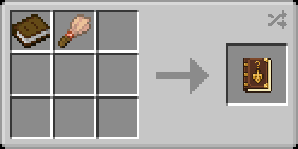

# Archaeology Journal

The Archaeology Journal records the loot you find, where you found it, and the conditions for obtaining it, helping you plan your next expedition.

## Obtaining

Combine a book and a brush in a crafting table to make the Archaeology Journal.

- Right-click the journal in hand to open it.
- Press `C` (default) to open a journal you are carrying.
- When opened via the hotkey, the journal can sit in your inventory; with a Curios/Trinkets integration installed, it can also rest in an accessory slot.
- Hover over an item in your inventory and press `C` to look it up in the journal. If a matching entry is found, the journal opens directly to it. With JEI installed, this also works in JEI's item list.

## Home Page

The right side of the first page after opening the journal shows collection statistics: number of brushes, loot chests opened, current log entries and noted entries, plus the time of the latest record and the most recently discovered item.

## Catalog

The Catalog groups possible finds by loot source. New sources and items unlock as you explore.

The Catalog supports:

- Searching and sorting
- Favoriting entries
- Hiding locked (undiscovered) content
- Viewing item acquisition conditions and estimated probabilities
- Viewing how loot sources are related

The probabilities shown are estimates. Your actual finds also depend on the biome, dimension, tool enchantments, and other conditions.

## Log

The Log records discoveries that have actually happened, including:

- Items found and their quantities
- Coordinates, dimension, and biome
- Structure or container source
- Time of discovery
- The detailed source of the loot

Logs can be grouped by time, dimension, biome, and note status. Opening a log entry's details lets you add a note and copy a teleport command for returning to the discovery site.

Each loot source has its own log records. Servers can set a limit for each source; once it is reached, the oldest unprotected records are removed.

## What Unlocks Records

The following actions advance the journal's catalog and collection progress:

- Brushing suspicious blocks
- Excavating decorated pots
- Catching fishing loot
- Opening loot chests

The Suspicious Reader's scan results help you learn where suspicious blocks are and what they contain, but the Log records a full discovery only when you actually obtain the loot.

## Collection Progress and Rewards

When every item in a catalog entry and its sources listed beneath it has been unlocked at least once, the entry reaches 100% completion and grants a one-time reward of 1 Ancient Coin.

## What Can Be Tracked

By default, the journal covers common archaeology finds, decorated pots, fishing, buried treasure, the Ancient City, and this mod's special loot. Other mods and datapacks may add more loot sources to the Catalog.

## JEI Integration

With JEI installed, item entries in the journal's catalog support JEI's `U` (uses) and `R` (recipes) hotkeys; closing the JEI overlay returns you to the Archaeology Journal automatically.

## Multiplayer

Journal progress and logs are saved per player. On multiplayer servers, every player has their own unlock state and discovery records; the mod must be installed on both the client and the server.
