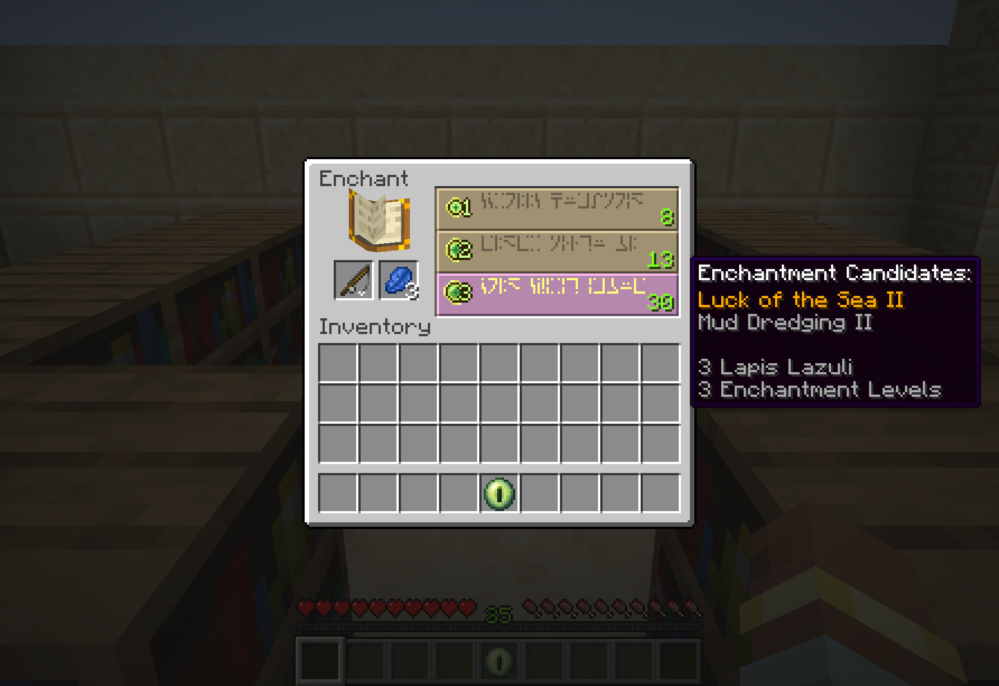
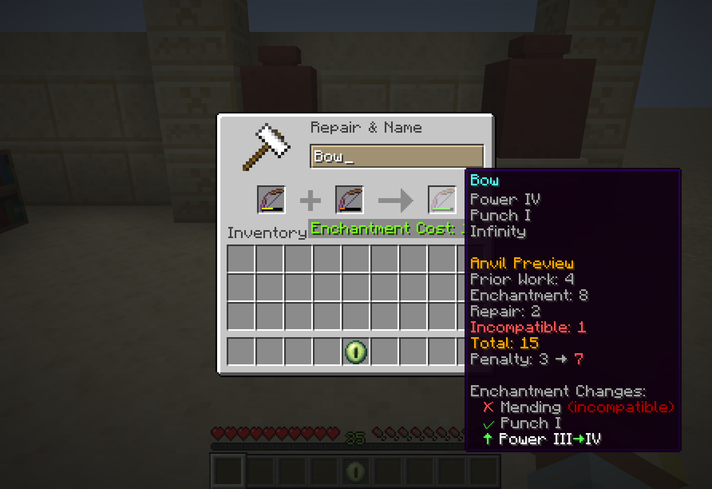
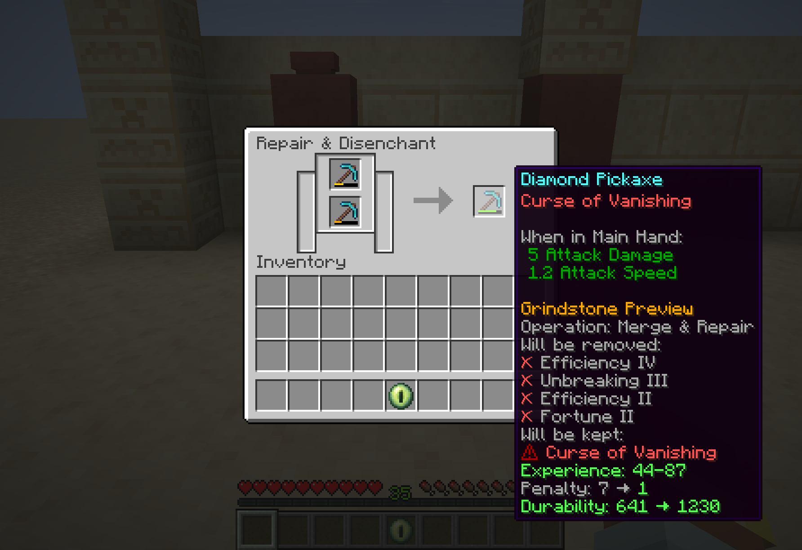

# Eye of Cat

The Eye of Cat is a passive utility relic that reveals hidden mechanics in enchanting tables, anvils, and grindstones.

## Obtaining

Every **Buried Treasure** chest generates **1 Eye of Cat**.

## How to Carry

Keep the Eye of Cat anywhere in your carried range for its effects to work automatically:

- Player inventory or hotbar
- Charm accessory slot (with Fabric Trinkets or NeoForge Curios installed)
- Inside a carried [Specimen Box](en-Specimen-Box)

## Three Reveal Abilities

### 1. Enchantment Candidate Reveal

When hovering the three enchantment options in an Enchanting Table, you see the complete list of candidate enchantments and levels instead of vanilla's single-line preview.

### 2. Anvil Cost Breakdown

When using an Anvil, hovering shows a full breakdown of the experience level cost:

- Current prior-work penalty and resulting penalty after the operation
- Prior work, enchanting, repair, rename, and incompatibility costs
- Enchantment changes (marking incompatible or unsupported entries) and "Too Expensive!" warnings

### 3. Grindstone Operation Preview

When using a Grindstone, hovering previews:

- Operation type (Disenchant or Merge & Repair)
- Which enchantments will be removed and which curses will be kept
- Returned experience range, durability change, and penalty change

