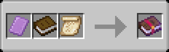

# Lost Pages and Enchantments

Lost Pages connect archaeology exploration to four dedicated enchantments. Every enchanted book forged from a Lost Page is a random result.

## Obtaining Lost Pages

Lost Pages have an 8% chance to appear in the rare archaeology loot pool of Trail Ruins. The Archaeology Journal records them once you discover the relevant loot.

## Crafting Base Pages

Place 3 pitcher plants in a row in a crafting table to get 3 Base Pages. Each Base Page can also be crafted on its own into 1 paper.

## Forging a Random Enchanted Book

Place one of each into a smithing table, from left to right:

1. Base Page
2. Book
3. Lost Page

The output is a random enchanted book. The result may be:

- A book with one of this mod's enchantments
- A book with a vanilla enchantment
- A book containing both a mod enchantment and a vanilla enchantment

## The Four Enchantments

| Enchantment | Applies to | Effect |
|---|---|---|
| Mud Dredging I–III | Fishing Rod | While fishing, a chance to dredge up an extra treasure: 20% at level I, +10% per additional level. Extra finds in swamps favor higher-value treasures. |
| Textile Recovery | Shears | Shearing sheep drops an extra 1–3 string. |
| Precision Excavation I–III | Brush | When brushing suspicious blocks, a chance to double that brush's loot: 28%, 44%, and 60% respectively. |
| Fossil Hunter | Pickaxe | Mining naturally generated bone blocks has a 50% chance to grant extra fossil loot. The possible rewards vary by dimension. |

### Fossil Hunter Restrictions

Fossil Hunter only works on bone blocks recorded as naturally generated at world creation. Bone blocks placed by players or machines, and bone blocks that have already been processed, do not trigger the bonus; no bonus is granted in creative mode or when block drops are disabled either.

### How to View Enchantment Effects

The detailed effects of ordinary enchanted books can be viewed in the item tooltip. While holding an [Eye of Cat](en-Eye-of-Cat), you can also see the full information of every candidate enchantment in the enchanting table.
