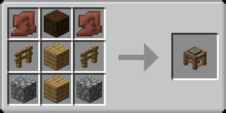
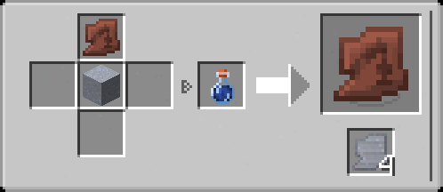
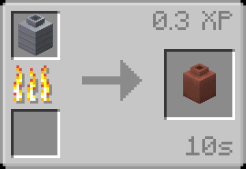
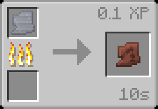

# Pottery Wheel

The Decorated Pottery Wheel duplicates rare pottery sherds and molds custom four-sided unfired decorated pots, with an interactive preview and hopper automation.

## Crafting the Wheel

Combine the following materials in a crafting table:

- 2 pottery sherds (any type)
- 1 log (any wood)
- 2 wooden fences (any wood)
- 2 wooden planks (any wood)
- 2 cobblestone (or blackstone, cobbled deepslate, etc.)

## Interface and Basics

Right-click the wheel to open its 7-slot interface:

- **Top, Left, Right, Bottom slots**: Place pottery sherds or bricks as pattern templates.
- **Clay slot**: Place clay blocks or clay balls.
- **Water slot**: Place a vanilla water bottle (inserting one fills the wheel block's water basin).
- **Output slot**: Collect finished unfired items.

Each cycle takes **8 seconds** (160 ticks). **Pattern sherds and bricks are never consumed**; each craft consumes clay and 1 water bottle, leaving an empty glass bottle.

### 3D Preview & Zoom Lightbox

The preview area on the right shows the resulting pot or sherd:

- Drag across the preview to rotate a decorated pot and inspect all four sides.
- **Click the preview** to open a zoomable, draggable lightbox for closer inspection; press `Esc` or click Close to return.

## Crafting Decorated Pots

1. Place 1 sherd (or **brick** for a blank side) into each of the four pattern slots.
2. Put **1 clay block** or **4 clay balls** in the clay slot and 1 water bottle in the water slot.
3. Collect **1 Unfired Decorated Pot** carrying all four chosen patterns.

## Duplicating Pottery Sherds

Place the sherd you want to copy into any single pattern slot and **leave the other three pattern slots empty**, then add clay and a water bottle:

- **1 clay block** + 1 water bottle → **4 Unfired Decorated Pottery Sherds**
- **1 clay ball** + 1 water bottle → **1 Unfired Decorated Pottery Sherd**

## Firing Finished Pottery

Smelt Unfired Decorated Pots or Unfired Decorated Pottery Sherds in a **Furnace** to turn them into finished vanilla pots or sherds with all patterns preserved.

- With **JEI** installed, both Pottery Wheel recipes and furnace firing recipes appear in JEI.
- On **NeoForge** with **Mekanism** (`10.7.19+`), the **Energized Smelter** fires unfired pots and sherds while preserving patterns.
- On **NeoForge** with **Create** (`6.0.10`), **Encased Fans** can bulk-smelt unfired pots and sherds while preserving patterns.

## Hopper Automation and Work Modes

### Hopper Sides

- **Top**: Inserts clay and vanilla water bottles
- **Sides**: Inserts sherds, bricks, clay, and water bottles
- **Bottom**: Extracts finished items and empty glass bottles

Upon completion, finished outputs and empty bottles **try to enter a hopper directly underneath first**; otherwise outputs stay in the output slot and the empty bottle returns to the water slot (or drops if water bottles remain stacked).

### Work Status Button

Click the mode button at the top-left of the interface to cycle between:

- **Enabled**: Runs whenever valid inputs are present
- **Disabled**: Pauses processing
- **Redstone Enabled**: Runs only while receiving a redstone signal
