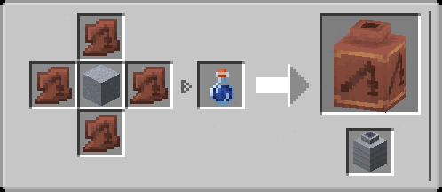

# Pottery Wheel

The Decorated Pottery Wheel is used to craft unfired decorated pots and unfired decorated pottery sherds, and can also duplicate pottery sherds you already own. It supports both manual operation and hopper automation.

## Crafting the Wheel

Arrange these materials in a crafting table as shown to make 1 Decorated Pottery Wheel:

- 2 pottery sherds
- 1 log
- 2 wooden fences
- 2 wooden planks
- 2 cobblestone

You can use other kinds of wood and pottery sherds. Other materials used to craft stone tools, such as blackstone, can replace the cobblestone.

## Interface and Inputs

Right-click the wheel to open its interface. It has seven slots:

- Top, left, right, bottom: hold pottery sherds or bricks to choose the patterns
- Clay: hold a clay block or clay balls
- Water: hold a vanilla water bottle
- Output: take the finished product

Each process takes 8 seconds. Sherds and bricks used as patterns are kept; each process consumes clay and one bottle of water, leaving an empty glass bottle.

## Crafting Decorated Pots

1. Put one sherd into each of the four pattern slots. Use a brick for any side you want to leave undecorated.
2. Put 1 clay block or 4 clay balls into the clay slot, and 1 water bottle into the water slot.
3. Take out 1 unfired decorated pot with patterns matching the four materials you placed.

Smelt the unfired decorated pot in a furnace to turn it into a vanilla decorated pot.

With Mekanism installed on NeoForge, the Energized Smelter can also fire decorated pots and pottery sherds. The finished pottery keeps the patterns on the unfired item.

## Duplicating Pottery Sherds

Put the sherd you want to copy into any pattern slot and leave the other pattern slots empty. Add clay and 1 water bottle:

- Consume 1 clay block to get 4 unfired sherds with the same pattern.
- Consume 1 clay ball to get 1 unfired sherd with the same pattern.

Smelt the unfired sherds in a furnace to get sherds with the copied pattern. The images use the Angler pattern; other patterns are copied and fired the same way. The original sherd is kept.

## Hopper Automation

Hoppers can insert or extract items from these directions:

- Top: input clay and water bottles
- Sides: input pottery sherds and other pattern materials
- Bottom: output finished products and empty glass bottles

Finished products first try to enter the hopper directly below; if the hopper cannot accept them, the items stay in the wheel's output slot.

## Work Modes

The mode button in the interface toggles between three states:

- Always work
- Stop working
- Work only when receiving a redstone signal
