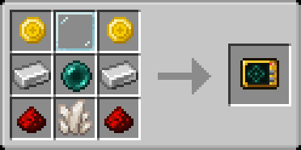
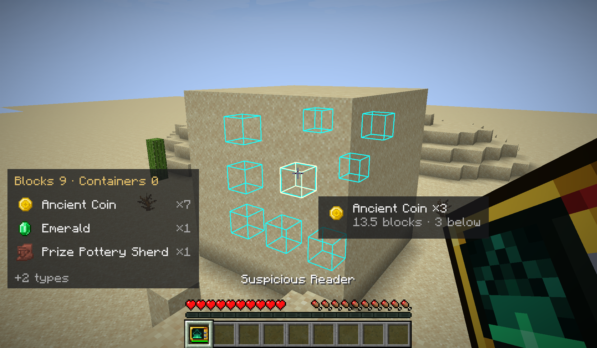
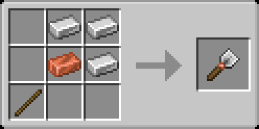

# Suspicious Reader & Archaeological Shovel

These two tools pair together for a "scan first, excavate fast" workflow. When held across your main hand and off-hand, unscanned blocks are scanned by the Reader first, while already-scanned blocks are extracted by the Shovel first.

## Suspicious Reader

### Crafting

The recipe requires:

- 2 Ancient Coins
- 1 glass pane
- 2 iron ingots
- 1 ender pearl
- 2 redstone dust
- 1 nether quartz

### Single-Block Scan

In default **Single Block** mode, right-click a suspicious block or [Unsuspicious Block](en-Unsuspicious-Blocks) to inspect its contents (and who sealed it, for Unsuspicious Blocks). Single-block scans cost **0 energy**.

### Ranged Scan

While holding the Reader, press `V` (rebindable in Key Binds) to cycle scan levels:

| Mode | Range | Energy Cost |
|---|---|---|
| Single Block | 1 block | Free (0 energy) |
| Low Range | 3×3×3 | `1 + newly scanned suspicious blocks` |
| Mid Range | 5×5×5 | `2 + newly scanned suspicious blocks` |
| High Range | 7×7×7 | `3 + newly scanned suspicious blocks` |

- Ranged scans center the cube behind the block face you clicked and highlight suspicious blocks and unopened loot containers inside the area.
- Suspicious blocks you have already scanned and loot containers do not add extra per-block energy cost.
- Higher scan levels play a faster scan animation on the item model; at 0 energy, the indicator light turns off.

### Scan HUD and World Outlines

- **Bottom-Left Summary**: Shows the total suspicious blocks and loot containers found, plus up to 3 grouped item rows and any empty block count.
- **Crosshair Target Details**: While holding the Reader in either hand, looking at a scanned target within 32 blocks (even through surface sand) displays its item, count, distance, and height difference. Loot containers display "Contents unknown" without spoiling their contents.
- **Toggle HUD**: Press `H` to toggle the Reader HUD panels (without hiding Jade or basic world outlines). Panels also hide automatically when another GUI is open or `F1` is pressed.
- **Outline Colors & Duration**: Suspicious blocks with loot glow cyan, empty blocks glow gray, and unopened containers glow purple, with a brighter outline on your focused target. Outlines remain visible for 10 seconds, extending up to 30 seconds while you keep looking at a target.

### Energy and Recharging

- **Max Energy**: 512 (shown by a green/yellow/red bar on the item).
- **Auto Recharge**: Ranged scans automatically consume Ancient Coins from your inventory if energy runs low.
- **Manual Recharge**: Sneak + right-click air to spend 1 Ancient Coin for 256 energy. If less than 256 energy is missing, the first click warns of potential waste; sneak + right-clicking again within 1 second forces the recharge.

## Archaeological Shovel

### Crafting and Stats

Craft the Archaeological Shovel with **3 iron ingots, 1 copper ingot, and 1 stick**. It has iron mining tier and 256 durability, repairable on an anvil with iron ingots or Ancient Coins.

### Direct Extraction

Right-click a suspicious block that **you** have scanned to extract its loot immediately without waiting for brushing, finalizing its journal unlock and log entry.

- Unscanned blocks, blocks scanned by another player, or empty blocks cannot be extracted.
- With the Reader in one hand and the Shovel in the other, right-clicking an unscanned block scans it first, and a second right-click extracts the loot.

### Vein Digging and Safe Mining

- **3-Block Vein Digging**: Mining shovel-mineable blocks while not sneaking digs up to **3 blocks** vertically downward (1 extra durability per extra block); sneaking restores single-block digging. Vein digging automatically stops before breaking suspicious blocks or the blocks supporting them.
- **Suspicious Block Protection**: Normal mining does not break vanilla suspicious blocks and never triggers vein digging. Hold **Shift (sneak)** to break a single suspicious block intentionally.
- Right-click a placed [Unsuspicious Block](en-Unsuspicious-Blocks) with the Shovel to break it and drop its sealed item.

### Unearthing Ancient Coins

Mining sand, red sand, or gravel with the Archaeological Shovel has a **0.3%** chance to drop an extra Ancient Coin. Ancient Coins can be used to:

- Recharge the Suspicious Reader (256 energy per coin)
- Repair any damageable item on an anvil for **25% of its max durability** with no prior-work penalty
- Trade with Wandering Traders (1 Ancient Coin for 5 emeralds)
