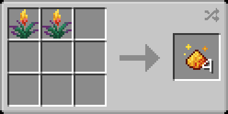
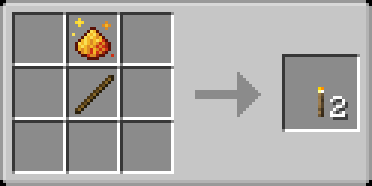
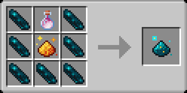

# Spark Dust and Rewind Dust

Torchflowers can be processed into flammable **Spark Dust** for fuel and torches, or combined with Echo Shards and Dragon's Breath to craft **Rewind Dust**—an item that regenerates world-generated structures in place.

## Spark Dust

### Crafting

Combine **2 Torchflowers** anywhere in a crafting grid to get **4 Spark Dust**.

### Uses

- **Furnace Fuel**: Each Spark Dust burns for **800 ticks** (40 seconds, enough to smelt 4 items).
- **Crafting Torches**: Place **1 Spark Dust** directly above **1 Stick** in a crafting grid to make **2 Torches**.
- **Crafting Rewind Dust**: Used as the center catalyst in Rewind Dust.

## Rewind Dust

### Crafting

Arrange the following ingredients in a `3×3` crafting table to craft **1 Rewind Dust**:

- **7 Echo Shards** (top-left, top-right, middle-left, middle-right, and all 3 bottom slots)
- **1 Dragon's Breath** (top-center)
- **1 Spark Dust** (center)

### How to Use

Right-click any block inside the bounds of a **world-generated structure** (consumes 1 Rewind Dust in survival):

- Works on naturally generated structures (such as Desert Pyramids, Ocean Monuments, Trail Ruins, Nether Fortresses, End Cities, Trial Chambers, and mod-added structures). Player-built structures and standalone terrain features cannot be rewound.
- If no structure is present, if the structure extends beyond the world border or touches spawn protection, if its layout cannot be read cleanly, or if it is on cooldown, no Rewind Dust is consumed.

### Cooldown and Rebuild Behavior

- **40-Minute Structure Cooldown**: Triggering a rewind puts that entire structure on a **40-minute** (48,000 ticks) shared cooldown across all players (plus a 1-second item cooldown).
- **Chunk-by-Chunk Regeneration**: The server rebuilds the structure one chunk per tick to avoid freezing the game, accompanied by particles, sound cues, and a 3-second screen distortion effect (respecting vanilla's Distortion Effects accessibility setting). Only one rewind task runs per server at a time.
- **One-Time Features Reset**: Vanilla one-time structure states—including Desert Pyramid chests, Jungle Temple chests and traps, Stronghold corridor chests, Stronghold/Fortress spawners, Mineshaft cave spider spawners, and Swamp Hut entities—are reset to generate fresh loot and mobs.

> **Important Warning**: Rewind Dust **re-runs world generation** rather than restoring a backup snapshot. It **overwrites any player builds or edits** inside the structure and regenerates loot containers and entities. Do not use it inside your base or storage area.
