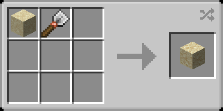

# Unsuspicious Blocks

Unsuspicious Sand and Unsuspicious Gravel are decorative and prank blocks that look identical to vanilla suspicious blocks, but hold an item sealed by a player instead of generating archaeology loot.

## Crafting an Empty Block

Place the following two items anywhere in a crafting grid:

- **1 sand or gravel**
- **1 [Archaeological Shovel](en-Reader-and-Shovel)**

This produces 1 **Unsuspicious Sand** or **Unsuspicious Gravel**. Each craft costs the shovel **1 durability** and leaves the shovel in the crafting grid until its durability runs out.

## Sealing Items

Combine **1 empty Unsuspicious Block** and **1 item to hide** in any crafting grid to seal that item inside (one item per block; Unsuspicious Blocks cannot be sealed inside each other).

- The block remembers which player sealed it.
- Scanning it with the [Suspicious Reader](en-Reader-and-Shovel) or viewing it with **Jade** reveals both the sealed item and the player who sealed it.

## Placing and Retrieving

- Like suspicious blocks, if the supporting block directly below a placed Unsuspicious Block is removed, the block breaks immediately and drops its sealed item.
- Right-clicking a placed Unsuspicious Block with a **vanilla Brush** or the **Archaeological Shovel** breaks it immediately (consuming 1 tool durability) and drops the sealed item without a brushing animation.
- Unsuspicious Blocks do not unlock entries or create discovery logs in the [Archaeology Journal](en-Archaeology-Journal).
