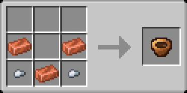
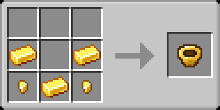
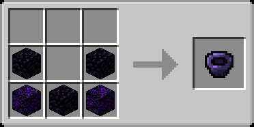

# 钓鱼打捞与淘盘淘洗

除了用刷子发掘遗迹，你还可以带着附魔钓竿在各类水域打捞沉船物资，或携带淘盘前往河流与下界熔岩中淘取沉积物、矿物与遗物。

## 泥底打捞

为钓鱼竿附魔[泥底打捞](zh-Lost-Pages-and-Enchantments)（I–III 级）后，每次成功收竿都有概率额外获得 1 件战利品：I 级为 **20%**，每提高一级增加 **10%**（满级 40%）。

### 浅水与开阔水域

- **非开阔水域**：仅能捞出黏土球、泥巴、玻璃瓶、骨粉、睡莲等基础淤泥杂物。
- **开阔水域**：有高概率进入地区战利品池；安装 **Relics** 模组时，开阔水域每次触发还有 **2%** 概率额外捞出 1 件 Relics 饰品。

### 地区战利品分化

- **非沼泽开阔水域**：
  - **通用漂流货**：纸、线、皮革、碗、指南针、时钟。
  - **内陆淡水**（非海洋、非沙滩）：额外可能捞到灯笼、附魔之瓶与绿宝石。
  - **冰寒与恶地水域**：冰冻河流/冰海/雪滩可捞出浮冰；恶地群系可捞出金粒。
  - **温水与冷水海洋、海滩**：分别产出对应的原版纹饰陶片（温水：垂钓/庇护/嗅探；冷水：利刃/探险/悲恸/富饶），以及**海岸盔甲纹饰锻造模板**和**沉船木桶**。
  - **沉船木桶**：木桶物品放置并打开后，会按原版沉船地图舱或宝藏舱战利品表生成整箱船货。
- **沼泽与红树林沼泽开阔水域**：分流至专属沼泽池，可捞出木棍、糖、蜘蛛眼、火药、红石粉、荧石粉、粘液球、红树胎生苗、发酵蛛眼、受损的附魔金斧、水肺/夜视/剧毒药水以及唱片 `13`。

> 古代金币与失落书页不会通过「泥底打捞」掉落。

## 淘盘淘洗

### 三种淘盘与制作

三把淘盘均可在铁砧用对应材料修复，也可以附魔耐久/经验修补：

| 淘盘 | 合成材料 | 耐久 | 铁砧修复 | 可淘洗点位与特性 |
|---|---|---:|---|---|
| **铜淘盘** | 3 铜锭 + 2 铁粒 | 32 | 铜锭 | 仅河流「闪烁的光」，按基础幸运抽取，适合日常稳定淘洗。 |
| **金淘盘** | 3 金锭 + 2 金粒 | 24 | 金锭 | 仅河流「闪烁的光」，默认自带 `+1.0` 幸运加成；每次成功淘洗自然生成点时，默认都有 **10%** 概率在附近生成特殊淘洗点。 |
| **黑曜石淘盘** | 3 黑曜石 + 2 哭泣的黑曜石 | 64 | 黑曜石 | **唯一可淘洗下界「幽微的光」的淘盘**；也可淘水，但默认承受 `-1.0` 幸运惩罚，会显著降低水中矿砂产出并屏蔽金粒、河床晶石与失落书页。 |

在工作台里选相邻的两行。上排左右和下排中间放主材料，下排左右放副材料。

### 操作方式与淘洗点种类

对准液面上的波光长按右键约 **5 秒**（100 游戏刻）即可完成一次淘洗，消耗 **1 点**耐久与淘洗点 **1 次**可用次数（默认每个点位可用 **3 次**）。波光条纹会随剩余次数减少而变暗，成品会自动抛向你的位置。

- **闪烁的光（水域）**：
  - **世界生成点（永久）**：随新区块生成，不计入维度上限也不会自然消失；淘空后仍保留位置并持续冒出上浮粒子，每隔 **20–40 分钟**逐步恢复 1 次可用次数。
  - **自然生成点（临时）**：大约每 **30 秒**在玩家周围河流尝试自然生成，伴随「有东西掉入了水中」提示，寿命为 **20–40 分钟**（每个维度默认同时最多 5 个），耗尽次数或到期后消散。采空后附近 `3×3` 区块进入 30 分钟冷却。
  - **特殊生成点（临时）**：这是金淘盘的额外奖励。点位优先出现在同高的最近可用水面，独立于自然生成上限与冷却，淘洗特殊点不会继续再生。
  - **结冰提示**：如果下方水源结成普通冰，波光会暂停闪烁且无法淘洗；冰面融化后恢复正常。
- **幽微的光（下界岩浆表面）**：
  - 仅在区块生成时出现（紫色波光），属于永久点位，淘空后会逐步恢复次数；只能使用**黑曜石淘盘**淘洗。
- 安装 **Jade** 时，瞄准淘洗点即可查看临时/永久类型、剩余次数以及消失或下次恢复倒计时。

### 产出说明

- **河流淘洗**：
  - 每次必定产出 **3–6 个黏土球**，并附带沙子、沙砾或燧石。
  - 有概率获得冲积矿砂（铁粒、粗铜、煤炭、金粒）与遗物（古代金币、鹦鹉螺壳、失落书页，以及按普通河流/冰冻河流区分的麦捆、挚友、烈焰、狼嚎纹饰陶片）。
  - **河床晶石**（青金石、紫水晶碎片、绿宝石、钻石）：受幸运影响明显，铜盘有较低概率触发，金盘概率大幅提高，黑曜石盘不会触发。
  - **高幸运遗物池**：总幸运达到 **`+1.0`** 及以上（如使用金淘盘或携带幸运效果）时解锁，可开出成堆古代金币、失落书页、附魔之瓶、命名牌、心碎/爱心/危机陶片与金苹果。
- **下界岩浆淘洗**：
  - 稳定产出玄武岩、黑石、镶金黑石、岩浆膏、灵魂沙与灵魂土，以及金粒、下界石英、荧石粉、黑曜石和哭泣的黑曜石（可在下界就地修复黑曜石淘盘）。
  - 有概率淘出烈焰粉、恶魂之泪、火焰弹、**下界合金碎片**，以及按五大下界群系区分的风味掉落（诡异森林末影珍珠、绯红森林下界疣、灵魂沙峡谷骨块、玄武岩三角洲镶金黑石、下界荒地金锭）。
