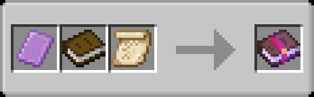

# 失落书页与附魔

本模组新增了四种围绕考古、采集与探索设计的附魔，以及通过「失落书页」在锻造台制作随机附魔书的途径。

## 获取失落书页

失落书页可以从以下途径获得：

- **古迹废墟**：稀有考古战利品池有 8% 概率出现。
- **河流淘洗**：使用[铜淘盘或金淘盘](zh-Fishing-and-Panning)淘洗「闪烁的光」有概率获得（总幸运达到 `+1.0` 时还可从高幸运遗物池中开出）。
- **化石猎手**：使用「化石猎手」采掘主世界或下界的自然骨块也有概率掉落。

## 制作基页

在工作台中将 **3 株瓶子草** 横向排成一行，可合成 **3 张基页**；单张基页也可以直接合成为 1 张纸。

## 锻造随机附魔书

在**锻造台**中从左到右依次放入：

1. **基页**（锻造模板槽）
2. **书**（基础物品槽）
3. **失落书页**（追加材料槽）

取出成品时会随机鉴定为一本附魔书：

- **20% 概率**：仅包含本模组 4 种附魔之一（随机等级）
- **30% 概率**：同时包含 1 种本模组附魔与 10–20 级随机原版附魔
- **50% 概率**：仅包含 15–35 级随机原版附魔

## 四种附魔详解

| 附魔 | 最高等级 | 适用工具 | 获取途径 | 效果说明 |
|---|---|---|---|---|
| **泥底打捞** | III | 钓鱼竿 | 失落书页、附魔台、村民交易 | 收杆时有概率额外打捞 1 件战利品：I 级 20%，每升一级 +10%（满级 40%）。具体产出取决于是否处于开阔水域与所在群系（详见[钓鱼打捞与淘盘淘洗](zh-Fishing-and-Panning)）。 |
| **织物采集** | I | 剪刀 | 失落书页、村民交易、铁砧打书 | 每次剪羊毛时必定额外掉落 1–3 根线。 |
| **精准发掘** | III | 刷子 | 失落书页、村民交易、铁砧打书 | 刷拭可疑方块获得战利品时，按等级有 **28% / 44% / 60%** 概率使本次掉落物翻倍。 |
| **化石猎手** | I | 镐 | 失落书页、随机战利品附魔（宝藏附魔） | 破坏自然生成的骨块时有 **50%** 概率额外触发对应维度的化石掉落表。 |

### 化石猎手的机制细节

- **限定自然骨块**：只对区块或结构生成时记录为“自然生成”的骨块生效。玩家或机器放置的骨块、创造模式破坏、关闭 `doTileDrops` 游戏规则或已经被其他工具挖过的坐标不会触发额外奖励。
- **维度差异与时运加成**：
  - **主世界**：产出骨头、骨粉、燧石、煤炭、铁锭、铜锭、红石粉、紫水晶碎片，以及古代金币（55%）、失落书页（20%）和联动饰品（安装 Artifacts 时有 10% 概率掉落其饰品）。
  - **下界**：产出骨头、骨粉、下界石英、金粒、荧石粉、烈焰粉、岩浆膏、金锭（40%）、古代金币（35%）、失落书页（15%）、联动饰品（10%）以及下界合金碎片（8%）。
  - 其中的矿石类产出与下界合金碎片受镐上的**时运**附魔加成。

### 查看附魔信息

持有[猫之瞳](zh-Eye-of-Cat)时，打开附魔台可以在每个选项的悬浮提示中看到完整的候选附魔列表，便于在附魔钓鱼竿或书本前确认结果。
