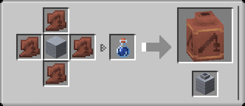
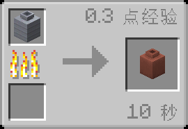
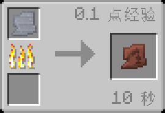

# 纹饰陶轮台

纹饰陶轮台用于压印复制稀有的纹饰陶片，或者指定四面图案制作未烧制的纹饰陶罐，支持预览旋转与漏斗自动化。

## 制作陶轮台

在工作台中按以下材料合成 1 个纹饰陶轮台：

- 2 枚纹饰陶片（任意种类）
- 1 个原木（任意木种）
- 2 个木栅栏（任意木种）
- 2 个木板（任意木种）
- 2 个圆石（或黑石、深板岩圆石等石质工具材料）

## 界面与工作机制

右键陶轮台打开操作界面，共有 7 个槽位：

- **上、左、右、下四个纹饰槽**：放入纹饰陶片或红砖作为样板。
- **黏土槽**：放入黏土块或黏土球。
- **水槽**：放入原版水瓶（放入后陶轮台方块上的水槽会显示动态水面）。
- **输出槽**：取出未烧制的半成品。

每次加工固定耗时 **8 秒**（160 游戏刻）。**作为样板的陶片和红砖不会被消耗**；每次加工消耗对应数量的黏土和 1 瓶水，并留下一只空玻璃瓶。

### 3D 成品预览与放大灯箱

右侧预览区会实时渲染即将产出的陶罐或陶片：

- 在预览区按住拖动，可以手动旋转查看陶罐四面纹饰。
- **点击预览图**可以打开放大灯箱，自由放大、缩小和平移端详细节；按 `Esc` 或点击关闭退出灯箱。

## 制作纹饰陶罐

1. 在上、左、右、下四个纹饰槽各放入 1 枚材料（某面想要保持空白时放入**红砖**）。
2. 在黏土槽放入 **1 个黏土块**或 **4 个黏土球**，并在水槽放入 1 瓶水。
3. 加工完成后获得 **1 个未烧制的纹饰陶罐**，四面纹样与输入槽一一对应。

## 复制纹饰陶片

在任意一个纹饰槽放入要复制的陶片，**其余三个纹饰槽留空**，再放入黏土与水瓶：

- 消耗 **1 个黏土块** + 1 瓶水 → **4 枚**相同纹样的未烧制纹饰陶片
- 消耗 **1 个黏土球** + 1 瓶水 → **1 枚**相同纹样的未烧制纹饰陶片

## 烧制成品

将未烧制的纹饰陶罐或未烧制的纹饰陶片放入**熔炉**烧制，即可得到保留对应纹饰的成品（烧制时间与经验同常规熔炼）。

- 安装 **JEI** 后，可在纹饰陶轮台专用分类及熔炉分类中查看对应配方。
- 在 **NeoForge** 端安装 **Mekanism**（`10.7.19+`）时，可使用**电力熔炼炉**烧制并保留纹饰。
- 在 **NeoForge** 端安装 **Create**（`6.0.10`）时，可使用**鼓风机**进行批量熔炼并保留纹饰。

## 漏斗自动化与工作模式

### 漏斗方向

- **顶部**：输入黏土与原版水瓶
- **侧面**：输入纹饰陶片、红砖（也可输入黏土与水瓶）
- **底部**：输出成品与空玻璃瓶

加工完成时，成品和空玻璃瓶会**优先直接进入正下方的漏斗**；下方没有漏斗或漏斗已满时，成品会留在输出槽中，空瓶留在水槽（若水槽还有其他水瓶则原地掉落）。

### 工作状态切换

点击界面左上角的模式按钮，可在三种工作状态间循环切换：

- **启用**：材料齐全即自动加工
- **禁用**：暂停所有加工
- **红石启用**：仅在接收到红石信号时加工
