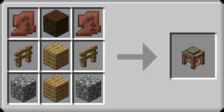
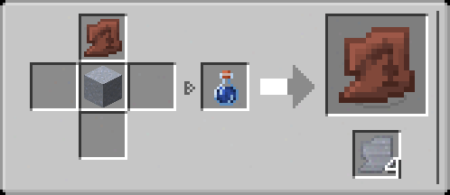

# 纹饰陶轮台

纹饰陶轮台用于制作未烧制的纹饰陶罐和未烧制的纹饰陶片，也可以复制已经拥有的纹饰陶片。它支持手动操作和漏斗自动化。

## 制作陶轮台

在工作台中按图摆放材料，合成 1 个纹饰陶轮台：

- 2 枚纹饰陶片
- 1 个原木
- 2 个木栅栏
- 2 个木板
- 2 个圆石

图中木材和陶片可替换为其他种类，圆石也可换成黑石等可用于制作石质工具的材料。

## 界面和输入

右键陶轮台打开界面。陶轮台共有七个槽位：

- 上、左、右、下：放置作为纹样的陶片或红砖
- 黏土：放置黏土块或黏土球
- 水：放置原版水瓶
- 输出：取出成品

一次加工需要 8 秒。作为纹样的陶片和红砖会保留；每次加工消耗黏土和一瓶水，并留下空玻璃瓶。

## 制作纹饰陶罐

1. 在上、左、右、下四个纹饰槽各放入一枚陶片；想让某一面保持空白时，放入红砖。
2. 在黏土槽放入 1 个黏土块或 4 个黏土球，在水槽放入 1 瓶水。
3. 加工后取出 1 个未烧制的纹饰陶罐，四面的纹样与放入的材料对应。

将未烧制纹饰陶罐放入熔炉，可以烧制为原版纹饰陶罐。

在 NeoForge 安装 Mekanism 后，也可以用电力熔炼炉烧制纹饰陶罐和陶片。成品保留坯件的纹饰。

## 复制纹饰陶片

在任意一个纹饰槽放入要复制的陶片，其余纹饰槽留空；再放入黏土和 1 瓶水：

- 消耗 1 个黏土块，得到 4 枚相同纹样的未烧制陶片。
- 消耗 1 个黏土球，得到 1 枚相同纹样的未烧制陶片。

将未烧制陶片放入熔炉，烧成对应纹样的陶片。图中以垂钓纹样为例，其他纹样的复制和烧制方法相同，原陶片始终保留。

## 漏斗自动化

漏斗可以从以下方向送入或取出物品：

- 顶部：输入黏土和水瓶
- 侧面：输入纹饰陶片和其他纹饰材料
- 底部：输出成品和空玻璃瓶

成品会优先尝试进入正下方的漏斗；漏斗无法接收时，物品会留在陶轮台的输出槽中。

## 工作模式

界面中的模式按钮可以在三种状态间切换：

- 始终工作
- 停止工作
- 仅在收到红石信号时工作
