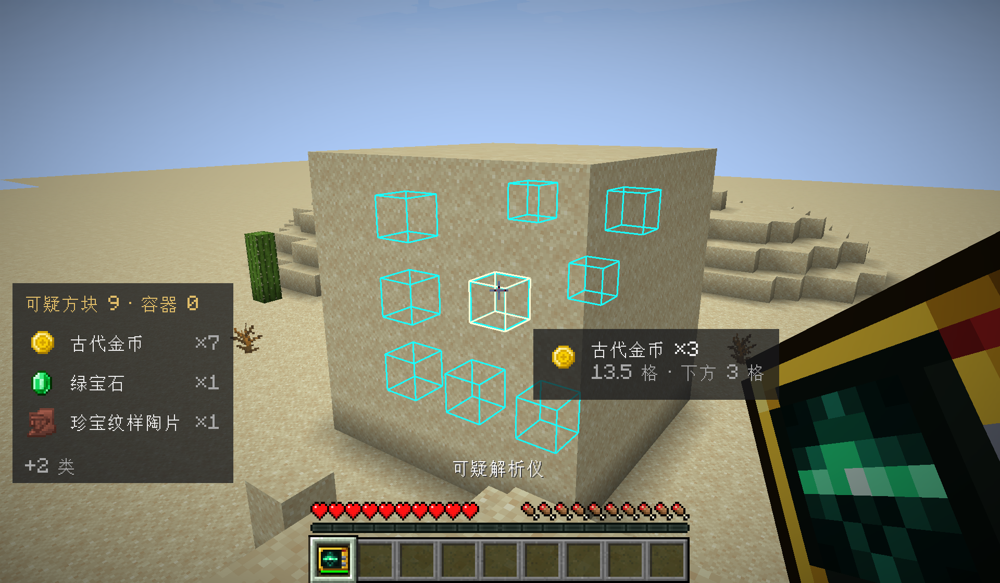
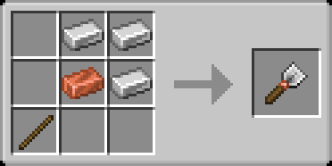

# 可疑解析仪与考古铲

这两件工具构成“先扫描确认、再快速发掘”的考古组合。主副手同时装备时，未扫描的方块会优先由解析仪扫描，已扫描的方块会优先由考古铲直接取物。

## 可疑解析仪

### 制作

配方需要：

- 2 枚古代金币
- 1 个玻璃板
- 2 个铁锭
- 1 个末影珍珠
- 2 个红石粉
- 1 个下界石英

### 单方块扫描

默认「单方块」模式下右键可疑方块或[不可疑方块](zh-Unsuspicious-Blocks)，即可在屏幕提示中查看内部物品（以及不可疑方块的封存者）。单方块扫描**不消耗能量**。

### 范围扫描

手持可疑解析仪按 `V` 键（可在按键设置中修改）循环切换扫描模式：

| 模式 | 扫描范围 | 能量消耗 |
|---|---|---|
| 单方块 | 1 个方块 | 免费（0 能量） |
| 低级范围 | 3×3×3 | `1 + 新扫描可疑方块数` |
| 中级范围 | 5×5×5 | `2 + 新扫描可疑方块数` |
| 高级范围 | 7×7×7 | `3 + 新扫描可疑方块数` |

- 范围扫描以点击方块的背面方向延伸对应格数作为立方体中心，并高亮范围内的可疑方块与尚未开启的战利品容器。
- 已由你扫描过的可疑方块与战利品容器不会重复计入“新方块”能量消耗。
- 扫描等级越高，解析仪物品上的扫描动画播放越快；能量耗尽时指示灯熄灭。

### 扫描 HUD 与透视描边

- **左下角汇总面板**：展示本次扫描发现的可疑方块与容器总数，并按物品分组展示前 3 类物品及空方块数量。
- **准星目标详情**：主手或副手持有可疑解析仪时，注视 32 格内的已扫描目标（可穿透表层沙子），会在准星旁显示内部物品、数量、距离与相对高度差。未开启的战利品容器只显示「内容未解析」，不会剧透箱内物品。
- **开关面板**：按 `H` 键可以随时显示或隐藏扫描 HUD 面板（不会影响 Jade 或基础透视描边）；打开其他界面或按 `F1` 时自动隐藏。
- **描边颜色与持续时间**：含战利品的可疑方块为青色、空可疑方块为灰色、未开战利品容器为紫色，当前注视目标会显示更亮的外框。描边基础保留 10 秒，持续注视目标可延长至最多 30 秒。

### 能量与充能

- **最大能量**：512 点（物品耐久条以绿 / 黄 / 红显示剩余电量）。
- **自动充能**：范围扫描电量不足时，会自动消耗背包中的古代金币补充能量。
- **手动充能**：潜行右键空气可消耗 1 枚古代金币恢复 256 点能量。若剩余可充空间不足 256 点，首次操作会提示可能浪费能量；在 1 秒内再次潜行右键即可强制消耗硬币充能。

## 考古铲

### 制作与基础属性

使用 **3 个铁锭 + 1 个铜锭 + 1 根木棍** 合成考古铲。它具备铁铲挖掘等级与 256 点耐久，可在铁砧使用铁锭或古代金币修复。

### 直接发掘

对准**由你本人扫描过**的可疑方块右键，即可直接取出其中的战利品（不会触发刷拭等待时间），同时完成考古笔记解锁与日志记录。

- 未扫描过的方块、由其他玩家扫描的方块或已清空的方块无法直接取出。
- 主手持解析仪、副手持考古铲时：对未扫描方块右键会先扫描，再右键一次即可由副手直接取物（主副手对调同理）。

### 向下连挖与防误破坏保护

- **向下连挖**：非潜行状态下挖掘沙子、红沙、砂砾等可用铲挖掘的方块时，会向下连续挖掘最多 **3 格**（每额外挖掘 1 格消耗 1 点耐久）；潜行时恢复为单格挖掘。连挖会自动避开可疑方块及其正下方的支撑方块。
- **保护可疑方块**：普通左键挖掘无法破坏原版可疑方块，也不会触发连挖；必须**按住潜行键**才能单格挖掉可疑方块，防止手滑破坏尚未发掘的战利品。
- 对准已放置的[不可疑方块](zh-Unsuspicious-Blocks)右键可直接敲碎并取回封存物品。

### 掘沙掉落古代金币

使用考古铲挖掘沙子、红沙或砂砾时，有 **0.3%** 概率额外掉落 1 枚古代金币。古代金币可用于：

- 为可疑解析仪充能（每枚 256 点）
- 在铁砧上为任意带耐久物品恢复 **25% 最大耐久**，且不累加铁砧惩罚值
- 与流浪商人交易（1 枚古代金币换 5 枚绿宝石）
