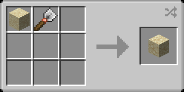

# 不可疑方块

不可疑的沙子与不可疑的沙砾是用于装饰、藏物和整蛊朋友的伪装方块。它们的外观与原版可疑方块一致，但内部封存的是你亲自放入的物品。

## 制作空方块

在工作台中无序放入以下两件物品：

- **1 个沙子或沙砾**
- **1 把[考古铲](zh-Reader-and-Shovel)**

即可得到 1 个**不可疑的沙子**或**不可疑的沙砾**。每次制作消耗考古铲 **1 点**耐久，考古铲会留在合成格中（耐久耗尽时损坏）。

## 封存物品

将 **1 个空的不可疑方块**和 **1 个想要藏起来的物品**放入工作台或背包合成格（无序），即可封存成带物品的不可疑方块。每个方块最多封存 1 件物品（不能把不可疑方块相互嵌套封存）。

- 封存后的方块会记录制作者的玩家信息。
- 使用[可疑解析仪](zh-Reader-and-Shovel)扫描或安装 **Jade** 观察时，会显示里面封存的物品与封存玩家。

## 放置与取回

- 放置后的不可疑方块如果下方失去支撑方块（变成空气、水等可下落空间），会直接碎裂并掉落内部封存的物品。
- 用**原版刷子**或**考古铲**右键已放置的不可疑方块，会立即将其破坏（消耗工具 1 点耐久）并弹出封存的物品，不会像真正的可疑方块那样出现漫长的刷拭进度。
- 不可疑方块不会触发[考古笔记](zh-Archaeology-Journal)的战利品解锁与发掘日志。
