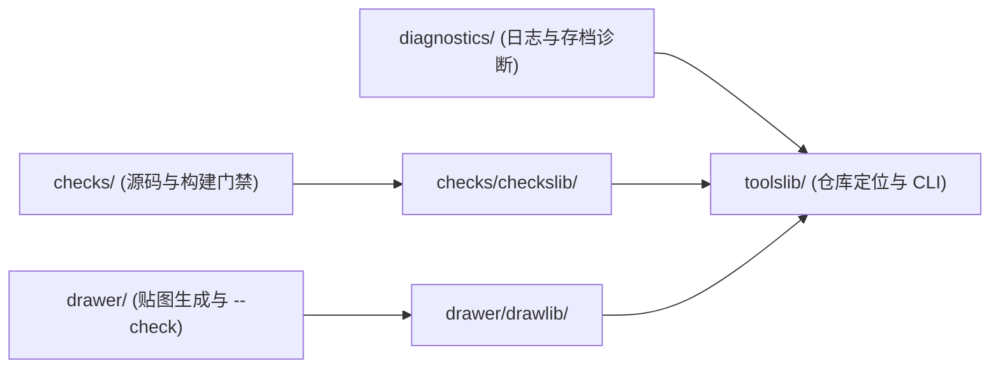

# 仓库工具

`tools/` 统一收纳仓库全部工程工具——包括源码与发布校验、程序化纹理绘制架构与生成器、以及运行时性能与存档诊断脚本。工具统一基于 Python 3.12+ 与 Git（其中 `drawer/` 额外依赖 Pillow），默认从自身位置向上定位仓库根目录，中文诊断输出统一使用 UTF-8。

## 目录分包与依赖架构

| 子包 | 职责 | 关键约束 |
|---|---|---|
| [`toolslib/`](toolslib/) | 跨工具公共底座 | 深度无关的 `repo_root()`、Git 可分发文件清单、`mod_assets_dir()` 与控制台编码初始化 |
| [`checks/`](checks/) | 源码、文档、i18n、隔离、UI Kit 与发布物校验 | 独占 [`checkslib/`](checks/checkslib/) 解析源码与配置，不修改被检文件 |
| [`drawer/`](drawer/) | 程序化像素艺术与 UI 纹理生成框架及脚本 | 基于 [`drawlib/`](drawer/drawlib/) 封装画布、色板、ASCII 字形、九宫格、防重叠图集与预览 |
| [`diagnostics/`](diagnostics/) | 游戏运行期日志性能分析与存档检验 | 读取指定或最新测试日志与 `.dat` 缓存，只读源存档、仅向显式路径输出报告 |

所有子包入口均支持直接通过 `python tools/<子包>/<脚本>.py` 从任意工作目录执行，无需额外设置 `PYTHONPATH`。

## 校验入口 (`checks/`)

| 用途 | 命令 |
|---|---|
| 固定顺序执行源码检查 | `python tools/checks/check-all.py` |
| 局部执行，仍保持固定顺序 | `python tools/checks/check-all.py --only docs --only i18n` |
| 平台与端隔离 | `python tools/checks/check-isolation.py` |
| UI Kit 消费边界 | `python tools/checks/check-ui-kit-boundaries.py` |
| 文档链接、图片和导航 | `python tools/checks/check-docs.py` |
| 同时核对本地根规则的出站链接 | `python tools/checks/check-docs.py --include-local-rules` |
| 中英语言文件配对、JSON、值与 key | `python tools/checks/check-i18n.py` |
| JSON 与 Mixin/SPI/平台资源接线 | `python tools/checks/check-wiring.py` |

每个入口支持 `--root <项目目录>`；具体参数查 `--help`。通过返回 `0`，发现违规返回 `1`，缺少必需输入或工具环境错误返回 `2`。诊断包含文件、可确定的行号、规则 ID 和问题。

文档检查解析文件目标和 Wiki 无扩展名页名，隔离代码围栏与行内代码，核对文档入口可达性。标题锚点由编辑核对，新增交叉引用使用文件链接与小节名称。写作语义按[文档维护](../docs/README.md)审校。

语言检查覆盖源码资源中的 `en_us.json` 与 `zh_cn.json`；格式合法、顶层对象、翻译字符串和 key 集合分别核对。接线检查读取源码配置，生成的 refmap 和元数据展开结果由构建处理；外部类型由编译依赖解析。

### 依赖与边界检查规则

Java 引用扫描会跳过注释、字符串、字符字面量与 Text Block，解析显式导入、静态导入、全限定引用以及源码可判定的同包和通配导入类型。Loader API 与平台实现类型留在平台源集，客户端类型由客户端所有者消费。

客户端所有者统一按模组根包下的 `client` 包及其子包识别（规则见 [`boundaries.py`](checks/checkslib/boundaries.py)）。`core`、公共 `platform` 与公共 Loader 入口仅使用共享契约；原版 Minecraft、Loader 客户端 API、渲染类型与 UI Kit 仅由客户端所有者消费。`ModPayloads` 中的 S2C 条目仅声明类型与 Codec，客户端接收函数由 `ClientPayloadBindings` 持有。

隔离检查同时核对 `common` 下的 `core / client / platform` 归属、Loader 下的 `client / platform` 归属、根包保留入口以及 `package` 与源码目录路径的一致性。接线检查要求 Mixin 的 `package` 限定在专属注入包，且客户端 Mixin 登记在 `client` 数组；SPI、元数据与反射加载的运行时语义结合对应入口及实机验收核对。

UI Kit 检查覆盖公开包消费、客户端归属、已退出仓内的旧 kit 目录/包以及遗留原生控件。静态引用与可定位结构由脚本判定；环境守卫、反射、回调与游戏效果结合源码及实机验收核对。

### 构建与产物打包检查

`./gradlew.bat build` 执行 `checkSourceRepository` 与 `checkUiKitPackaging` 门禁。产物路径直接取 Fabric `remapJar` 与 NeoForge `jar` 的输出，后者包含 `jarJar` 任务生成的内嵌内容。

`tools/checks/check-ui-kit-packaging.py` 也可接收 `--fabric-jar` 和 `--neoforge-jar` 显式路径。它核对内嵌平台库、精确 dev 版本约束、宿主误展开的库类与旧 kit。必需输入缺失返回 `2`，归档或元数据违规返回 `1`。

Gradle 默认使用 `python`，可通过 `-Prepository_python=<解释器路径>` 指定。独立 UI 库由用户级 `meteos_ui_kit_maven_dir` 提供；PR / 分支 CI 直接运行源码检查。现有 release 构建仍需要可访问的 UI 库 Maven 来源。

## 纹理绘制架构 (`drawer/`)

[`drawlib/`](drawer/drawlib/) 为仓内程序化像素艺术提供统一抽象：采用 `(x, y, width, height)` 宽高安全原语替代原始 PIL 闭区间矩形，统一十六进制/RGBA 解析与继承色板（`Palette`）、带尺寸/色标校验及 X 轴镜像的 ASCII 像素字符矩阵渲染、即时越界与防重叠校验的 `AtlasBuilder` 局部坐标托管、棋盘格放大预览，以及支持 `--root`、`--output`、`--preview` 与 `--check`（逐像素一致性比对）的 `TextureSpec` 运行器。

| 入口 | 用途 | 产物目标 |
|---|---|---|
| [`generate_all.py`](drawer/generate_all.py) | 统一批量生成、输出预览图或 `--check` 校验全部贴图 | 全部已注册贴图 |
| [`generate_ui_atlas.py`](drawer/generate_ui_atlas.py) | 生成全模组统一 UI 图标与控件皮肤图集 | `textures/gui/ui_atlas.png` (`256x128`) |
| [`generate_book_texture.py`](drawer/generate_book_texture.py) | 生成考古笔记双页书本背景 | `textures/gui/archaeology_journal_book.png` (`384x256`) |
| [`generate_bookmark_texture.py`](drawer/generate_bookmark_texture.py) | 生成笔记右侧书签三态条带 | `textures/gui/bookmark_tab.png` (`40x66`) |
| [`generate_log_entry_texture.py`](drawer/generate_log_entry_texture.py) | 生成考古日志条目三态圆角底纹 | `textures/gui/log_entry.png` (`148x78`) |
| [`generate_lantern_pet_texture.py`](drawer/generate_lantern_pet_texture.py) | 生成灵魂提灯宠物实体贴图 | `textures/entity/soul_lantern_pet.png` (`64x64`) |

修改任意程序化纹理前先更新对应生成器并运行 `python tools/drawer/generate_all.py` 重新产出 PNG，保证代码与图像同源；验证是否与当前资源严格同步可执行 `python tools/drawer/generate_all.py --check`。

## 运行与存档诊断 (`diagnostics/`)

| 入口 | 用途 | 参数查 `--help` |
|---|---|---|
| [`loot_simulation_profile.py`](diagnostics/loot_simulation_profile.py) | 解析 `/usb journal reload` 热运行日志各阶段耗时并导出 CSV / Markdown 对照表 | 支持 `--log`、`--round`、`--baseline`、`--csv`、`--report` |
| [`read_loot_probability_save.py`](diagnostics/read_loot_probability_save.py) | 读取 `unsuspiciousblock_loot_probability.dat`（gzip/zlib NBT）摘要与指定表输入键明细 | 支持显式 `.dat` 路径、`--table`、`--show-items` |

## 相关文档

- [开发流程](../docs/guides/development.md)
- [UI Kit 宿主接入](../docs/dev/internals/ui-kit-api.md)
- [UI 图标与控件皮肤图集](../docs/dev/internals/toolbar-icon-atlas.md)
