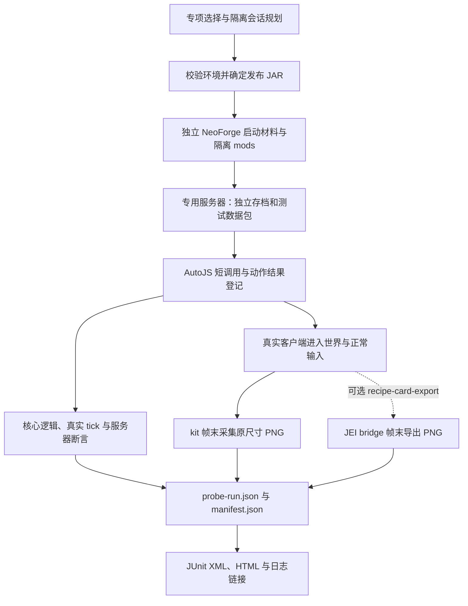

# NeoForge 核心探针

探针用于开发阶段的本地测试，release 流程不运行探针。运行器使用独立 NeoForge 启动工程和指定构建 JAR，AutoJS 在各端主线程执行共享 JS 场景。服务端权威状态、客户端镜像与实际 PNG 分别记录；界面外观与手感由用户复核。

## 本地运行

Agent 调用前先按根目录 `AGENTS.md` 的「探针调用授权」核对授权范围。

将[配置示例](config.example.json)复制到被忽略的 `.local/probes.json`，填写 AutoJS 与 Rhino NeoForge JAR 的绝对路径。接受 [Minecraft EULA](https://aka.ms/MinecraftEULA) 后显式设置 `acceptEula: true`，工具仅在本次隔离服务器写入 `eula=true`。可指定 `java`，默认使用独立运行工程的 Java 21 Toolchain。宿主构建从远程 Maven 解析固定的 UI Kit 版本。

AutoJS 使用 `/mcp` 的 `initialize → tools/list → status → eval_js`；每端独立进程、端口和 JS 作用域。脚本使用 `Java.loadClass`，仅依赖 Rhino，无需安装 KubeJS。客户端需要可用的桌面与 OpenGL 环境。Windows 使用 `--background` 或本地配置 `background: true` 在独立 desktop 启动客户端；启动器保留原生进程所有权，不切换用户输入 desktop。服务端与 Gradle 隐藏控制台运行。游戏与 MCP 仅监听 loopback，端口须互异且空闲。

```powershell
python tools/probes/run.py --list
python tools/probes/run.py --validate --only runtime-artifact
python tools/probes/run.py --only runtime-artifact
python tools/probes/run.py --background --only scan-take-journal --only journal-viewport
python tools/probes/run.py --background --artifact build/probes/artifact.json --suite journal-catalog
python tools/probes/run.py --background --artifact build/probes/artifact.json --suite core
python tools/probes/run.py --background --artifact build/probes/artifact.json --suite all
python tools/probes/run.py --background --artifact build/probes/artifact.json --only ui-member-tree --only ui-form-bodies
python tools/probes/run.py --background --artifact build/probes/artifact.json --only recipe-card-export
python tools/probes/inspect_tooltips.py --background --artifact build/probes/artifact.json --lang both --shift both
```

宿主构建和各会话串行执行。已有本次构建时，可传 `--artifact build/probes/artifact.json` 使用 Gradle `writeProbeArtifact` 生成的发布物清单。控制台输出本次全新运行目录，目录中保存原始记录、分会话清单和派生报告。

运行前用 `--list` 查看任务、套件、所需游戏端和夹具。通过 `--only` 精确选例，重复指定时自动去重并保留输入顺序。`--suite core` 运行日常回归，`--suite journal-catalog` 与 `--suite journal-ui` 运行专项，`--suite all` 运行全部功能用例。`--validate` 校验所选运行环境并输出会话计划。原始记录保存选择来源、执行顺序及会话关联。

`recipe-card-export` 可单独选择，也随 `--suite all` 执行。运行器按需构建 `tools/recipe_cards/runtime`，将工具 JAR 与 JEI runtime 装入对应会话的客户端。默认筛选 `unsuspiciousblock` 命名空间的 JEI 配方，使用三倍整数倍率和第一个候选材料。筛选与倍率参数见 `--help`。已有工具产物时可传 `--recipe-card-artifact tools/recipe_cards/runtime/build/artifact.json`。

该分支通过同一 AutoJS 客户端会话调用 JEI bridge，串行提交每张卡片，并将 PNG、`recipe-cards/recipe-cards.json`、请求状态和摘要写入运行目录；`probe-run.json` 的 `recipeCards` 与 `recipeCardManifest` 字段保存对应证据。传输超时只查询原请求，不重复提交。分支失败保留已经完成的 PNG，按探针退出码记录为业务失败或环境错误。

> **专项巡检模板**：[`inspect_tooltips.py`](inspect_tooltips.py) 配合 [`scripts/tooltip_inspect.js`](scripts/tooltip_inspect.js) 提供纯检查全部物品 Tooltip 的独立入口（支持 `--lang zh_cn|en_us|both`、`--shift up|down|both`、`--items` 与 `--no-screenshots`），输出 `tooltip-report.json` / `tooltip-report.md` 及容器槽位悬停 PNG，不拖慢日常核心回归套件。

运行器仅关闭自身进程。正常停服保留存档；超时后的副作用先查询动作结果，状态不明时结束实例。退出码 `0` 为选定集合通过，`1` 为业务断言失败，`2` 为配置、协议、采集或环境错误。

## 运行拓扑与证据



`probelib/selection.py` 登记用例及启动需求。启动需求匹配的相邻用例可以共享会话，改写世界的用例使用独立会话。每个会话单独暂存所需端的启动参数、Mod 和数据包夹具。独立 ModDevGradle 工程提供 Minecraft 与 NeoForge 运行材料，宿主使用指定 JAR。会话的 `manifest.json` 记录产物、夹具摘要、进程与图形环境。

`scripts/` 构造场景并读取真实业务对象。Python 场景按考古笔记、世界玩法与 UI 组织，复用 Case 编排动作、等待和截图。扫描、淘洗和猫族旅程经正常客户端输入触发，服务端读取真实结算，客户端单独读取镜像。UI 从活动布局按业务 key 或唯一语义选择器解析命中，经 Screen 和 NeoForge Hook 派发。kit 在后续完成帧采集截图，Case 校验文件格式和原始尺寸。

`scripts/shared.js` 统一双端的业务观察：物品按完整稳定签名索引，条目保留 itemId/type/data；日志保留身份、来源、位置/维度/生物群系/结构、创建/更新时间、预期/实得、备注和 tableStack。history 为 null 表示不存在，空日志仍保留自动保留设置、终身及来源累计、首次解锁。Java long 经十进制字符串传递，Python 计算时转 int。扫描和淘洗的实物数量预期来自固定场景；日志身份差集与 lifetime 增量用于识别新结算。

Case 负责一次场景的状态所有权：使用正式命令重置自有表，登记自有材料并在 finally 逆序清理；释放输入与采集，恢复窗口、GUI scale 和原 op 权限。表单专项使用 `usb_probe:archaeology/ui_forms`，猫族清理先移除信物再重置关系，自有实体和掉落限定在场景区域。重启场景内部保留服务端存档，外部清理通过 Runtime 当前连接执行。`Case.expect` 对业务条件只轮询读取，超时记录最后观察并产生 fail；`wait_for` 用于启动、布局和采集前置，异常归 error。

UI 场景位于 `probelib/ui_cases.py`，使用既有 Case 的动作记账、等待和截图 interface。`scripts/ui_scenarios.js` 仅装配已注册配置的真实 Screen；场景不反射控件，不维护第二份输入树。后台 native adapter 收敛在 `probelib/desktop.py`，Runtime 统一关闭自有客户端再释放 desktop；`manifest.json` 保存后台 desktop 与输入 desktop 状态。

新增 UI 场景时，优先选择稳定业务 key；无 key 的字段可使用 `case.click({'kind': 'TEXT_INPUT', 'name': '<字段无障碍名称>'})`。每个选择器须唯一，操作后断言实际页面、字段或服务端结果；PNG 用于复核渲染。普通 Tab 路径验证 reveal，避免直接调用字段 setter 或正文 reveal 代替用户操作。

`probe-run.json` 保存判定，HTML 与 JUnit 从它派生。业务通过要求每个登记的必验项完成且相等，GUI 还需目标 PNG。缺项、准备、协议或清理错误归工具错误，停止后例。清理成功时，发生业务失败的运行可继续其他用例。正常重启在同一服务端存档中进行，通过空缓存客户端验证恢复。

新增必验项时，在注册表登记 ID、预期依据与观察面，并通过 `Case.check` 或 `Case.await_check` 提交业务观察。报告保留独立预期、实际值和比较结果。动作回执、截图、就绪条件和两端镜像各对应自身验证目标。评审时用固定夹具和真实入口，并用已知旧产物、受控业务变化或契约反例核对断言确实失败，再用正常产物执行同一用例。

## 核心用例与选择

用例纳入条件：属于核心玩法、有确定输入和独立预期、需要重复执行，并且容易跨层回归或难以逐次人工核对。优先覆盖记账、结算、同步、持久化和输入坐标的交汇处。

| 用例 | 集合 / 证据 | 关注点 |
|---|---|---|
| `runtime-artifact` | core / server | 指定发布 JAR 来源与摘要、专用服务器加载 |
| `scan-take-journal` | core / gui | 扫描发现与实物交付分开、主副手让位、pending、去重、双端日志；详情/奇数窗口命中与搜索保持、取消清空、代表 PNG |
| `journal-restart` | core / gui | 正常停服与空缓存同步恢复进度、上下文、时间、备注及历史，重复登录奖励去重和详情 PNG |
| `panning-settlement` | core / server | 正常客户端长按、会话时钟、切换目标、中断、变体门槛与实物结算镜像 |
| `panning-generation` | 专项 / server | 区块接缝采样、特殊再生的锚点、来源和账本 |
| `cat-player-journey` | core / server | 真实携带绑定、主人喂食受伤猫、食物/治疗/羁绊/镜像与冷却 |
| `journal-viewport` | 专项 / gui | 窗口/GUI scale 矩阵、整数物理倍率、输入命中、阅读状态和 Tooltip PNG |
| `ui-member-tree` | 专项 / gui | 双向 Tab、离焦字符、resize 旧释放、模态遮挡、活动右页与唯一业务 key |
| `ui-form-bodies` | 专项 / gui | 专属表保留/裁剪提交、数字过滤、Tab reveal、管理语言草稿、配置失败/重置/取消及窄窗 PNG |
| `cat-ledger` | 专项 / model | 独立状态的关系门槛、冷却边界、去重、阶段、命数和序列化 |
| `cat-carried-binding` | 专项 / server | 第一层标本箱绑定写回、他人身份、额外空白信物规则 |
| `simulation-reload` | 专项 / gui | 真实模拟与拒绝回执、重载代次、旧 DTO 接收规则和新请求 |
| `journal-catalog-loading` | 专项 / gui | 冷缓存完整目录、欢迎页、在队列排空前收到单表结果、共享回填与阅读位置 |
| `core-architecture-inventory` | 专项 / server | 标本箱、失落书页、自然骨块、陶轮及世界状态到期 |
| `core-architecture-catalog` | 专项 / server | 组合条目、内联引用、目录重建与投影结果 |
| `merchant-trade-pool` | 专项 / server | 高权重报价与无效条目过滤 |
| `core-architecture-storage` | 专项 / server | 商人与淘洗点旧 NBT 的一次迁移、正常停服与重启读取 |
| `recipe-card-export` | 可选 / gui | JEI public layout、筛选清单、串行 PNG、请求状态与来源清单 |

`model` 通过独立状态和显式时间调用真实 Java 规则。模拟拒绝例用未签发工具触发真实网络回执。重载后的接收检查分别投递旧代和同代的对照负载，除代次外，两份负载的表、哈希、输入键与样本标记相同。两次分别读取客户端缓存，以验证接收或丢弃。

| 改动落点 | 定向集合 |
|---|---|
| 依赖、打包、平台启动 | `runtime-artifact` |
| 扫描、挖取、日志结算 | `scan-take-journal`、`journal-restart` |
| kit 视口、输入树、笔记布局 | `scan-take-journal`、`journal-viewport`、`ui-member-tree` |
| 配置、表单正文、管理详情 | `ui-form-bodies` |
| 猫族关系、喂食或携带扫描 | `cat-player-journey`，按改动追加 `cat-ledger`、`cat-carried-binding` |
| 淘盘与淘洗点 | `panning-settlement`、`panning-generation` |
| 模拟、目录重载、相关网络 | `journal-catalog-loading`、`simulation-reload` |
| wiki 配方卡片导出 | `recipe-card-export` |
| 公共网络或玩家生命周期 | 全部受影响的同步/恢复用例 |

## 性能基准

[`benchmark.py`](benchmark.py) 复用 NeoForge 隔离运行器和发布物清单。 `list` 枚举负载，`run --only <id>` 采样，`compare` 离线读取两份原始 JSON。功能用例的通过条件由业务断言决定，性能结果有自己的记录与退出码。

```powershell
python tools/probes/benchmark.py list
python tools/probes/benchmark.py run --only loot-projection --artifact build/probes/artifact.json
python tools/probes/benchmark.py compare baseline/benchmark.json current/benchmark.json --report perf.md --csv perf.csv
```

| 负载 | 计量边界 |
| --- | --- |
| `loot-projection` | 已编译引用图上的根表投影，包含新投影器初始化。 |
| `catalog-codec` | 已稳定目录的实际 Codec 编码。另报编码字节数。 |
| `shimmer-ledger` | 固定自然条目、新 tick、无到期时的账本维护。 |
| `journal-simulation` | 正式重建命令到观测到队列排空，附每表有效计算、可用的线程 CPU 与跨 tick 历时。 |
| `journal-visible` | 目录同步可见、选表后的概率可见及共享回填。输出 Python 轮询观测区间，并记录点击前已有概率的轮次。 |

扩展负载时在 [基准注册](probelib/benchmarks.py) 声明所需端、夹具、主指标、缓存口径和固定输入。采样函数返回原始指标与负载身份，另核对正确的业务产物。同步 Java 计时使用线程内单调时钟，跨 tick 计时由 Python 发起和观察。各轮在正常 tick rate 下串行采集。冷缓存目录负载在预热后的同一 JVM 内按轮重建。

比较要求负载、环境、缓存、profile 模式、采样配置和单位一致。先同机运行同产物确认波动，再交替采样基线与候选。原始文件保留各轮样本；输出包括中位数和离散程度，样本充足时附 p95。指定 `--absolute`、`--percent` 与 `--min-samples` 后，主指标同时超过两种阈值时返回 `1`。采样及兼容比较返回 `0`，不可比较或采集错误返回 `2`。

依赖与验证入口见[仓库工具](../README.md)；授权边界、临时诊断/截图脚本编写与 Rhino/AutoJS 注意事项见[探针使用指南](../../docs/guides/probes.md)。
