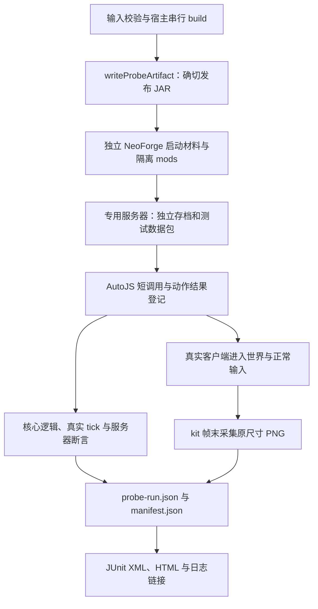

# NeoForge 核心探针

探针用于开发阶段的本地测试，release 流程不运行探针。运行器使用独立 NeoForge 启动工程和指定构建 JAR，AutoJS 在各端主线程执行共享 JS 场景。服务端权威状态、客户端镜像与实际 PNG 分别记录；界面外观与手感由用户复核。

## 本地运行

Agent 调用前先按根目录 `AGENTS.md` 的「探针调用授权」核对授权范围。

将[配置示例](config.example.json)复制到被忽略的 `.local/probes.json`，填写 AutoJS 与 Rhino NeoForge JAR 的绝对路径。接受 [Minecraft EULA](https://aka.ms/MinecraftEULA) 后显式设置 `acceptEula: true`，工具仅在本次隔离服务器写入 `eula=true`。可指定 `java`，默认使用独立运行工程的 Java 21 Toolchain。宿主构建继续使用用户级 Gradle 属性 `meteos_ui_kit_maven_dir` 定位本地 kit Maven。

AutoJS 使用 `/mcp` 的 `initialize → tools/list → status → eval_js`；每端独立进程、端口和 JS 作用域。脚本使用 `Java.loadClass`，仅依赖 Rhino，无需安装 KubeJS。客户端需要可用的桌面与 OpenGL 环境。游戏与 MCP 仅监听 loopback，端口须互异且空闲。

```powershell
python tools/probes/run.py --validate --only runtime-artifact
python tools/probes/run.py --only runtime-artifact
python tools/probes/run.py --only scan-take-journal --only journal-viewport
python tools/probes/run.py --artifact build/probes/artifact.json
```

默认串行执行宿主完整构建、运行准备和探针。已有本次构建时，传 `--artifact build/probes/artifact.json` 消费其准确归档；该 manifest 由 Gradle `writeProbeArtifact` 从实际任务输出生成。运行目录须全新，原始记录、进程日志和派生报告保存在控制台显示的目录中。

运行器仅关闭自身进程。正常停服保留存档；超时后的副作用先查询动作结果，状态不明时结束实例。退出码 `0` 为选定集合通过，`1` 为业务断言失败，`2` 为配置、协议、采集或环境错误。

## 运行拓扑与证据



`runtime/` 是独立 ModDevGradle 工程，只准备 Minecraft、NeoForge、启动依赖和参数文件；不接入宿主源码输出。`mods/` 只放本次宿主 JAR、AutoJS 和 Rhino，kit 从宿主内嵌加载。运行记录核对实际模组路径与 SHA-256，清单保存依赖摘要、启动参数、PID、退出码和客户端图形环境。

`scripts/` 构造场景并读取真实业务对象；`probelib/cases.py` 用普通函数组织输入、等待和独立预期。服务端状态与客户端镜像分别读取。主副手用例向原版 `KeyMapping` 投递右键，淘洗用例保持客户端右键并由服务端观察真实 use/tick/finish 链；UI 使用当前 Screen 的真实输入与 NeoForge Pre/Post Hook。每次点击重新查询布局 key 并确认实际命中。截图等待业务就绪与几何稳定，由 kit 在后续完成帧采集，工具校验 PNG 数据和原始尺寸。

`probe-run.json` 是判定源，HTML 与 JUnit 从它派生。GUI 成功同时要求目标 PNG；失败时尽力采诊断图，采集错误单独记录。准备或协议错误结束实例，业务失败保留断言，清理错误使整体返回 `2`。原始记录先写入，再生成展示；派生失败保留已有证据。每次使用全新目录，正常重启在同一服务器存档进行，客户端旧目录保留并换用空缓存目录验证恢复来源。

## 核心用例与选择

用例纳入条件：属于核心玩法、有确定输入和独立预期、需要重复执行，并且容易跨层回归或难以逐次人工核对。优先覆盖记账、结算、同步、持久化和输入坐标的交汇处。

| 用例 | 优先级 / 证据 | 关注点 |
|---|---|---|
| `runtime-artifact` | P0 / server | 指定发布 JAR 来源与摘要、专用服务器加载 |
| `scan-take-journal` | P0 / gui | 扫描发现与实得分开、主副手让位、pending、去重、两端日志与详情 PNG |
| `journal-viewport` | P0 / gui | 缩小/恢复/GUI scale、实际命中、搜索与日志阅读状态、resize 关闭确认框 |
| `cat-ledger` | P0 / model | 关系门槛、冷却边界、同猫同 tick 去重、阶段、命数和状态序列化 |
| `journal-restart` | P0 / gui | 正常停服恢复、空缓存同步、重复登录奖励去重和恢复详情 PNG |
| `panning-settlement` | P1 / server | 正式交互与真实 tick 完成、剩余次数/耐久/实际产出/即时日志、中断和变体门槛 |
| `cat-carried-binding` | P1 / server | 第一层标本箱绑定写回、他人身份、额外空白信物规则 |
| `simulation-reload` | P1 / gui | 真实模拟与拒绝回执、重载代次、旧 DTO 接收规则和新请求 |

`model` 仅创建独立状态、显式传入时间并调用真实 Java 规则。淘洗走服务端玩家 use/tick/finish 流程。模拟拒绝例通过公开目录接收 Interface 构造客户端未签发工具输入，服务端签发目录保持真实；旧 DTO 以实际 Codec 保存，在 reload 后直接调用客户端接收 Interface，覆盖代次过滤。

| 改动落点 | 定向集合 |
|---|---|
| 依赖、打包、平台启动 | `runtime-artifact` |
| 扫描、挖取、日志结算 | `scan-take-journal`、`journal-restart` |
| kit 视口、输入树、笔记布局 | `scan-take-journal`、`journal-viewport` |
| 猫族记账或携带扫描 | `cat-ledger`、`cat-carried-binding` |
| 淘盘与淘洗点 | `panning-settlement` |
| 模拟、目录重载、相关网络 | `simulation-reload` |
| 公共网络或玩家生命周期 | 全部受影响的同步/恢复用例 |

范围排除：Fabric 游戏探针、全资源/全屏幕/语言/分辨率矩阵、像素黄金图、动画手感、随机世界生成、完整 NPC AI、可选模组兼容矩阵、概率大样本与压力测试。资源接线由现有源码门禁负责；外观与手感通过代表 PNG 和人工游戏复核确认。

依赖与验证入口见[仓库工具](../README.md)。
