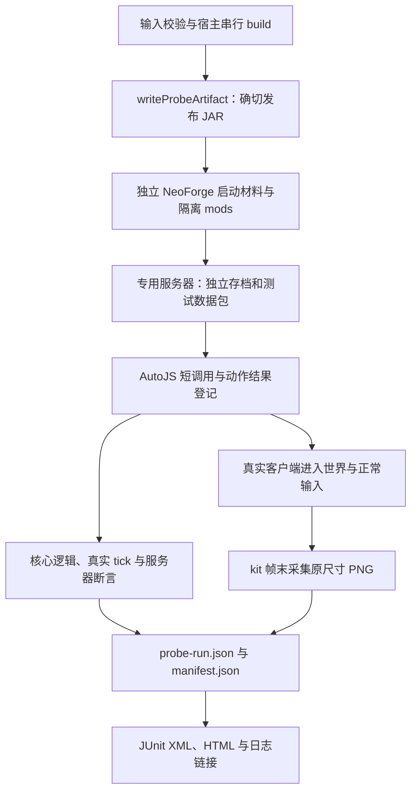

# NeoForge 核心探针

探针用于开发阶段的本地测试，release 流程不运行探针。运行器使用独立 NeoForge 启动工程和指定构建 JAR，AutoJS 在各端主线程执行共享 JS 场景。服务端权威状态、客户端镜像与实际 PNG 分别记录；界面外观与手感由用户复核。

## 本地运行

Agent 调用前先按根目录 `AGENTS.md` 的「探针调用授权」核对授权范围。

将[配置示例](config.example.json)复制到被忽略的 `.local/probes.json`，填写 AutoJS 与 Rhino NeoForge JAR 的绝对路径。接受 [Minecraft EULA](https://aka.ms/MinecraftEULA) 后显式设置 `acceptEula: true`，工具仅在本次隔离服务器写入 `eula=true`。可指定 `java`，默认使用独立运行工程的 Java 21 Toolchain。宿主构建继续使用用户级 Gradle 属性 `meteos_ui_kit_maven_dir` 定位本地 kit Maven。

AutoJS 使用 `/mcp` 的 `initialize → tools/list → status → eval_js`；每端独立进程、端口和 JS 作用域。脚本使用 `Java.loadClass`，仅依赖 Rhino，无需安装 KubeJS。客户端需要可用的桌面与 OpenGL 环境。Windows 使用 `--background` 或本地配置 `background: true` 在独立 desktop 启动客户端；启动器保留原生进程所有权，不切换用户输入 desktop。服务端与 Gradle 隐藏控制台运行。游戏与 MCP 仅监听 loopback，端口须互异且空闲。

```powershell
python tools/probes/run.py --validate --only runtime-artifact
python tools/probes/run.py --only runtime-artifact
python tools/probes/run.py --background --only scan-take-journal --only journal-viewport
python tools/probes/run.py --background --artifact build/probes/artifact.json
python tools/probes/run.py --background --artifact build/probes/artifact.json --suite all
python tools/probes/run.py --background --artifact build/probes/artifact.json --only ui-member-tree --only ui-form-bodies
python tools/probes/inspect_tooltips.py --background --artifact build/probes/artifact.json --lang both --shift both
```

默认串行执行宿主完整构建、运行准备和核心集合。已有本次构建时，传 `--artifact build/probes/artifact.json` 消费其准确归档；该 manifest 由 Gradle `writeProbeArtifact` 从实际任务输出生成。运行目录须全新，原始记录、进程日志和派生报告保存在控制台显示的目录中。

无选择参数或 `--suite core` 按顺序运行 `runtime-artifact`、`scan-take-journal`、`journal-restart`、`panning-settlement`、`cat-player-journey`。`--suite all` 运行全部注册场景。重复 `--only` 精确选例、去重并保留输入顺序；`--suite` 与 `--only` 互斥。原始记录的 `selection` 保存 `core/all/explicit` 来源，`selected` 保存实际顺序。

> **专项巡检模板**：[`inspect_tooltips.py`](inspect_tooltips.py) 配合 [`scripts/tooltip_inspect.js`](scripts/tooltip_inspect.js) 提供纯检查全部物品 Tooltip 的独立入口（支持 `--lang zh_cn|en_us|both`、`--shift up|down|both`、`--items` 与 `--no-screenshots`），输出 `tooltip-report.json` / `tooltip-report.md` 及容器槽位悬停 PNG，不拖慢日常核心回归套件。

运行器仅关闭自身进程。正常停服保留存档；超时后的副作用先查询动作结果，状态不明时结束实例。退出码 `0` 为选定集合通过，`1` 为业务断言失败，`2` 为配置、协议、采集或环境错误。

## 运行拓扑与证据



`runtime/` 是独立 ModDevGradle 工程，只准备 Minecraft、NeoForge、启动依赖和参数文件；不接入宿主源码输出。`mods/` 只放本次宿主 JAR、AutoJS 和 Rhino，kit 从宿主内嵌加载。运行记录核对实际模组路径与 SHA-256，清单保存依赖摘要、启动参数、PID、退出码和客户端图形环境。

`scripts/` 构造场景并读取真实业务对象；`probelib/cases.py` 用普通函数组织输入、等待和独立预期。服务端状态与客户端镜像分别读取。主副手用例等待加载覆盖层退出、物品同步及准星命中后，向原版 `KeyMapping` 投递右键；淘洗先核对双端命中同一目标 UUID 与铜盘同步，再保持客户端右键，服务端只观察真实 use/tick/finish 链。猫族旅程以主人治疗受伤猫的正常右键触发喂食，再观察 tick 末记账和自然镜像。UI 输入 module 位于 `scripts/ui.js`，从当前活动布局读取唯一业务 key，或由 `kind/name/text` 组成的唯一语义选择器。几何、裁剪、可见/可用状态与焦点值来自真实 target；有 key 时核对根命中，无 key 时核对字段命中，最终由 Screen 和 NeoForge Pre/Post Hook 派发输入。悬停只调用已安装的 GLFW 指针回调通知 MouseHandler，不移动系统鼠标。代表截图前通过原版公开 API 清除无关通知，等待业务就绪与几何稳定后，由 kit 在后续完成帧采集，工具校验 PNG 数据和原始尺寸。

`scripts/shared.js` 统一双端的业务观察：物品按完整稳定签名索引，条目保留 itemId/type/data；日志保留身份、来源、位置/维度/生物群系/结构、创建/更新时间、预期/实得、备注和 tableStack。history 为 null 表示不存在，空日志仍保留自动保留设置、终身及来源累计、首次解锁。Java long 经十进制字符串传递，Python 计算时转 int。扫描和淘洗的实物数量预期来自固定场景；日志身份差集与 lifetime 增量用于识别新结算。

Case 负责一次场景的状态所有权：使用正式命令重置自有表，登记自有材料并在 finally 逆序清理；释放输入与采集，恢复窗口、GUI scale 和原 op 权限。表单专项使用 `usb_probe:archaeology/ui_forms`，猫族清理先移除信物再重置关系，自有实体和掉落限定在场景区域。重启场景内部保留服务端存档，外部清理通过 Runtime 当前连接执行。`Case.expect` 对业务条件只轮询读取，超时记录最后观察并产生 fail；`wait_for` 用于启动、布局和采集前置，异常归 error。

UI 场景位于 `probelib/ui_cases.py`，使用既有 Case 的动作记账、等待和截图 interface。`scripts/ui_scenarios.js` 仅装配已注册配置的真实 Screen；场景不反射控件，不维护第二份输入树。后台 native adapter 收敛在 `probelib/desktop.py`，Runtime 统一关闭自有客户端再释放 desktop；`manifest.json` 保存后台 desktop 与输入 desktop 状态。

新增 UI 场景时，优先选择稳定业务 key；无 key 的字段可使用 `case.click({'kind': 'TEXT_INPUT', 'name': '<字段无障碍名称>'})`。每个选择器须唯一，操作后断言实际页面、字段或服务端结果；PNG 用于复核渲染。普通 Tab 路径验证 reveal，避免直接调用字段 setter 或正文 reveal 代替用户操作。

`probe-run.json` 是判定源，HTML 与 JUnit 从它派生。GUI 成功同时要求目标 PNG；失败时尽力采诊断图，采集错误单独记录。准备或协议错误结束实例；业务失败保留断言，清理成功后继续后例；清理错误保留最初业务失败并使场景成为 error，整体返回 `2`、停止后例。原始记录先写入，再生成展示；派生失败保留已有证据。每次使用全新目录，正常重启在同一服务器存档进行，客户端旧目录保留并换用空缓存目录验证恢复来源。

场景模板发生未预期异常时，运行器保存异常类型、消息和 traceback，停止后续场景，仍执行自身进程清理并生成 HTML/JUnit；模板错误不会被重试或吞掉。新增场景先用系统临时输入验证该故障路径，再接入真实 NeoForge 用例。

## 核心用例与选择

用例纳入条件：属于核心玩法、有确定输入和独立预期、需要重复执行，并且容易跨层回归或难以逐次人工核对。优先覆盖记账、结算、同步、持久化和输入坐标的交汇处。

| 用例 | 集合 / 证据 | 关注点 |
|---|---|---|
| `runtime-artifact` | core / server | 指定发布 JAR 来源与摘要、专用服务器加载 |
| `scan-take-journal` | core / gui | 扫描发现与实物交付分开、主副手让位、pending、去重、双端日志；详情/奇数窗口命中与搜索保持、取消清空、代表 PNG |
| `journal-restart` | core / gui | 正常停服与空缓存同步恢复进度、上下文、时间、备注及历史，重复登录奖励去重和详情 PNG |
| `panning-settlement` | core / server | 正常客户端长按、真实 tick 结算、次数/耐久/实物/日志与镜像，中断和变体门槛 |
| `cat-player-journey` | core / server | 真实携带绑定、主人喂食受伤猫、食物/治疗/羁绊/镜像与冷却 |
| `journal-viewport` | 专项 / gui | 窗口/GUI scale 矩阵、整数物理倍率、输入命中、阅读状态和 Tooltip PNG |
| `ui-member-tree` | 专项 / gui | 双向 Tab、离焦字符、resize 旧释放、模态遮挡、活动右页与唯一业务 key |
| `ui-form-bodies` | 专项 / gui | 专属表保留/裁剪提交、数字过滤、Tab reveal、管理语言草稿、配置失败/重置/取消及窄窗 PNG |
| `cat-ledger` | 专项 / model | 独立状态的关系门槛、冷却边界、去重、阶段、命数和序列化 |
| `cat-carried-binding` | 专项 / server | 第一层标本箱绑定写回、他人身份、额外空白信物规则 |
| `simulation-reload` | 专项 / gui | 真实模拟与拒绝回执、重载代次、旧 DTO 接收规则和新请求 |

`model` 仅创建独立状态、显式传入时间并调用真实 Java 规则。淘洗由正常客户端长按进入 use/tick/finish 流程。模拟拒绝例通过公开目录接收 Interface 构造客户端未签发工具输入，服务端签发目录保持真实；旧 DTO 以实际 Codec 保存，在 reload 后直接调用客户端接收 Interface，覆盖代次过滤。

| 改动落点 | 定向集合 |
|---|---|
| 依赖、打包、平台启动 | `runtime-artifact` |
| 扫描、挖取、日志结算 | `scan-take-journal`、`journal-restart` |
| kit 视口、输入树、笔记布局 | `scan-take-journal`、`journal-viewport`、`ui-member-tree` |
| 配置、表单正文、管理详情 | `ui-form-bodies` |
| 猫族关系、喂食或携带扫描 | `cat-player-journey`，按改动追加 `cat-ledger`、`cat-carried-binding` |
| 淘盘与淘洗点 | `panning-settlement` |
| 模拟、目录重载、相关网络 | `simulation-reload` |
| 公共网络或玩家生命周期 | 全部受影响的同步/恢复用例 |

范围排除：Fabric 游戏探针、全资源/全屏幕/语言/分辨率矩阵、像素黄金图、动画手感、随机世界生成、完整 NPC AI、可选模组兼容矩阵、概率大样本与压力测试。资源接线由现有源码门禁负责；外观与手感通过代表 PNG 和人工游戏复核确认。

依赖与验证入口见[仓库工具](../README.md)；授权边界、临时诊断/截图脚本编写与 Rhino/AutoJS 注意事项见[探针使用指南](../../docs/guides/probes.md)。
