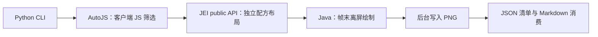

# JEI 配方卡片 PNG

仅用于 NeoForge 客户端的 wiki 配方卡片导出工具。JEI 提供配方与原生布局，JS 筛选并串行提交，独立 Java 插件在帧末离屏绘制，Python 命令保存导出清单。PNG 可直接用于 Markdown 图片排版。

## 安装与导出

使用仓库要求的 Python、Java 与 Gradle 环境，Minecraft、NeoForge 和 JEI 版本读取根目录 `gradle.properties`。工具锁定对应 JEI 版本。自动化还需要 AutoJS 与 Rhino 的 NeoForge JAR；可通过参数指定，也可读取本地 `.local/probes.json` 的 `autojsJar`、`rhinoJar` 和 `clientMcpPort`。

1. 关闭目标客户端，在仓库根目录安装：

   ```powershell
   python tools/recipe_cards/export.py install --autojs "D:/mod-dependencies/AutoJS.jar" --rhino "D:/mod-dependencies/Rhino.jar"
   ```

   默认目标为 `neoforge/run`，`--game-dir` 可指定其他客户端目录。工具构建与主 Mod 构建相互独立。已有准确产物时，用 `--artifact tools/recipe_cards/runtime/build/artifact.json` 复用 `writeToolArtifact` 的结果。目标客户端需加载主 Mod 和 JEI；主仓 NeoForge 开发配置已声明 JEI runtime 依赖。

   安装器核对依赖的 NeoForge 模组 ID，备份同 ID 的旧安装、旧 `recipe_card_exporter` 与有变化的 `config/autojs.json`，备份放在主仓 `.local/recipe-cards/retired/`。AutoJS 配置仅绑定 loopback，开放客户端 Java 互操作。缺少 AutoJS/Rhino 时会显示所缺依赖，仍保留已安装的工具。安装器只处理文件，由用户启动客户端。

2. 重启 NeoForge 客户端，进入世界并等待 JEI 加载完成，查询当前可用配方：

   ```powershell
   python tools/recipe_cards/export.py list
   python tools/recipe_cards/export.py list --namespace "*"
   ```

   默认筛选 `unsuspiciousblock`。有配方 ID 时按其命名空间匹配；匿名配方按分类命名空间匹配。清单中的 `category` 和 `recipe` 可传给同名筛选参数，支持重复指定，多个筛选维度取交集。遵循 JEI 的可见分类与配方查询结果。

3. 导出到显式目录：

   ```powershell
   python tools/recipe_cards/export.py export --output .local/wiki/recipe-cards-zh_cn
   ```

   可加 `--category` 或 `--recipe` 精确筛选。导出使用当前客户端语言与资源包。切换语言并等待资源重载后，导出到另一目录。自定义 AutoJS 端口时，对 `list`、`export`、`status` 指定安装时相同的 `--port`。完整参数见各子命令 `--help`。

## 卡片外观与可调项

默认直接裁取 JEI 卡片及其自带边框，以原生逻辑尺寸的三倍整数倍率绘制；图片尺寸随分类变化。保留槽位、数量、分类绘制的条件文字和模型预览，图片主体与游戏中的 JEI 配方一致。Tooltip 和外部交互按钮不参与导出。

| 可调项 | 使用方式与影响 |
|---|---|
| 像素倍率 | `--scale` 调整整数倍率；逻辑布局和裁取范围保持原生尺寸。嵌套模型工作区同步采用该倍率，绘制后恢复客户端原倍率 |
| 代表材料 | `--variant` 指定候选序号；每个槽位按原候选顺序取模，保留空候选及关联顺序 |
| 语言和贴图 | 在客户端选择语言、资源包后等待重载，再执行导出 |
| Markdown 展示大小 | 在 wiki 页面调整图片展示宽度；源 PNG 保留导出像素 |

输入固定后会调用分类的 `onDisplayedIngredientsUpdate`，让陶轮等分类生成与当前输入匹配的产物；普通产物使用对应候选，动态产物固定回调生成的显示结果。一个 variant 表示一组代表组合。按需用其他序号另行导出，组合全集由具体配方决定。

动画进度和旋转模型沿用分类自身的绘制行为。依赖屏幕尺寸、滚动裁剪或自有 RenderTarget 的分类需要实机核对。单张图像同时受像素预算与 GPU 最大纹理尺寸限制，超限请求显示失败原因。

## 输出、覆盖与恢复

输出目录包含 PNG 和 `recipe-cards.json`。文件名包含可读的配方 ID、variant 与身份摘要；匿名配方以分类和当前清单中的原始位置标识。匿名位置和重名配方的位置依赖当前 JEI 注册顺序，重载后应重新读取清单。

清单保存分类、配方身份、请求 ID、状态、像素尺寸、语言、实际显示槽位信息与 PNG 摘要。槽位中的 JEI UID 用于区分 JEI 识别的材料子类型。清单用于对应图片与来源，配方的匹配规则仍以游戏配方为准。

默认保护已存在的 PNG 和清单；重新导出可换目录，或显式使用 `--overwrite` 覆盖本次选择对应的文件。单张完成后更新清单，部分失败仍保留成功图片。退出码 `0` 为成功，`1` 为卡片导出失败，`2` 为配置、协议、文件或环境错误。

请求在客户端渲染阶段执行，写入成功后才返回 `done`。传输超时后只查询原请求，不重发；超时会停止本批次。可在同一客户端查询清单中的最后一个请求：

```powershell
python tools/recipe_cards/export.py status <requestId>
```

桥接接口保留最后一个请求，后续提交会替换它。查询完成状态与路径后，再决定是否重新执行导出。保持客户端窗口正常渲染；暂停渲染会使排队请求等待下一帧。游戏日志使用 `[usb_recipe_cards]` 标记导出错误。

## 实现边界与验收



`runtime/` 是工具专属 ModDevGradle 工程，JEI API 仅参与编译，JEI 实现由客户端提供。工具使用 NeoForge 帧事件和 public JEI 接口，不接入主 Mod 源集或发布物。JS 与截图请求分离；渲染后恢复 framebuffer、视口和矩阵等状态，后台线程负责 PNG 编码与写入。Python 复用 `toolslib` 的仓库定位与控制台设置，以及 `probelib.autojs` 的 HTTP 传输，不执行探针场景。

代码与 CLI 的检查按[开发流程](../../docs/guides/development.md)执行。实机验收使用普通工作台、可替代材料配方和陶轮配方：核对中文、数量、候选与动态产物一致，边缘无裁切、图像方向与颜色正常；更改窗口和 GUI scale 后复核同一配方，连续导出后检查游戏界面正常。实际 PNG 的 wiki 展示效果由使用者复核。

工具导航与构建边界见[仓库工具](../README.md)。
